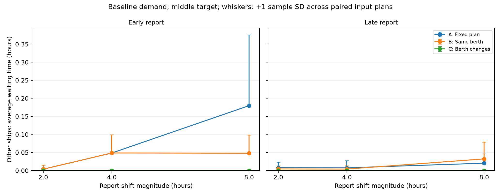
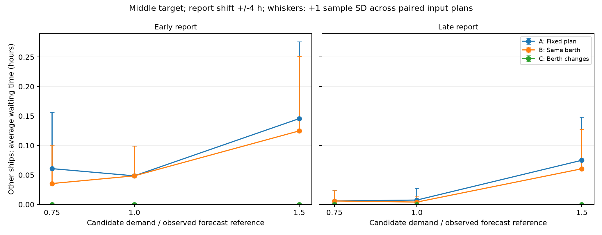
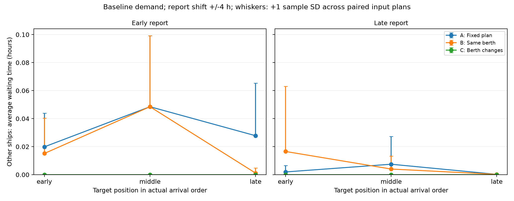
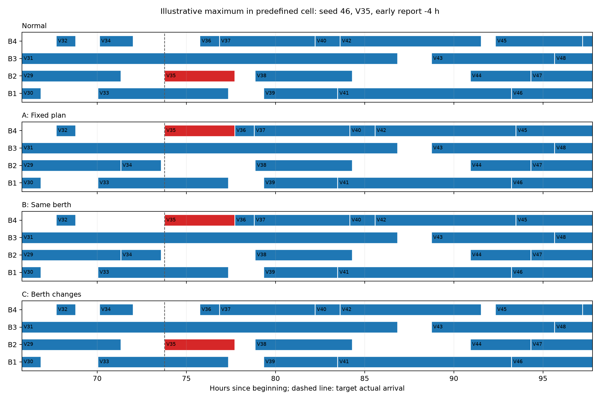

# 主実験の結果と考察

実施日：2026年11月11日。モデル版：`discrete_4berth_unbounded_advance_v3`。

ユーザー指示により、同じバース内調整・バース変更の両方で前倒し時間の上限をなくし、固定を含む3方式で主実験を実行した。旧自由調整はバース変更へ統合し、上限比較の補足実験は廃止した。正常計画・実到着・荷役時間・改ざん条件の作り方は維持する。

現在の設定・試行別結果・集計・図表は[results/final_20261111](../results/final_20261111/)。旧4方式の結果は`results/final_20261105/`に保持し、[旧レポート](過去資料/予備比較レポート_20261105_前倒し制限あり.md)へ説明を保管した。採用前の確認実験フォルダ`results/no_advance_limit_20261111/`は、ユーザー指示で削除した。以下は正式な3方式の結果である。

## 1. 研究の問いと位置づけ

> 到着とバース利用を調整した正常待ち0の状態から、1隻の申告到着時刻だけの改ざんが他船へどう波及し、計画時刻・順番の調整とバース変更で何が変わるか。

1. 改ざんの方向・幅、船の多さ、対象船の位置によって、他船への影響がどう変わるか。
2. 同じバース内の調整で減る待ちと、逆に生まれる待ちは何か。
3. 別バースを使える場合に待ちを回避する仕組みと、このモデルの限界は何か。

新しい最適化手法や攻撃検知手法を提案する研究ではない。簡単な規則と同一入力による対応比較で、他船への波及・待ちの負担先・局所調整の効果と悪化例を説明する。ETA改ざんや計画回復そのものの新規性、世界初、卒論審査の合格は主張しない。関連5文献の整理と原資料へのリンクは[旧レポート第1節](過去資料/予備比較レポート_20261105_前倒し制限あり.md#1-研究の問いと先行研究に対する位置づけ)に残す。前倒し2時間を採用する理由として文献を引用する必要はなくなった。

## 2. 実験条件とデータの由来

| 条件 | 設定 |
| --- | --- |
| バース | 離散型B1〜B4、同時に各1隻、全船が全バースを使用可能 |
| 候補の生成期間 | 168時間未満。調整後に期間外へ出る船も全船処理 |
| 基準平均候補間隔 | 24×13÷103＝3.029126213592233時間 |
| 船の多さ（需要倍率） | 0.75・1・1.5。平均候補間隔は基準値÷倍率 |
| 候補間隔の分布 | 指数分布という仮定。実測の到着分布への当てはめではない |
| 基準荷役時間 | Gamma(shape=2, scale=2.4)、平均4.8時間という仮定 |
| バース別荷役時間 | 基準時間×(1+0.1×最寄りバースとの番号差)。最寄りは一様乱数 |
| 正常計画 | 候補から予約を作り、実到着と正常申告を予約開始へ調整 |
| 改ざん | 1隻の申告だけを±2・4・8時間変更。0未満は0に丸める |
| 対象位置 | 実到着順10・50・90%の順位を端数切上げで選ぶ |
| 試行 | 各セル10試行、seed42〜51。属性の乱数はseed+100000 |
| 計画更新 | 改ざん後の申告で全船計画を運用前に1回更新。実到着は再調整しない |

神戸港データはKICT対象船席の13日分・103件の翌日予定から候補発生の規模を参考設定するために使った。1日平均は約7.92隻、168時間の期待候補隻数は約55.46隻である。基準需要の10試行平均隻数は61.1隻だった。平均が期待値へ近づくようseedを選別していない。実績寄港数・荷役時間・実待ち時間を推定したデータではない。出典・原本ハッシュ・集計定義は[保存済み参照記録](../data/kobe_reference_20261105/README.md)にまとめた。

バース数4はKICTのPC14〜17の体制を参考とするが、実運用の再現とは説明しない。正常時の到着調整に上限を設けず、候補からの延期を待ちに含めない。今回の30正常計画で最大到着調整は12.291時間、調整後に168時間以上となる船は計12隻、最大実到着は174.232時間だった。これらの概要は[config.json](../results/final_20261111/config.json)の`normal_plan_diagnostics`に記録する。

## 3. 3方式の違いと計算数

| 方式 | バース・順番・開始の扱い |
| --- | --- |
| A 固定 `fixed` | 計画バースとバース内順番を維持し、計画開始より前には始めない。未到着の前船を待つ |
| B 同じバース内調整 `same_berth` | 計画バースを維持。到着済みの船を更新後の計画順で確認し、空き次第開始 |
| C バース変更 `reassign` | 到着済みの船を更新後の計画順で確認し、空きバースのうち荷役最短を選ぶ |

B・Cには前倒し時間の上限がない。実到着前開始・荷役の重複・開始後の中断や移動は認めない。他船に悪影響がないかを先読みする処理もない。実到着順のFIFOへ切り替える方式ではなく、未到着の船を飛ばしながら計画順で確認する。

3需要×3対象位置×3改ざん幅×2方向＝54通りの改ざん条件を、10試行・3方式で計算し、攻撃運用は1,620回。正常運用は30入力×3方式＝90回、合計1,710運用・112,404船別行となった。方式まで含む比較条件は162通りである。

正常指標270行は対象位置ごとに同じ正常運用を参照した値を含み、270個の正常計画ではない。同じ需要・試行の船データを条件間で共有し、需要間もseedと船の属性を共有するため、1,620個の独立標本として扱わない。

## 4. 全体の結果

主指標は対象船以外の平均待ち時間。次表は各ケースの指標を計算し、全540ケースを同じ重みで平均した値であり、全船をまとめた重み付き平均ではない。正常時は3方式とも全船待ち0を確認した。

| 方式 | 他船平均待ち（時間） | 他船に待ちが出たケース / 540 | 対象船平均待ち（時間） |
| --- | ---: | ---: | ---: |
| A 固定 | 0.048973 | 239 | 2.387551 |
| B 同じバース内調整 | 0.037167 | 229 | 0.838440 |
| C バース変更 | 0.000000 | 0 | 0.000000 |

BはAに対して他船平均待ちが改善95、悪化33、変化なし412ケースだった。全体平均は約24.1%小さいが、常に改善する規則ではない。変化なしには、両方で待ち0の条件と、同じ正の待ちが残る条件がある。Cは全ケースで全船待ち0となったが、その構造は第8節で説明する。

## 5. 申告方向と待ちの負担先

| 申告方向 | Aの他船平均待ち | Bの他船平均待ち | Aの対象船平均待ち | Bの対象船平均待ち |
| --- | ---: | ---: | ---: | ---: |
| 早い申告（各270ケース） | 0.069763 | 0.037711 | 0.000000 | 0.652603 |
| 遅い申告（各270ケース） | 0.028183 | 0.036622 | 4.775102 | 1.024277 |

単位は時間。早い申告ではBが未到着の対象船を待たず他船を処理でき、他船平均待ちは減る一方、対象船には新たな待ちが生じる。遅い申告では対象船を予定より早く入れることで対象船の待ちが減る一方、他船平均待ちは増えた。調整が全員の待ちを必ず減らすのではなく、負担先が変わることを論じられる。ただし全ケースをこの単一の仕組みだけで説明できるとは断定しない。

## 6. 改ざん幅・需要・対象位置



図1：基準需要・中盤対象の改ざん幅別。他船平均待ちの10試行平均と、上側だけ標本標準偏差1個分のひげを描く。信頼区間や有意差を示していない。

全需要・全対象位置を含むBの平均は、幅2/4/8時間について、早い申告で0.018605/0.040915/0.053613時間、遅い申告で0.018895/0.029831/0.061140時間だった。この集計では幅が大きいほど平均待ちが大きいが、個々の試行の単調性までは示していない。



図2：中盤対象・改ざん±4時間の需要別比較。

全幅・全位置を含むBの平均は、需要0.75/1/1.5倍について、早い申告で0.024097/0.017215/0.071822時間、遅い申告で0.024424/0.011140/0.074302時間だった。高需要で大きいが、0.75倍から1倍では減るため、常に単調増加とは言えない。需要間では船数・対象船・全船の集合も変わる。



図3：基準需要・改ざん±4時間の対象位置別比較。対象位置だけで影響の大きさが決まるわけではなく、予約の空きや荷役時間との組合せも関係する。

各図は指定セルだけを表示する。上記の全条件集計と範囲が異なる。全11指標・各セルの平均・標準偏差は[summary.csv](../results/final_20261111/summary.csv)、正常との差や増減回数の計算元は[run_metrics.csv](../results/final_20261111/run_metrics.csv)を参照する。

## 7. 調整が他船を遅らせる具体例

需要0.75倍、seed48（試行7）、終盤のV33を8時間遅く申告した36隻のケースである。B−Aの他船平均待ちが最も悪化したケースを事後に選んだ仕組み説明用の例であり、典型例ではない。時刻は開始からの経過時間。

V33は実到着145.735時、申告153.735時、B2の荷役に14.501時間かかる。V34は149.369時に実到着し、改ざん後計画ではB2でV34→V33の順に処理する。

| 方式 | V33の開始〜完了 | V33の待ち | V34のバース・開始〜完了 | V34の待ち |
| --- | --- | ---: | --- | ---: |
| A 固定 | 153.735〜168.236 | 8.000時間 | B2・149.369〜152.006 | 0時間 |
| B 同じバース内調整 | 145.735〜160.236 | 0時間 | B2・160.236〜162.872 | 10.867時間 |
| C バース変更 | 145.735〜160.236 | 0時間 | B1・149.369〜152.269 | 0時間 |

BはV34がまだ来ていない145.735時にV33を入れ、荷役を中断しないため、後から来るV34を待たせる。対象船の待ちを8時間減らしても、他船にそれ以上の待ちを生み、全船総待ちも8時間から10.867時間へ増えた。他船平均待ちは0から0.310473時間へ増加する。

CはV34をB1へ入れる。B1の荷役はB2より約0.264時間長いが、待ちを回避できる。空きバース活用、順番の入れ替わり、待ちと荷役時間の違いを船別に説明できる。



図4は上記の悪化例とは別で、基準需要・中盤対象・早い申告4時間という事前指定セル内でAの他船平均待ちが最大の試行を選んだ例。平均を代表する図ではない。正常とA〜Cの4段を描く。

## 8. バース変更で全ケース待ち0になる理由

Cは今回の全540攻撃ケースで正常運用を再現した。正常時の実到着を予約開始へ合わせており、全船が全バースを使え、バース別荷役時間を正確に知る。実到着時に正常計画と同じ「その時点の空きバース中で荷役最短」という選択ができるため、最初の船から順に待ちなしの運用を再現できる。

今回の入力では実到着がすべて異なり、この運用では待ち船が生まれないため、申告から決めた優先順が競合する場面もない。これは、バース変更が実港で完全防御になることや、一般の入力で最適解になることを意味しない。正常時の到着調整を含むモデル構造の結果である。

したがってCだけの需要別・幅別の性能差は論じられない。一方、Cが0となる理由を説明し、計画バースに拘束するBに残る待ちと比較することはできる。多くのケースを回すこと自体を新規性とはしない。

## 9. 検証・再現と旧結果の扱い

```bash
# 再実行は空の新しい保存先を指定する
.venv/bin/python main.py --study --output results/reproduction_20261111
.venv/bin/python -m unittest -v
```

15件の自動テストで正常待ち0、申告のみの改ざん、2時間を超える前倒し、未到着船の飛越し、別バースの荷役時間、後続船を待たせても荷役を中断しないこと、全船保持、再現性と保存対象の限定を確認する。

3方式化時点では、計算本体を呼ばない検算で全1,710運用・112,404船別行について全船保持、申告・実到着の分離、計画共有、時間制約、荷役時間の対応と重複なし、全11指標、平均・標本標準偏差・対応差・軽減量・増減回数を再計算した。その後の可読性整理でも全7表の一致を確認した。

ユーザー指示により、現在の保存対象は実験条件・試行別結果・集計・グラフに絞った。参照データのコピー、船別の詳細CSV、対応比較CSV、検算専用のコードと記録は現在の結果フォルダから外した。再確認は保存した条件で再実行し、残した2表を比較する。ソースの履歴はGitで管理する。

正式化前の確認実験と、全11指標・船別運用結果が一致することを方式名の対応を取って確認した。旧主実験の船データ・正常診断は不変で、固定の結果は旧固定、現在のCは旧自由調整に一致する。旧結果と神戸港参照データ・Excelは変更していない。前倒し制限ありの結果と新しいBの結果は、同じ方式条件として混ぜない。

## 10. 結論と限界

前倒し時間の上限を外しても、方式差・条件差・悪化例は残った。AとBの違いは、未到着船を待つか、到着済み船を先に処理するかという点に現れる。Bは全体平均で他船待ちを減らしたが、遅い申告では対象船の待ちを他船へ移す場合があり、局所的な調整は全体の改善を保証しない。Cは今回の強い仮定のもとで正常運用を再現し、その性質自体が適用範囲の限界を示す。

- 実績到着・荷役時間・実待ち時間を用いた実港検証ではない。予定データは規模の参考に限る。
- 分布形、平均荷役4.8時間、荷物位置、係数0.1は仮定。特定文献・実測値から採用した数値とは説明しない。
- 正常到着調整に上限がなく、速度・燃料や他港への影響を計算しない。調整後実到着からの待ちを評価する。
- B・Cは準備時間を扱わず、到着済みなら空き次第開始できる。全船が全バースを使い、荷役時間を正確に知る。
- 船長・水深・潮汐・クレーン・天候・抜港・複数攻撃・運用中の繰返し計画更新は扱わない。
- 初めは全バース空きで、前後週からの継続流入はない。需要倍率を実際の稼働率と読み替えない。
- 10seedの記述的比較であり、条件を繰り返した件数を独立標本数や有意差の根拠にしない。
- 同じ情報ずれなら通常誤報でも攻撃でも結果は同じで、意図や侵入方法を識別していない。

執筆では、背景・関連研究、問題設定、計算方法、実験結果、仕組みと限界の順に整理する。方式数や実験数だけで研究の強さを主張せず、上記の数値を船別の動きと結び付けて説明する。
