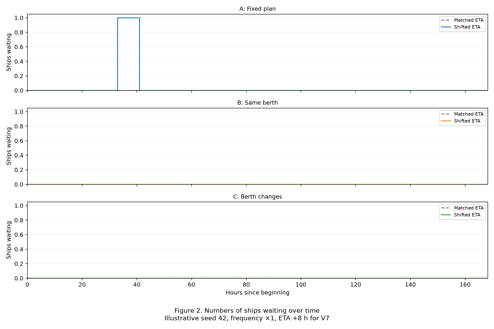
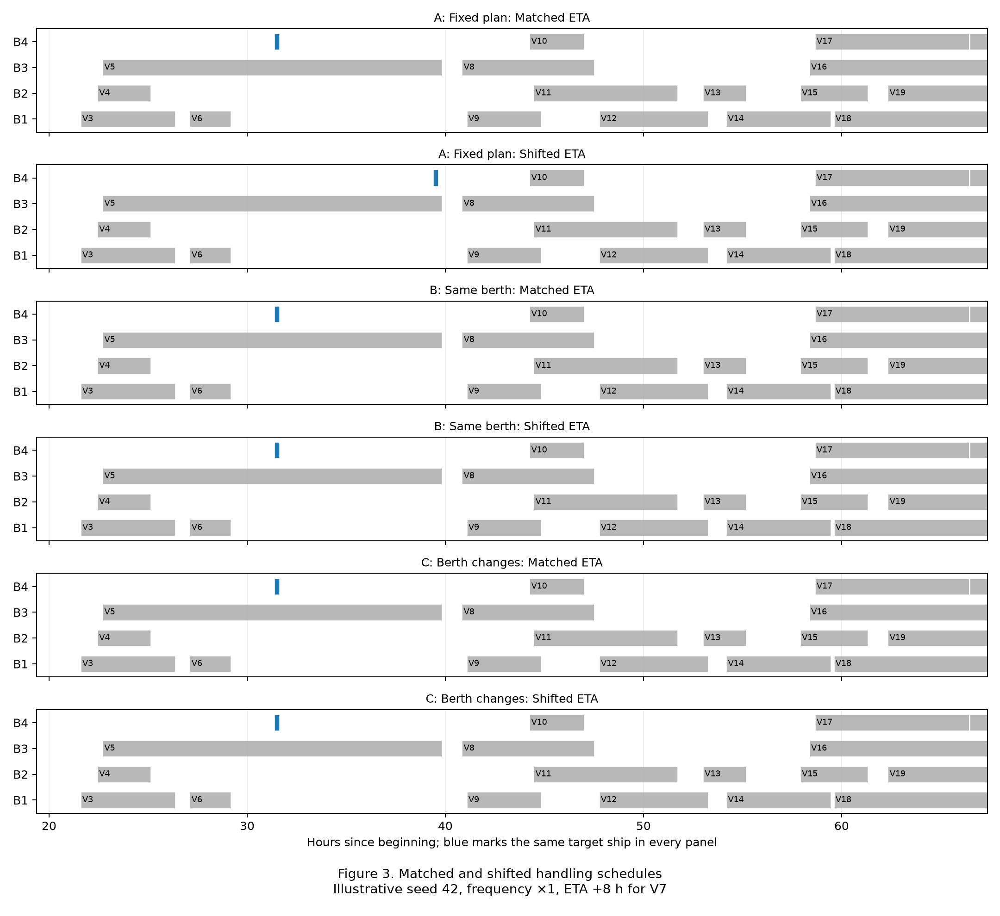

# 1隻の到着予定のずれがバース運用に与える影響

実到着順の10%地点にいる1隻だけ、予定到着が実際より2時間または8時間遅いときに、船の待ちがどう変わるかを調べた。天候、情報更新の遅れや入力ミスなどで予定と実際はずれ得る。サイバー攻撃による情報改ざんも、その要因の一つとして位置付ける。本実験は原因別の過程を扱わず、実到着と荷役条件を固定して予定情報のずれを与える。[要件](要件定義書.md)・[Excel](../results/results.xlsx)・[設定](../results/config.json)

## 1. 比較条件

表1 実験条件

| 項目 | 設定 |
| --- | --- |
| 船を生成する期間 | 168時間。期間内に到着した船をすべて完了まで処理 |
| 到着頻度 | 基準の0.75・1・1.5倍。平均到着間隔は約4.248・3.186・2.124時間 |
| 対象船 | 実到着順の隻数×0.10を切り上げた順位の1隻 |
| 予定の遅れ | 対象船の予定到着を実到着より2時間または8時間遅くする |
| 運用方式 | 固定・同じバース内調整・バース変更 |
| 比較基準 | 予定到着が実到着と一致。各試行・倍率・方式で1回実行 |
| 試行 | 各条件1試行、seed42 |

神戸港EDIの翌日予定30日分・226件から、基準の平均到着間隔を約3.186時間とした。[集計方法と参照期間](../data/kobe_reference_20261105/README.md)

生成した1週あたりの隻数は0.75倍で45隻、1倍で62隻、1.5倍で86隻だった。対象はそれぞれ5・7・9隻目。倍率ごとに同じ実到着、荷役条件、対象船を2つのずれ幅と3方式で共有した。予定ずれあり18運用と比較基準9運用の計27運用を実行した。

## 2. 全船の総待ち時間と対象船の待ち

各倍率・方式のずれなしを基準に、全船の総待ち時間と対象船自身の待ちの差を求めた。総待ち時間は各船の待ち時間を足した値で、正の差は待ちの増加を表す。

表2 全船の総待ち時間と対象船の待ち時間のずれなしとの差（時間）

| 到着頻度 | 予定の遅れ | 全船・固定 | 全船・同じバース内調整 | 全船・バース変更 | 対象船・固定 | 対象船・同じバース内調整 | 対象船・バース変更 |
| ---: | ---: | ---: | ---: | ---: | ---: | ---: | ---: |
| 0.75 | 2 | 2 | 0 | 0 | 2 | 0 | 0 |
| 0.75 | 8 | 8 | 2.347 | 0 | 8 | 2.347 | 0 |
| 1 | 2 | 2 | 0 | 0 | 2 | 0 | 0 |
| 1 | 8 | 8 | 0 | 0 | 8 | 0 | 0 |
| 1.5 | 2 | 8.129 | 6.129 | 0 | 2 | 0 | 0 |
| 1.5 | 8 | 16.597 | 15.791 | 0 | 8 | 7.194 | 0 |

図1 同じ試行・到着頻度・方式のずれなしからの全船の総待ち時間の変化

固定では、対象船の追加待ちが2時間・8時間の設定と一致した。到着頻度1倍・8時間では、全62隻の総待ち時間が約12.653時間から20.653時間へ増えた。増えた8時間はすべて対象船の計画開始待ちだった。

同じバース内調整では、6条件すべてで対象船の待ちが固定より短かった。0.75倍・8時間では、対象船の待ちが固定の8時間から2.347時間に短くなり、全船の総待ち時間の増加も8時間から2.347時間に縮まった。ずれなしより待ちが増えたのは、どちらの方式でも対象船1隻だった。

バース変更では、今回の6条件で全船の総待ち時間も対象船の待ちもずれなしと一致した。この結果が得られたのは、ここで使った入力と運用規則の組み合わせである。

## 3. 対象外の船への影響と運用例

1.5倍・8時間では、総待ち時間が固定で16.597時間、同じバース内調整で15.791時間増えた。予定を変えていない船のうち、固定と同じバース内調整でそれぞれ18隻の待ちが増えた。全船の最大待ちも、ずれなしの5.148時間から、固定で8時間、同じバース内調整で7.194時間に増えた。1.5倍・2時間の同じバース内調整では、対象船の待ちは0時間で、予定を変えていない18隻の待ちが増え、全船の総待ち時間は6.129時間増えた。対象船の待ちと全船への影響は、船ごとの結果を合わせて確認する必要がある。

図2・3は1倍・8時間、seed42の実行例。62隻の7番目に到着するV7が対象だった。対象船の待ちはずれなしで0時間、予定ずれありでは固定で8時間、同じバース内調整とバース変更で0時間だった。

図2 説明用試行の時刻別待ち船数

図3 説明用試行の荷役区間。青はすべて同じ対象船

## 4. 解釈の範囲

今回はseed42の1試行で、実到着順10%地点の1隻に2時間・8時間の遅い予定を与えた。試行間のばらつきは評価していない。対象位置や隻数、早い予定を与えたときの結果は、この比較からは評価できない。バース変更は全船がすべてのバースを使え、荷役時間を把握し、割当変更の準備時間・費用を置かないモデルである。到着頻度やずれ幅は比較用の条件で、実港の効果や発生確率の推定には用いない。

## 5. 保存と検証

Excelの条件別集計は全船の総待ち時間の比較18行と8指標の詳細144行、試行別結果は27行、船別データは193行、待ち理由の明細は1,737行。1試行なので標準偏差の欄は空欄。試行別結果の対象船IDと到着頻度・予定の遅れを使って、対象船や他の船の実行を追跡できる。

自動テスト25件で対象船の順位と端数処理、両方の幅で同じ1隻を使うこと、実到着・荷役条件の共有、実到着前の開始やバース重複の防止、比較基準との対応、Excelの保存を確認した。
