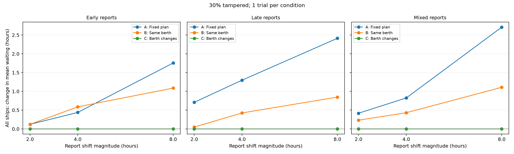
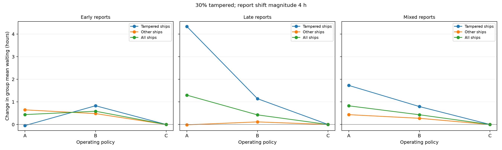
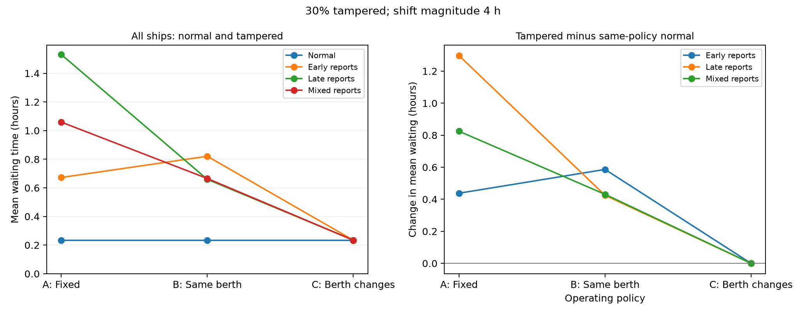
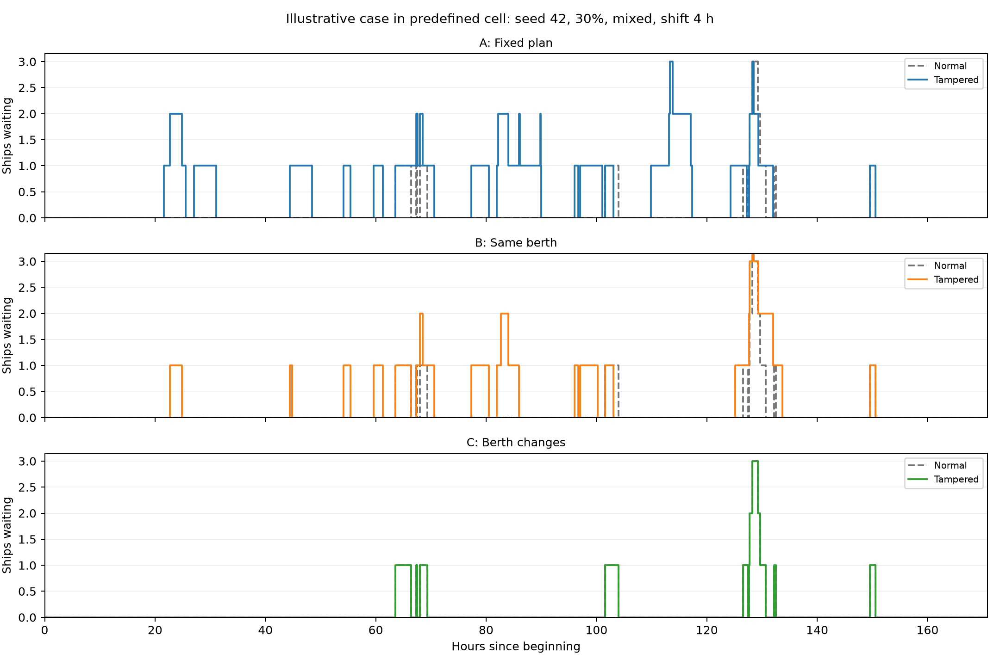
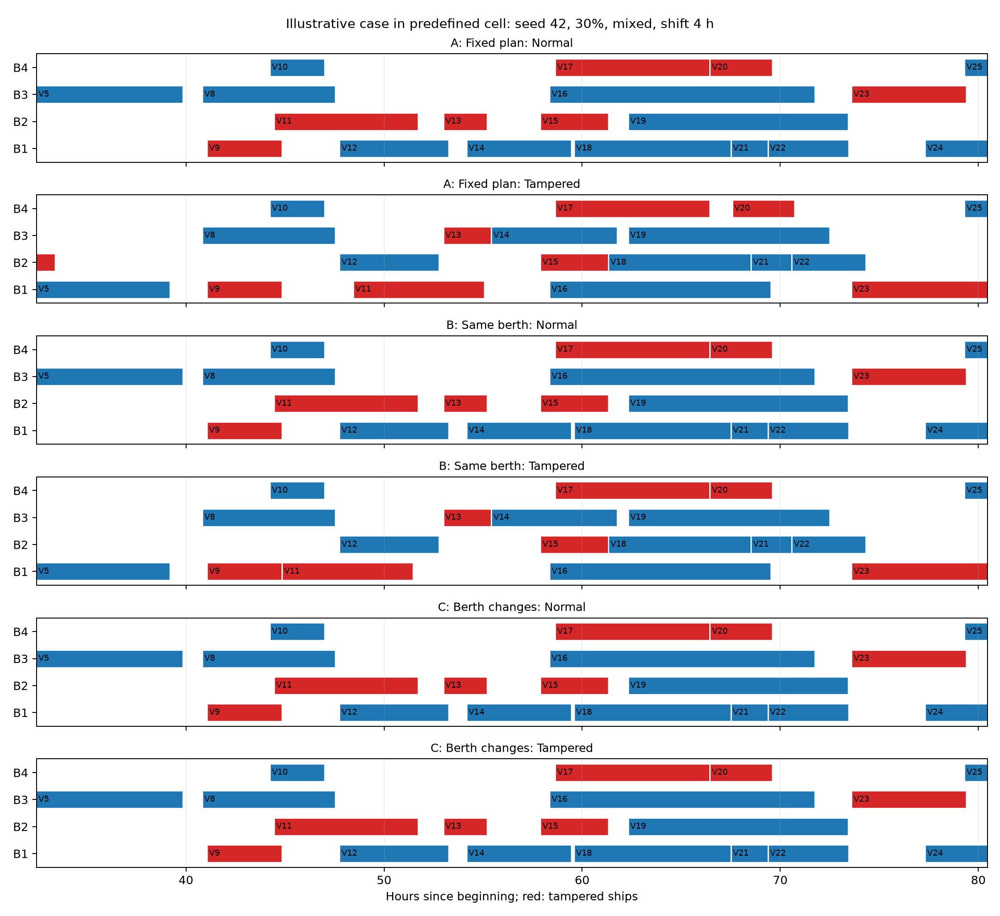

# 複数船の到着情報改ざん：各条件1試行の結果と考察

実施日：2026年11月11日。モデル版：`discrete_4berth_multi_ship_v6`。seed42の1週間を全条件で共有した。船の多さの倍率比較は廃止し、位置区分も使わない。早い申告・遅い申告・混在は維持した。

最新結果は[Excel](../results/results.xlsx)と[設定](../results/config.json)、6図のPNG/PDF。以前の3需要・各条件100試行は[旧レポート](過去資料/予備比較レポート_20261111_複数船100試行.md)と[結果一式](../results/archive/20261111_複数船_3需要_100試行/)へ保管した。以下は今回の1試行についての説明であり、以前の平均値や悪化件数を引き継がない。

## 1. 研究の問いと条件

> 全船は元の時刻どおりに来る一方、港側が誤った到着更新で計画を作り直すと、運用規則によって待ちと負担先はどう変わるか。

| 条件 | 設定 |
| --- | --- |
| バース・期間 | 離散型4バース、168時間未満に来る全船を荷役完了まで処理 |
| 到着間隔 | 保存済み参照値24×13÷103＝約3.029126時間を平均とする指数分布。倍率比較なし |
| 基準荷役時間 | Gamma(shape2, scale2.4)、平均4.8時間 |
| バース別荷役時間 | 基準×(1+0.1×最寄りバースとの番号差) |
| 対象の規模 | 1隻・10%・30%・50%。割合からの隻数は切り上げ |
| 対象の選び方 | 週全体の乱数順列の先頭から選択。規模間で包含し、幅・方向・方式間で共有 |
| 改ざん幅 | 2・4・8時間。0未満の早い申告は0へ丸める |
| 方向 | 全対象を早める／遅らせる主実験と、3割合で約半数ずつの混在補足 |
| 計画更新 | 対象全船の申告を変更後、運用前に全船計画を1回更新。実到着・荷役時間は不変 |
| 試行 | 各条件1試行、seed42。属性seed100042、対象選択seed200042 |

正常申告は実到着と同じ。到着後、バースが使えるまで待つことを認める。船の航行変更、侵入方法・検知・通常の予測誤差は扱わない。攻撃想定の背景は[先行研究の整理](../先行研究/資料の入手元.md#到着情報改ざんの攻撃想定に使う資料)を参照する。予定件数は規模の参考であり、分布と荷役時間は実測への当てはめではない。

| 方式 | 実行規則 |
| --- | --- |
| A 固定 | 更新後の計画バース・バース内順番を維持し、計画開始より前には始めない |
| B 同じバース内調整 | 計画バースを維持。到着済みの船を計画順に確認し、空き次第開始 |
| C バース変更 | 到着済みの船を計画順に確認し、空きバース中でその船の荷役時間が最短のものを選択 |

B・Cは前倒し上限なし。全方式で実到着前開始・同じバースの重複・開始後の中断や移動を禁止する。将来の到着や正常計画による運用判断はしない。

主実験4規模×3幅×2方向×3方式＝72運用、混在3割合×3幅×3方式＝27運用、正常3運用、計102運用。Excelの「試行別結果」は対象群別の正常12行＋改ざん99行＝111行、「条件別集計」は99セル×13指標＝1,287行。1週間の入力を共有する条件数であり、99個の独立した週を調べたものではない。

## 2. 今回生成された船と正常待ち

63隻を生成した。対象は1隻・7隻・19隻・32隻で、実際の割合は約1.59%・11.11%・30.16%・50.79%。位置は序盤・中盤・終盤に分けない。

正常時の全船平均待ちは3方式とも0.234596時間（約14.08分）、最大待ちは2.874779時間だった。0〜168時間の正常計画のバース使用割合は47.20%。週全体が常に埋まっている条件ではなく、集中する時間と空き時間がある。

主指標は`改ざん時の全船平均待ち − 同じ方式の正常時の全船平均待ち`。0は正常と同じで、待ち0ではない。船ごとの平均と試行間の平均を区別し、今回は乱数の異なる週に対する平均・ばらつきを評価しない。Excelの標準偏差は空欄で、図にひげは描かない。

## 3. 規模と申告幅の比較


図1：幅4時間の正常差。遅い申告のAは1隻で+0.063492時間、10%で+0.429195、30%で+1.296953、50%で+2.057387時間だった。混在でも10%の+0.362217から30%の+0.824772、50%の+1.144544へ増えた。これはseed42の例の変化で、別の週で同じ増え方になるとは限らない。



図2：対象30%の幅別比較。幅を変えても元の実到着・荷役時間・対象集合を共有する。点は1試行の全船平均待ちの正常差で、試行間の平均や信頼区間ではない。

## 4. 方式と負担先の違い

対象30%・幅4時間の全船平均待ちの正常差を示す（時間）。

| 方向 | A 固定 | B 同じバース内調整 | C バース変更 |
| --- | ---: | ---: | ---: |
| 早い | +0.437962 | +0.586370 | 0.000000 |
| 遅い | +1.296953 | +0.424915 | 0.000000 |
| 混在 | +0.824772 | +0.430958 | 0.000000 |

遅い申告や混在ではBがAの追加待ちを減らしたが、早い申告ではBがAより悪化した。全33の改ざん条件でAと比較すると、Bは改善24・悪化5・同じ4条件。これは同じ週の条件別比較であり、悪化の発生確率ではない。



図3：同じ30%・幅4時間。早い申告では、対象外群のΔはAの+0.647495時間からBの+0.481717時間へ減ったが、対象群はAの−0.047272時間からBの+0.828725時間へ増え、全船平均も悪化した。対象外群だけの改善を港全体の改善とは扱えない。



図4：同じ条件の絶対値と正常差。CのΔが0でも正常時と同じ平均0.234596時間の待ちがある。全33条件ではCはAより全船平均待ちが小さかったが、この1週間での結果に限る。

## 5. 時刻別の動き



図5：seed42・30%・混在4時間で、実到着から荷役開始までの待ち船数を示す。破線は正常、実線は改ざん時。同じ週を3方式で比較する。



図6：同じ条件を正常／改ざんの6段で比較。赤が対象群、青が対象外。固定方式の船別待ち増分が最大の船の実到着付近を拡大した。複数の対象が週全体へ分散しているため、最初から最後の影響までを1件の改ざんの波及継続時間とは呼ばない。

## 6. 考察と限界

固定方式では、嘘の申告に基づく計画開始を守るため、バースが空いていても待つ場合がある。追加待ちのすべてが処理能力不足を表すわけではない。同じバース内調整はその拘束を緩めるが、今回も全船では悪化する条件があり、空きを使う局所的な判断と全体の待ち削減は一致しない場合がある。

Cの追加影響が小さいのは、未到着船に空きを予約せず、全船が全バースを利用できる規則と整合する。ただし各仮定の寄与を個別に検証しておらず、最適性や現実の港の完全な防御は示さない。1試行でCの群平均が変わらなかった条件を、別の週・港でも影響がないと一般化しない。

今回は1週間の事例比較である。以前の100試行に基づく軽減率・悪化件数・群間の負担移動の数値は、旧モデルのレポートで条件を明記して扱う。現在の1試行について統計的有意差・安定した傾向・ばらつきは主張しない。荷役時間は仮定で、船長・水深・クレーン・天候・通常の予測誤差・前後週の継続流入も扱わない。

## 7. 検証と再現

```bash
.venv/bin/python -m unittest -v
.venv/bin/python main.py --study --output /tmp/thesis_reproduction
```

22テストで物理条件、申告だけの変更、対象集合・混在の再現性、正常差、既定1試行と需要列・位置列の不在、Excel3シートの値・見出し固定・フィルターを確認した。変更前の基準倍率・seed42の船別入力、全運用、指標、集計、正常診断の5表は、需要列を除いて変更後と完全一致した。需要比較を外しても残した条件の計算は変わっていない。

保存Excelの集計・試行別結果を再計算結果と照合し、全102運用・6,426船別行の実到着前開始と荷役重複の禁止、全船保持、荷役時間の対応を確認した。Excel3シートの表示と6図を確認し、設定のコードハッシュも一致した。移動した旧結果を含む既存results・data計104ファイルのSHA-256は変更前と一致した。

追加した「船別データ」には保存条件から再現した63隻の改ざん前入力を記録した。到着と全バースの荷役時間・係数を再現値と照合し、既存2シートの数値を保持した。
