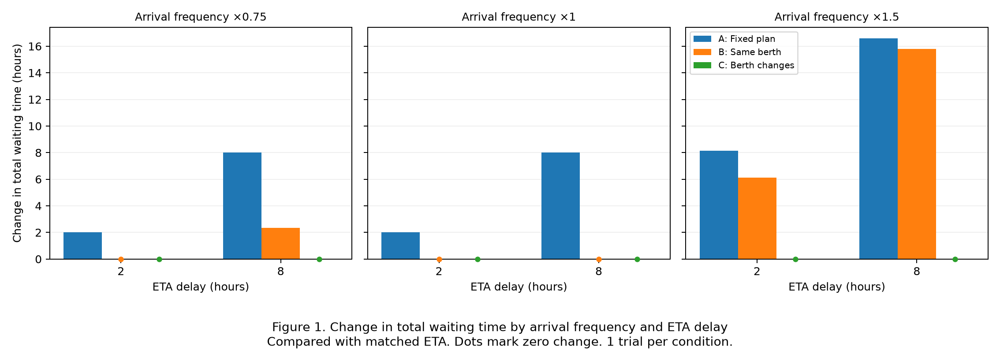
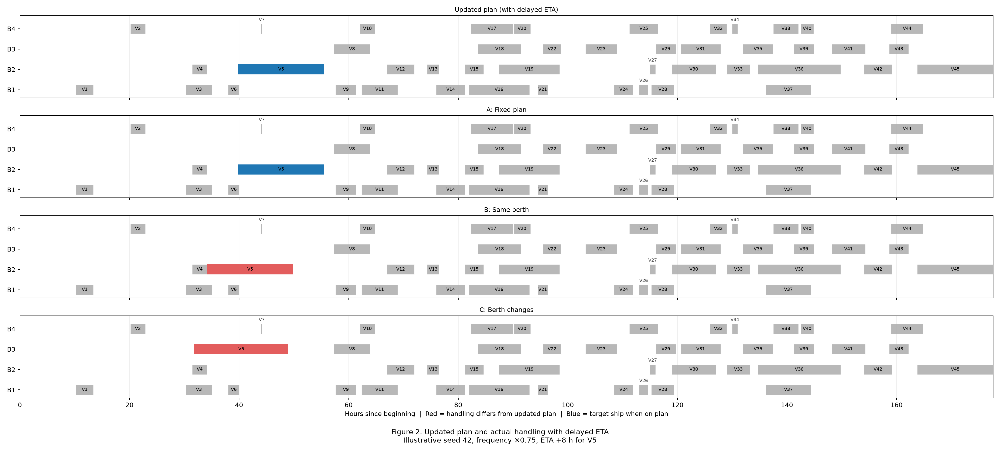
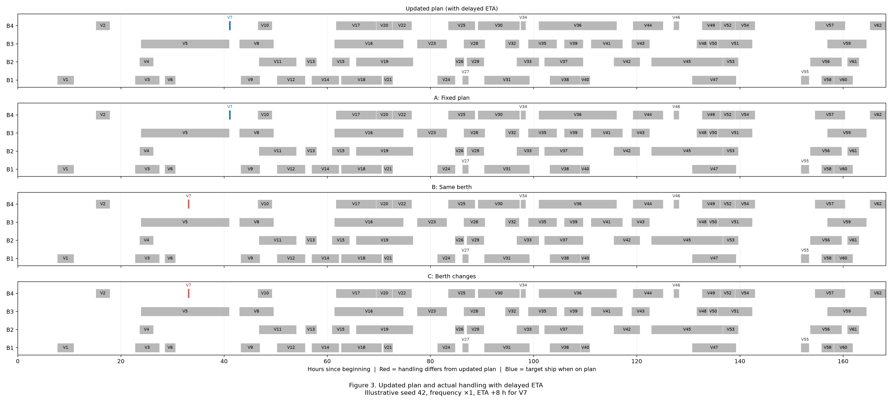
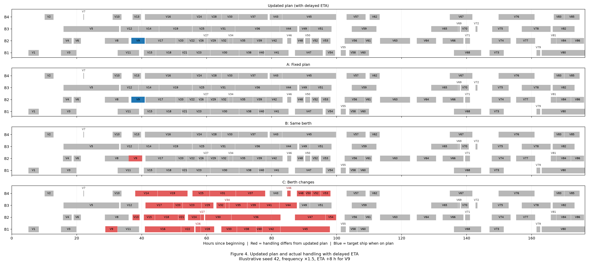

# 1隻の到着予定のずれがバース運用に与える影響

実到着順の10%地点にいる1隻だけ、予定到着が実際より2時間または8時間遅いときに、船の待ちがどう変わるかを調べた。天候、情報更新の遅れや入力ミスなどで予定と実際はずれ得る。サイバー攻撃による情報改ざんも、その要因の一つとして位置付ける。本実験では、各船の到着を最初の荷役開始予定に合わせる。調整後の実到着と荷役条件を全条件で共通にし、対象船の予定到着だけにずれを与えた。[要件](要件定義書.md)・[Excel](../results/results.xlsx)・[設定](../results/config.json)

## 1. 比較条件

表1 実験条件

| 項目 | 設定 |
| --- | --- |
| 到着候補を生成する期間 | 168時間未満。調整後の到着や荷役完了が期間後の船も処理 |
| 到着頻度 | 基準の0.75・1・1.5倍。到着候補の平均間隔は約4.248・3.186・2.124時間 |
| 対象船 | 実到着順の隻数×0.10を切り上げた順位の1隻 |
| 予定の遅れ | 対象船の予定到着を実到着より2時間または8時間遅くする |
| 運用方式 | 固定・同じバース内調整・バース変更 |
| 初期計画 | 予定到着と実到着を最初の荷役開始予定に合わせる。各倍率につき一つ保存 |
| 試行 | 各条件1試行、seed42 |

神戸港EDIの翌日予定30日分・226件から、到着候補の基準平均間隔を約3.186時間とした。[集計方法と参照期間](../data/kobe_reference_20261105/README.md)

到着候補を0.75倍で45隻、1倍で62隻、1.5倍で86隻生成した。調整後の実到着順で選んだ対象は、それぞれ5番目のV5、7番目のV7、9番目のV9だった。1.5倍では調整後の到着が168時間以降になった2隻も完了まで処理した。予定ずれありの18運用を実行した。

## 2. 全船の総待ち時間と対象船の待ち

遅れ0時間の初期計画では、到着と荷役開始の予定が一致する。Excelの「船別データ」では、乱数で生成した到着候補と基準荷役時間、その値を使って作った初期計画を同じ行で確認できる。

たとえば、到着頻度0.75倍のV20は乱数で89.158時間後の到着候補と2.863時間の基準荷役時間が出た。その時点では全バースが使用中のため、最初に空くB4で90.046時間後に荷役を開始し、93.196時間後に完了する計画になった。予定到着と実到着はどちらも荷役開始予定に合わせた。到着を約0.889時間遅らせた分は「到着を遅らせた時間」に記録した。

表2 予定ずれありの全船の総待ち時間と対象船の待ち時間（時間）

| 到着頻度 | 予定の遅れ | 全船・固定 | 全船・同じバース内調整 | 全船・バース変更 | 対象船・固定 | 対象船・同じバース内調整 | 対象船・バース変更 |
| ---: | ---: | ---: | ---: | ---: | ---: | ---: | ---: |
| 0.75 | 2 | 2 | 0 | 0 | 2 | 0 | 0 |
| 0.75 | 8 | 8 | 2.347 | 0 | 8 | 2.347 | 0 |
| 1 | 2 | 2 | 0 | 0 | 2 | 0 | 0 |
| 1 | 8 | 8 | 0 | 0 | 8 | 0 | 0 |
| 1.5 | 2 | 16.781 | 14.781 | 0 | 2 | 0 | 0 |
| 1.5 | 8 | 35.647 | 34.841 | 0 | 8 | 7.194 | 0 |

図1 到着頻度・遅れ幅・方式別の全船の総待ち時間

固定では、対象船の待ちが2時間・8時間の設定と一致した。到着頻度1倍・8時間では、全62隻の総待ち時間は8時間で、すべて対象船の計画開始待ちだった。

同じバース内調整では、6条件すべてで対象船の待ちが固定より短かった。0.75倍・8時間では、対象船の待ちが固定の8時間から2.347時間に短くなり、全船の総待ち時間も8時間から2.347時間に縮まった。この条件で待ったのは、どちらの方式でも対象船1隻だった。

バース変更では、今回の6条件すべてで全船の総待ち時間が0だった。この結果が得られたのは、ここで使った入力と運用規則の組み合わせである。

## 3. 対象外の船への影響と運用例

1.5倍・8時間では、総待ち時間が固定で35.647時間、同じバース内調整で34.841時間となった。予定を変えていない船のうち、どちらの方式でも27隻に待ちが生じた。最大待ちは固定で8時間、同じバース内調整で7.194時間だった。1.5倍・2時間の同じバース内調整では、対象船の待ちは0時間だったが、ほかの22隻に待ちが生じ、総待ち時間は14.781時間になった。

図2・3・4は、到着頻度ごとに予定を8時間遅らせた実行例。いずれもseed42で、最上段に予定の遅れを反映して組み直した計画を載せた。各方式でその計画からバース・荷役開始・荷役完了のいずれかがずれた船を赤で示す。

図2 到着頻度0.75倍・8時間での全船の荷役区間。対象船は45隻のうち実到着順5番目のV5

1倍では、対象船の待ちは固定で8時間、同じバース内調整とバース変更で0時間だった。

図3 到着頻度1倍・8時間での全船の荷役区間。対象船は62隻のうち実到着順7番目のV7

図4 到着頻度1.5倍・8時間での全船の荷役区間。対象船は86隻のうち実到着順9番目のV9

## 4. 解釈の範囲

今回はseed42の1試行で、調整後の実到着順10%地点の1隻に2時間・8時間の遅い予定を与えた。総待ち時間は港に着いてから荷役を始めるまでを測る。到着前の調整時間は別に記録し、調整に必要な航行や運用上の負担は扱わない。試行間のばらつきは評価していない。対象位置や隻数、早い予定を与えたときの結果は、この比較からは評価できない。バース変更は全船がすべてのバースを使え、荷役時間を把握し、割当変更の準備時間・費用を置かないモデルである。到着頻度やずれ幅は比較用の条件で、実港の効果や発生確率の推定には用いない。

## 5. 保存と検証

Excelの条件別集計は全船の総待ち時間の比較18行と8指標の詳細144行、試行別結果は18行、船別データは193行、待ち理由の明細は1,158行。1試行なので標準偏差の欄は空欄。試行別結果の対象船IDと到着頻度・予定の遅れを使って、対象船や他の船の実行を追跡できる。

自動テスト24件で到着候補を荷役開始予定に合わせた初期計画と、2時間・8時間の運用だけを集計すること、対象船の選択、実到着・荷役条件の共有、実到着前の開始やバース重複の防止、Excelの保存を確認した。
