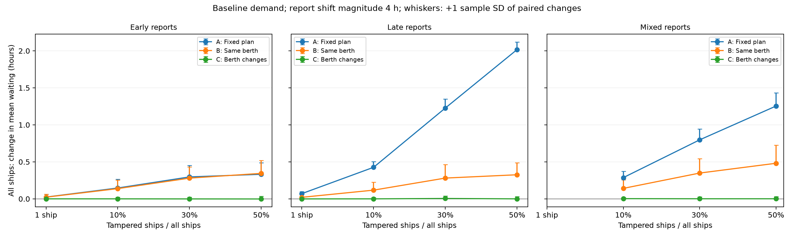
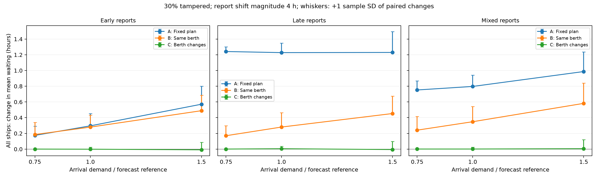
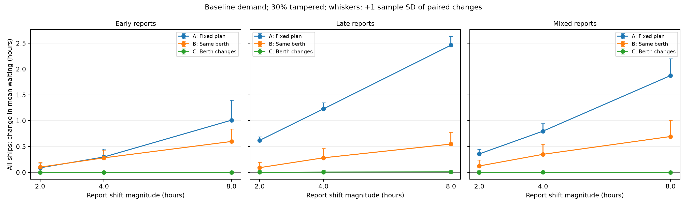
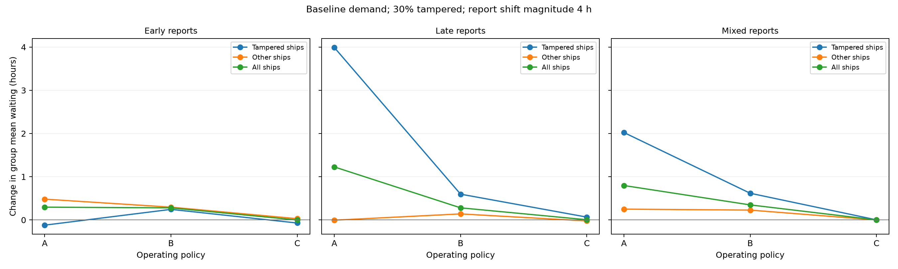
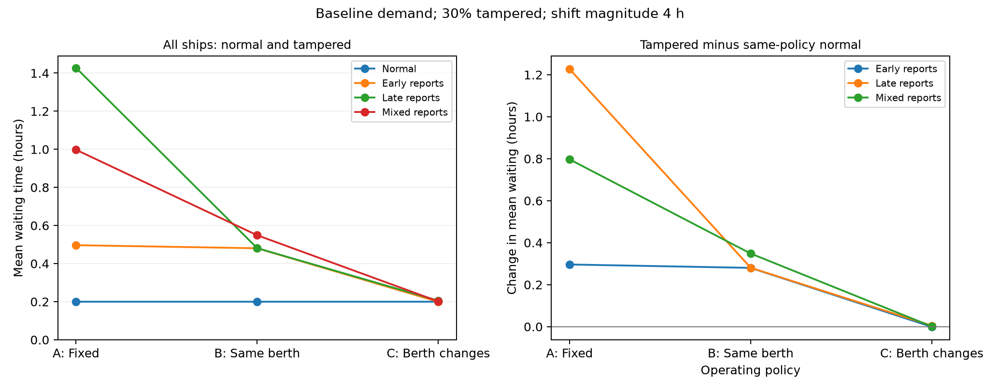
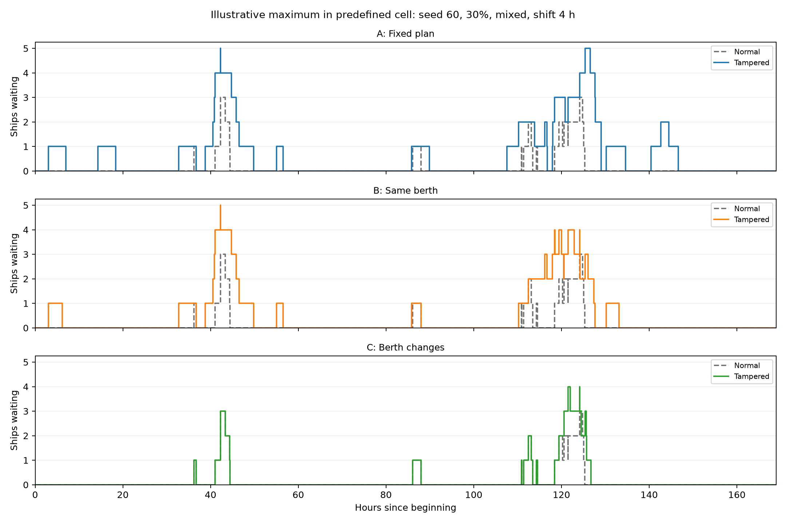
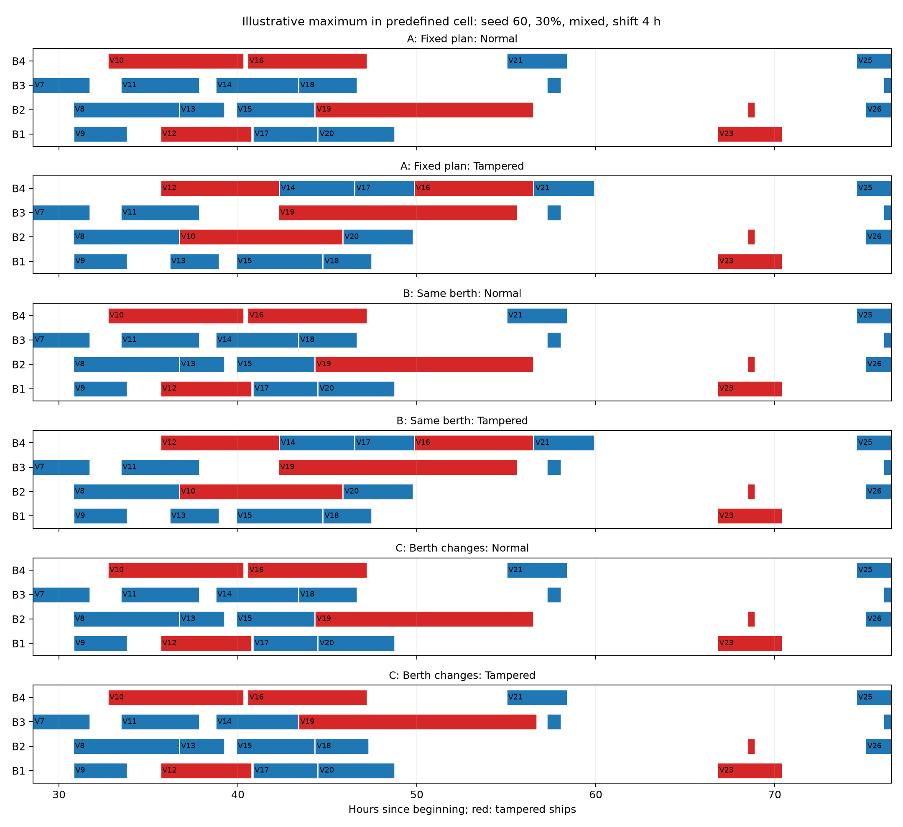

# 複数船の到着情報改ざん：100試行の結果と考察

実施日：2026年11月11日。モデル版：`discrete_4berth_multi_ship_v5`。各条件100試行、seed42〜141。

1隻・10%・30%・50%の申告を変える主実験と、早い申告／遅い申告が混在する補足実験を実行した。全船の実到着は最初に生成した時刻のまま、港側だけが誤った情報で全船計画を更新する。設定・2CSV・7図のPNG/PDFは[results直下](../results/)に置いた。旧1隻版は[旧レポート](過去資料/予備比較レポート_20261111_実到着固定1隻.md)と[旧結果](../results/archive/20261111_実到着固定_1隻_100試行/)へ保管した。

## 1. 研究の問いと位置づけ

> 誤った到着更新を信じて計画を作り直すとき、改ざん対象の割合・変更方向・需要によって待ちはどう変わるか。固定・同じバース内調整・バース変更では、全船の影響と負担先がどう違うか。

侵入や検知ではなく、改ざん情報が受け入れられた後の運用影響を扱う。正常申告は実到着に一致し、通常の予測誤差は加えない。船は港側の計画変更に合わせて航行を変えない。

Hacks・Pahl（2024）のETA・ETD改ざんシナリオ、ENISA（2019）のPCSデータ改ざんの脅威整理を背景とする。[該当ページと利用範囲](../先行研究/資料の入手元.md#到着情報改ざんの攻撃想定に使う資料)を参照する。同じ攻撃の実被害報告とは説明しない。計画回復や負担再配分自体も既存研究にあり、新しい最適化・検知手法や世界初を主張しない。今回の成果は、限定した情報改ざんと3運用規則の組合せを、同じ物理入力・正常運用に対する差で比較した結果とその適用範囲である。

## 2. 実験条件

| 条件 | 設定 |
| --- | --- |
| バース・期間 | 離散型B1〜B4、各同時1隻。168時間未満の到着を生成し、期間後も全船の荷役完了まで処理 |
| 実到着 | 指数分布の間隔を累計。正常計画・更新計画へ合わせて動かさない |
| 基準平均間隔 | 24×13÷103＝3.029126213592233時間 |
| 船の多さ | 基準の0.75・1・1.5倍。平均間隔は基準値÷倍率 |
| 基準荷役時間 | Gamma(shape=2, scale=2.4)、平均4.8時間 |
| バース別荷役時間 | 基準時間×(1+0.1×最寄りバースとの番号差)。最寄りは一様乱数 |
| 改ざんの規模 | 1隻・全船の10%・30%・50%。割合からの隻数は切り上げ |
| 対象の選択 | 週全体を乱数で並べ、その先頭から選ぶ。位置別の条件は設けない |
| 変更幅 | 2・4・8時間。早い申告が0未満なら0に丸め、実際の変更量も記録 |
| 主実験 | 対象全船を早める／対象全船を遅らせる、の2条件 |
| 混在補足 | 10%・30%・50%で約半数ずつ早める／遅らせる。1隻の混在は重複なので設けない |
| 計画更新 | 運用前に対象全船の申告を変更し、全船計画を1回だけ作り直す |
| 試行・乱数 | 各セル100試行、seed42〜141。属性はseed+100000、対象選択はseed+200000 |

全船数が56隻なら、1隻・6隻・17隻・28隻を対象とする。同じ需要・試行では対象集合を包含関係にし、変更幅・方向・方式を変えても同じ集合を使う。混在は選択順に早い／遅いを交互に割り当て、最初の方向だけ乱数で決める。割合を増やしても既存対象の符号は変えない。混在は対象間の申告順も乱しうるが、同じ方向・幅で動かす主実験では対象間の順番は原則保たれる（0への丸めを除く）。

基準間隔はKICT対象船席の13日103件の翌日予定を参考とし、実績寄港数ではない。分布形・平均荷役4.8時間・係数0.1は仮定である。[集計根拠](../data/kobe_reference_20261105/README.md)を参照する。全船が全バースを利用可能で、船長・水深・クレーン数などの制約は置かない。

| 方式 | 実行規則 |
| --- | --- |
| A 固定 | 更新後の計画バースとバース内順番を維持し、計画開始より前には始めない |
| B 同じバース内調整 | 計画バースを維持。到着済みの船を計画順に確認し、空き次第開始 |
| C バース変更 | 到着済みの船を計画順に確認し、空きバース中でその船の荷役時間が最短のものを選択 |

B・Cの前倒し上限はない。未到着船は飛ばすが、FIFOへの切替ではない。全方式で実到着前の開始、同じバースの重複、開始後の中断・移動を認めない。運用判断に正常計画・将来の実到着を使わず、後続船も含めた待ちの最適化は行わない。

### 計算数と標本数

- 主実験：3需要×4規模×3幅×2方向×3方式×100試行＝21,600改ざん運用。
- 混在補足：3需要×3割合×3幅×1混在条件×3方式×100試行＝8,100改ざん運用。
- 正常：300入力×3方式＝900運用。合計30,600運用（改ざん29,700）。

正常指標は対象群・対象外群を4規模で計算するためCSVでは3,600行となるが、正常の実行を4回繰り返したわけではない。`run_metrics.csv`は正常3,600＋改ざん29,700＝33,300行。`summary.csv`は297セル×13指標＝3,861行で、全セル100件である。同じ週を条件間で共有するため、運用数を独立標本数と数えない。

## 3. 正常時の待ちと評価方法

| 船の多さ | 正常時の全船平均待ち（時間） | 正常計画の期間内バース使用時間の割合 |
| --- | ---: | ---: |
| 0.75倍 | 0.073026 | 30.33% |
| 1倍 | 0.200333 | 41.08% |
| 1.5倍 | 0.906304 | 63.41% |

各100入力の平均。今回の正常運用では3方式の待ちが一致した。値をそろえる処理はしていない。使用時間の割合は、正常計画の0〜168時間内の荷役時間÷（4バース×168時間）であり、実港の稼働率ではない。高需要でも週全体が常に飽和する条件ではなく、局所的な集中と空き時間がある。需要間は同じseedを使うが、船数と選ばれる対象集合も変わる。

```text
改ざん影響 Δ ＝ 改ざん時の指標 − 同じ入力・同じ方式の正常時の指標
```

主指標は全船平均待ちのΔ。正は増加、負は減少、0は正常と同じであって待ち0ではない。各週の指標を等しい重みで平均し、全船を一括した船数加重平均とは区別する。割合によって対象外群の構成も変わるため、全船指標と対象群・対象外群の指標を併記する。

正常時にも待つ「待ち船数」と、正常より待ちが増えた「増加隻数」は異なる。13指標と定義は[実装説明](実装説明.md)を参照する。

## 4. 規模・方向・方式の比較



図1：基準需要・幅4時間。点は各100試行の全船平均待ちのΔの平均、上のひげは対応差の標本標準偏差1個分。信頼区間や最大値ではない。1隻は実際の割合が試行ごとに異なる区分で、横軸は等間隔の割合尺度ではない。

同じ図の固定方式Aでは、遅い申告の平均Δが1隻の+0.070646時間から10%の+0.426242、30%の+1.227315、50%の+2.017282時間へ増えた。混在でも10%の+0.286729から30%の+0.797174、50%の+1.254007時間へ増えた。複数船の影響を、1隻の結果の単純な倍数で表すことはできない。

次表は3割合（10%・30%・50%）・全需要・全幅を同じ構成で比較したもの。各方向・方式2,700ケースの平均で、1隻条件は含めない。

| 申告方向 | A 固定のΔ | B 同じバース内調整のΔ | C バース変更のΔ |
| --- | ---: | ---: | ---: |
| 早い | +0.469167 | +0.326645 | −0.001404 |
| 遅い | +1.434113 | +0.306248 | +0.000070 |
| 混在 | +1.049447 | +0.401648 | −0.000561 |

単位は時間。Aでは遅い申告の増分が大きい。申告を遅らせると、対象船が既に到着していても計画開始を待つため、空き時間による待ちも生じる。すべてをバースの物理的な混雑と説明しない。

BはAより平均増分を減らしたが、混在の増分は早い申告だけ・遅い申告だけのそれぞれより大きかった。早い／遅いを混ぜれば相殺されるわけではない。平均差のみからその原因を断定せず、対象間の順序変更・バース内競合を船別の動きで確認する必要がある。

全条件（1隻の早い／遅いと混在補足を含む）各方式9,900ケースのAとの対応比較では、Bは改善7,560・悪化656・同じ1,684ケースだった。例えば図1の早い申告50%ではAの+0.331864時間に対しBは+0.344261時間で、平均でもBが悪化した。空きを使う調整がすべての条件で全船の待ちを減らすわけではない。

## 5. 需要・変更幅・負担先



図2：30%・幅4時間。早い申告と混在では、今回の平均は需要とともにA・Bの追加待ちが増えた。一方、遅い申告のAは需要0.75／1／1.5倍で約+1.241／+1.227／+1.230時間とほぼ横ばいだった。正常時の待ちの増加と、改ざんによる追加影響を区別する。



図3：基準需要・30%。A・Bはこの断面で幅とともに平均増分が増えた。図1〜3は指定した断面の比較であり、全条件の集計値とは範囲が異なる。全セルは[summary.csv](../results/summary.csv)、対応する試行別指標は[run_metrics.csv](../results/run_metrics.csv)にある。



図4：基準需要・30%・幅4時間。例えば早い申告のCでは、対象群のΔは−0.070621時間、対象外群は+0.029939時間、全船は−0.000997時間だった。全船平均がほぼ変わらなくても、対象外群は平均約1.80分余計に待ち、負担の移動がある。

遅い申告のAも、対象外群が−0.004894時間である一方、対象群が+3.990255時間、全船が+1.227315時間だった。対象外の船だけを見ても港全体への影響を判断できない。群の大きさが違い、試行ごとの船数も違うため、群平均を単純に足して全船平均とはしない。



図5：基準需要・30%・幅4時間。左は全船平均待ちの絶対値、右は正常差。Cでも正常時から約0.200333時間の平均待ちがあり、右の0付近の点は待ち0を意味しない。

## 6. Cの追加影響が小さいという結果

複数船に広げてもCの全船平均待ちのΔは小さかった。全9,900ケースで、正常より増加1,489・減少1,516・変化なし6,895ケース（±1e-9時間を同じとする）である。平均の小ささに、増減の相殺も含まれる。

3割合だけの条件では、正常より待ちが増えた隻数は、Cでも早い申告で平均2.896隻、遅い申告で2.516隻、混在で2.729隻だった。全船平均の変化が小さくても、個々の船の負担がなくなるわけではない。

Cは未到着船に空きを予約せず、到着した船をすぐ空きへ入れられる。全バースが互換で、前倒しの準備時間もなく、荷役時間を正確に知る今回の条件では、申告変更が実行へ伝わる余地が限られる。混雑して到着済みの船が競合すると計画順の違いが作用しうる。この説明は規則と観測結果からの解釈であり、Cの最適性や現実の港での完全な防御を示すものではない。

## 7. 時刻別の動きと波及の読み方



図6：基準需要・30%・混在4時間という事前指定セルの100試行内で、Aの全船平均待ちのΔが最大のseed60を説明用に選んだ。典型例や全条件の最悪値ではない。同じ試行を3方式で示し、破線が正常、実線が改ざん時。実到着から荷役開始までの船を時刻ごとに数える。空きが生じると待ちが解消し、週の後半に別の対象船による影響が生じることもある。



図7：同じ試行の正常／改ざんを方式別6段で示す。赤が改ざん対象、青が対象外。固定方式で船別の待ち増分が最大の船の到着付近を拡大した。正常の赤は同じ対象集合を示し、正常申告まで改ざんされたという意味ではない。

改ざん対象は週全体へ分散している。最初と最後の影響の間には別々の改ざんの影響も含むため、その長さを1件の攻撃の波及継続時間とは呼ばない。また「序盤の問題ほど必ず影響が大きい」とは言えず、途中の空き時間で解消する可能性がある。待ちが増える結果を作るために実到着や試行を調整してはいない。

## 8. 結果の範囲と検証

**計画を守るための待ちと、混雑による待ちを分ける必要がある。** 固定方式では、実際には船とバースの準備が整っていても、嘘の申告に基づく計画開始を待つ。このため、遅い申告の対象割合が大きいと追加待ちが増える条件があった。ただし平均待ちの増加だけから「港全体が処理能力を超えた」とは言えない。全船は完了まで処理しており、今回の指標は処理不能や抜港の件数を表さない。

**同じバース内の調整でも、誤った計画への拘束を緩める効果があった。** 第4節の3割合をそろえた比較では、BはAの全船平均待ちの増分を、早い申告で約30.4%、遅い申告で約78.6%、混在で約61.7%減らした。これは集計した平均増分同士の比で、試行ごとの改善率の平均ではない。遅い申告で軽減が大きいことは、計画開始を待たずに処理できる規則と整合する。ただし全条件の656ケースではAより悪化し、先に入れた船が後続船を待たせる可能性もある。混在のBの増分が単方向の両条件を上回った点も、早い・遅いの影響を単純に足し引きできないことを示す。

**バース変更で平均影響が小さかったことも、モデルの条件と結び付けて評価する。** Cは未到着船のために空きを残さず、全船が全バースを利用できる。今回の使用割合と調整規則の下では、嘘の計画と実際の処理の結び付きが弱くなったと解釈できる。複数船にしてもCの追加影響が大きくならなかったことから、改ざん隻数だけでは混乱の規模は決まらず、計画への拘束や利用可能な資源の範囲も結果を左右すると考えられる。ただし各要因を一つずつ変更する実験はしておらず、その寄与の大きさまでは分離できない。

**全船平均と負担先を併せて見ることが研究上の要点となる。** Cの全体平均がほぼ正常と同じでも、対象外群の待ちが増える条件や、個々の船の待ちが増えるケースがあった。方式の評価には、全船への追加待ち、群別の負担、悪化ケース数を組み合わせる必要がある。また、週の途中で待ちが解消するのは空き時間に吸収されるためで、元の計画へ強制的に戻す処理があるわけではない。複数の改ざん対象が分散した週では、別の時刻に影響が再発することと、1件の影響が途切れずに続くことも区別する。

予定情報を規模の参考にした仮定モデルであり、実績到着・荷役・待ち時間で検証していない。高負荷条件を追加しておらず、船長・水深・クレーン・天候・抜港・通常の予測誤差・運用中の再計画・前後週の継続流入も扱わない。100試行は各条件の記述的比較で、統計的有意差や収束の証明ではない。ひげは試行間のばらつきであり、100試行平均の推定誤差とは異なる。特にCの小さな正負の平均差から、改善・悪化の確実性を断定しない。対象は無作為選択で、攻撃者が最大被害となる船を探索した評価ではない。

```bash
.venv/bin/python -m unittest -v
.venv/bin/python main.py --study --output /tmp/thesis_multi_reproduction
```

22件の自動テストが成功した。複数船の申告のみの変更、対象集合の再現・包含・隻数、混在の符号、0対象での一致、単一対象の従来計算との一致、群指標、正常差とその標準偏差、待ち船数の同時刻イベント処理、少数保存、船別データの保持範囲などを確認した。

100試行の全30,600運用・1,863,948船別行について、全船保持、実到着・申告の入力一致、実到着前開始の禁止、荷役時間・待ち・在港時間の計算、同じバースの重複禁止、方式ごとのバース維持・固定開始条件を実行時に独立確認した。正常値を対応付け、保存CSVから3,861集計行の平均・標準偏差・正常差・増減回数・固定に対する軽減量を再計算し、一致した。全セル100件、対象群の共有・包含・混在の均衡、設定のコードハッシュも確認した。

少数試行の主実験と通常実行は一時保存先で出力を確認し、最終7図のPNGも表示して確認した。旧結果13ファイルを一式移動し、既存results・data計85ファイルの内容が変わっていないことをSHA-256で確認した。今回の保存は設定・2CSV・7図のPNG/PDF、計17ファイルのみ。ソースコードの記録用コピーは作らない。
