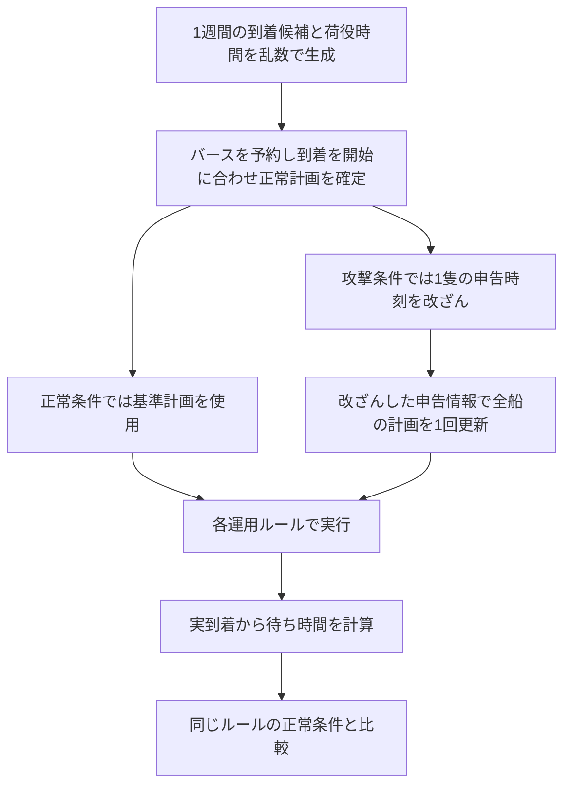

# 現状と今後の研究・開発計画

更新日：2026年11月5日（離散型に決定し、到着調整済み・正常待ち0の比較を実装）

教授の指摘と、その後の相談で採用した方針をまとめる。週単位の生成、運用前の計画更新、3つの運用ルールの比較は実装した。正常時の待ち0は事前の到着調整で実装した。到着候補の数値設定や距離係数などは未確定・未実装であり、実装済みの部分と分けて記録する。以前の「10隻・3バース、V2・V5・V10、各100試行」の主実験案は、この文書の方針へ見直す。

### 決定済み：離散型のバース割当（2026年11月5日）

- バースをB1、B2、…という数で扱い、各バースは同時に1隻、各船は同時に1バースを使用する。
- 船長・岸壁長・岸壁上の着岸位置は計算しない。以後の計画と実装は離散型を前提に進める。
- 現在の実装も離散型であり、この決定によって計算コードや保存済み結果は変わらない。
- 未決定なのは対象ターミナルの規模とバース数の具体値などであり、離散型か連続型かを再び未決定事項として扱わない。初期値3は暫定のままとする。

## 1. 研究の目的とゴール

> 正常時には全船に待ち時間が発生しないバース運用を基準に、1隻の到着予定情報の改ざんが他船へ与える影響と、複数の運用ルールによる軽減効果・限界を調べる。

既存のバース割当・再割当の考え方を、限定した到着情報改ざんの攻撃モデルへ適用する研究と位置づける。対象船の到着順、改ざん方向・幅、到着間隔やバース数による違いを比較し、1つのケースだけで結論を出さない。

研究のゴールは、次の点を実験結果から説明できることである。

- どの条件・運用ルールで、改ざんによる待ち時間が大きくなるか。
- 元の計画をどこまで守り、どこを変更すると影響を軽減できるか。
- 軽減できない影響や、効果がほとんど出ない条件は何か。

実装は、文系大学生が卒論で理解・説明できる規模に保つ。新しい最適化アルゴリズムの提案を中心にせず、比較条件と仮定を明確にする。到着のずれが他船へ影響することや、計画に基づいて再割当すること自体を本研究が初めて示すとは主張しない。先行研究との共通点・相違点は文献に基づいて整理する。

## 2. 教授の指摘と対応方針

以下の「対応」は相談後の整理であり、教授の発言をそのまま引用したものではない。

| 指摘の概要 | 対応方針 | 具体化が必要な点 |
| --- | --- | --- |
| 正常時に待ち時間があるのは不自然。計画時に分かるなら、減速などで到着を調整できるのではないか | 到着とバース利用が調整済みの正常計画を作り、3ルールとも待ち0を確認する方式を採用・実装 | 到着候補の分布・数値、バース数、調整上限を扱わない仮定の説明 |
| 計画期間と、いつ計画するかを明記する。1週間でもよい | 1週間を対象に、荷役運用開始前に計画を作成・更新する | 週の開始時のバース状態、最初の船の到着時刻 |
| 隻数は固定でもよい。10隻・3バースにこだわる必要はない | 1週間への拡張に合わせて隻数を増やす。混雑は到着間隔・荷役時間・バース数から考える | 週内の隻数の生成方法、対象とするターミナルの規模 |
| 荷物に一番近い場所を1.0、隣を1.1、さらに隣を1.2とする | 荷物の位置とバースの距離に対応する荷役係数へ見直す | バース配置、荷物の位置、距離と係数の対応 |
| データを使う理由を説明する | 各分布・数値について、公開資料による値か、研究上の仮定かを明示する | 候補値の根拠と、値を変えた場合の結果の確認 |
| V1の扱いを整理する | 最初の船とシミュレーション開始時点の条件を明示する | 現在のV1＝到着0、早い申告の0への丸め、週開始前からの荷役を含めるか |
| ゴール、研究の位置づけを明確にする。1つのケースだけではない | 改ざんの影響が大きい条件と、複数ルールによる軽減の条件・限界を調べる | 先行研究との比較、主実験で変える条件の絞り込み |
| 元の計画の順番を、どのルールで扱うかを明確にする | 計画順の維持、未到着船の扱い、バース変更、早期開始をルールごとに定義する | 比較ルールの最終的な組合せ、同時イベントの処理 |
| 100回より10回でもよいので、複数ルールを比較する | 最初の比較は各設定10試行とし、ルールの違いを確認する | 結論のばらつきに応じた試行追加 |
| 第3章で問題の想定、第4章で定式化・計算方法を説明し、フローチャートを書く | 実装と並行して卒論の章立て・計算の流れを整理する | 記号・制約・評価式と図の作成 |
| 抜港を入れることも考えられる | 優先度を下げ、初期の比較には含めない | 将来追加する場合の抜港条件、未処理貨物などの評価 |

## 3. 現在の実装との違い

現在は申告到着時刻順のFCFSで各条件の初期計画を作り、固定計画・同じバース内調整・バース変更ありを比較できる。詳細は[要件定義書](要件定義書.md)、[実装説明](実装説明.md)を参照する。

| 項目 | 保存済み100試行 | 今回の実装 | 残る作業 |
| --- | --- | --- | --- |
| 対象期間・隻数 | 固定10隻 | 初期値168時間の到着候補を生成。調整後に期間外となった船も保持。固定隻数も指定可能 | 対象ターミナルの規模と生成条件の根拠 |
| 正常時の待ち時間 | 発生する場合がある | 予約開始に到着を合わせ、3ルールとも全船待ち0を検査。候補と調整時間も保存 | 仮定と現実の違い、調整時間と計画の余裕の考察 |
| 荷役係数 | 0.9・1.0・1.1を船ごとに並べ替える | 現方式を維持 | 荷物の位置を決め、距離に基づく係数へ変更 |
| 計画更新 | 各条件の申告から計画 | 条件ごとに全船の計画を1回作り、全ルールで共有。計画表も保存 | 正常計画からの変更の考察 |
| 運用ルール | 固定計画のみ | 固定・同じバース内調整・バース変更あり | 数値条件の決定と、実到着で動くルールの限界の整理 |
| 改ざん対象 | V5 | 実験プログラムはV5固定を維持 | 週内の序盤・中盤・終盤の選び方と比較 |
| 試行数・保存先 | 100試行、results/ | コマンド初期値10試行、results_coordinated/ | 正式な比較条件での実験と必要な試行追加 |

保存済みの100試行は[予備比較レポート](予備比較レポート.md)と対応する従来の固定計画の記録として残す。新しい週単位の比較結果は別の保存先へ記録する。

## 4. 正常計画と1週間の設定

### 正常時の待ち時間を必ず0にする（2026年11月5日採用・実装）

> 本研究では、到着予定とバース利用予定が事前に調整され、情報改ざんやその他の外乱がなければ、全船が到着後直ちに荷役を開始できる状態を正常計画とする。この条件の下で、1隻の申告到着時刻の改ざんによって生じる待ち時間と、他船への影響を比較する。

従来の「到着間隔・バース数で原則0を目指し、まれな待ちは許容する」方針から変更した。到着候補と荷役時間を乱数で作り、重複しないバース利用予定を立て、その荷役開始に実到着・正常申告を合わせる。候補時刻と調整時間を別に残し、正常計画を保存する。各試行でseedを変えて別の正常計画を作るため、手作業の固定値だけを用いる実験ではない。

```text
到着調整時間 = 調整後の実到着 − 調整前の到着候補
待ち時間 = 実際の荷役開始 − 調整後の実到着
正常条件：実際の荷役開始 = 調整後の実到着（3ルールとも待ち0）
```

正常時0は実行結果で確認し、1e-9時間を超えたらエラーにする。実行後に待ちを0へ置き換えたり、試行を再生成・除外したりしない。攻撃後は申告だけを変え、実到着と荷役時間を再調整しない。

到着調整の上限、速度、距離、燃料は計算しない。調整時間は港での待ちとは別であり、総所要時間がその分短縮されたとは解釈しない。現実の港の正常計画が必ず待ち0という主張ではなく、調整済みの状態から情報改ざんの影響を測るための研究仮定である。

到着候補の分布・間隔やバース数は正常計画の詰まり方と必要な調整時間を変える。正常時に待ち0でも前後の予約の余裕は異なり、改ざんで影響が出ない場合もある。結果を選別せず、余裕と影響の関係を調べる。バッファ時間を指定する機能はまだ追加していない。

### 対象期間と隻数

- 到着候補を生成する対象期間は1週間（168時間）とする。週の開始を時刻0として時間で表し、計画の作成・更新はこの週の運用開始前に行う。
- 候補の到着間隔を順に生成し、週内に到着候補を持つ船を対象とする。隻数は候補の間隔に応じて決まり、調整後の実到着間隔は別となる。現時点は指数分布・平均2.37時間を暫定で使用し、研究に使う具体値は今後決める。
- 隻数は現在の10隻より増やす方向とする。例えば平均到着間隔2.37時間なら、168÷2.37で約71隻という規模の目安になるが、この値を新しい設定値や実港の隻数として確定しない。
- 到着調整で実到着が168時間以降となった船も残す。対象船の荷役が168時間を超える場合も、全対象船の荷役完了まで計算する。週末で計算を打ち切って待ち時間を小さく見せない。
- 遅い申告によって申告時刻が週末を超えても、その船を比較対象から除外しない。同じ試行の正常・攻撃・各ルールで対象船の集合を共有する。

weekly serviceを背景に1週間を対象とする理由を説明する。ただし、特定ターミナルの実測スケジュールを再現したモデルであるとは扱わない。対象がどの程度の規模のターミナルか、バース数と到着間隔を含めて説明できるようにする。

### 週の開始時点とV1

従来の固定隻数ではV1の実到着が0で、早い申告も0へ丸めるため時刻が変わらない。新方式でも最初の候補が0なので、全バース空きの条件下でV1の実到着は0となる。ただし、到着調整を加えた現行コードは旧結果の再現には使えない。

週単位では、全バース空きから始め、V1も最初に生成した到着間隔の後に到着する仮設定とした。ユーザーへ確認中の項目であり、研究上の最終決定ではない。週開始前からの荷役を含める場合は追加実装が必要となる。初期状態が正常時の待ち時間や序盤の改ざんに与える影響を確認し、設定に記録する。

## 5. 改ざん後に何を作り直すか

### 採用した流れ：運用開始前に全船の計画を1回更新する



1. 到着候補と、船・バースごとの荷役時間を乱数で生成する。
2. 候補時刻でバース・荷役順・開始・完了を予約し、到着・正常申告を予約開始へ調整する。候補と調整時間を残し、正常計画を比較の基準として保存する。
3. 攻撃条件では、運用開始前に1隻の申告到着時刻だけを早める、または遅らせる。
4. 運用者が更新された申告情報を信用するものとして、全船のバース・荷役順・計画開始時刻を1回作り直す。申告が変わらない変更幅0や丸めの場合は、保存した正常計画を維持する。対象船だけの修正では、後続船への割当の変化を扱えないためである。
5. 正常条件と攻撃条件のそれぞれについて、同じ初期計画から複数の運用ルールを実行する。実到着時刻と荷役時間は全比較で共有する。

正常な基準計画は比較のために研究者が保存する。攻撃条件の運用者が改ざんを発見して正しい時刻へ戻すことは前提にしない。改ざんした計画に合わせて実到着を調整すると、情報だけを書き換える現在の攻撃とは意味が変わるため、実到着は変更しない。

### 運用ルールでいう「元の計画」

正常条件では正常な基準計画、攻撃条件では改ざん後に更新した計画を指す。運用中に計画順を優先するルールは、それぞれの条件の計画順を使う。攻撃条件だけ正常な計画順を使って、正しい情報を知っている運用にはしない。

「運用前の計画更新」と「運用中の調整」は区別する。運用前には全船の計画を1回作り直し、運用開始後には到着済みの船と空きバースに対して、選んだルールを適用する。荷役中の船を含めて全計画を何度も作り直すモデルにはしない。

## 6. 比較する運用ルール

複数ルールを比較する方針は採用済み。次の3つを比較できるよう実装した。今回の実装では3つを同じ正常計画から比較する。数値設定を決めた正式な主実験とは区別する。

| ルール候補 | 計画順・未到着船の扱い | バース・開始時刻の扱い |
| --- | --- | --- |
| 固定計画 | 元の計画順を守り、前の船が未到着でも飛ばさない | 計画バースを維持し、計画開始時刻より早く始めない。現在の方式 |
| 同じバース内で順番を調整 | 同じバースの到着済み・荷役未開始の船から計画順で選ぶ。未到着船は飛ばす | バースは維持し、到着済みなら計画より早い開始を許す |
| 空きバースへの変更も許す | 全バースの到着済み・荷役未開始の船から計画順で選ぶ。未到着船は飛ばす | 空きバースへ変更でき、計画より早い開始を許す。以下の採用済み規則を使う |

### 採用済みの「空きバースへの変更も許す」規則

- 船の到着時と荷役完了時に、到着済みの待ち船と空きバースを確認する。
- 到着済み・荷役未開始の船の中で、元の計画順が先の船を優先する。
- 優先する船について、事前に分かっている荷役時間が最も短い空きバースを選ぶ。同じならバース番号の小さい順とする。
- 複数の待ち船と空きバースがある場合は、計画順に1隻ずつ割り当てる。全船の組合せを最適化するものではない。
- 到着済みで空きバースがあれば、元の計画開始時刻より早く荷役を始められる。
- 未到着船の将来の実到着を先読みせず、その船のために空きバースを確保して待ち続けない。実際に到着した時点で候補へ加える。
- 荷役中の船は移動・中断しない。同じ船の二重処理、実到着前の荷役、同じバースでの荷役の重複を認めない。
- 別のバースへ変更した場合は、変更先に対応する荷役時間を使う。

「計画順」は、申告到着時刻順のFCFSで定めた全船の順序（現在の`assignment_order`に相当）とする。申告が同時なら船番号の小さい順とする。例えば計画がA→B→Cで、Aが未到着、BとCが到着済みならBを選ぶ。Bの荷役中にAが到着しても中断せず、次の空きバースでは待っているAをCより優先する。

実装では同時刻の到着と荷役完了をまとめて扱い、その時刻の全到着済み船を計画順で確認する。攻撃の検知・防止ではなく、誤った情報に対する運用上の影響軽減として評価する。

### バース変更ありで影響が出なくなる条件

現行の`reassign`は、到着済みの船を空きバースの最短荷役時間で処理し、申告上の開始時刻や計画バースには拘束されない。調整後の実到着がすべて異なる場合、正常時に待ち0なら各到着時点で未開始の船はその1隻だけになる。その都度、正常計画と同じ空き状況・選択規則で開始できるので、申告の並べ替えが実行順に影響せず、改ざん後も正常時と同じ運用が再現される。

これは2試行でたまたま効果が大きかったという説明ではなく、この条件下のモデル構造による。全バースを利用可能とし、荷役時間を正確に知り、実到着時に自由に割り当てられる簡略化に依存する。同時到着では到着済み複数船の優先順が変わり得るため、同じ結論を無条件には広げない。

今回の実装では影響を発生させるためのルールや制約を追加しない。主実験では、この方式を自由な調整が可能な比較基準として扱うのか、予約や設備の制約を含む別の方式が必要かを研究の問いに合わせて検討する。追加はユーザーと相談して行う。

## 7. 荷役時間とデータの理由

### 荷物の位置に基づく係数

船ごとの基準荷役時間を共有し、バースによる違いを係数で表す構造は維持する。

```text
船i・バースjの荷役時間 = 船iの基準荷役時間 × 船i・バースjの距離に対応する係数
```

荷物の置き場所に最も近いバースを1.0とし、1つ隣を1.1、さらに1つ隣を1.2とする方向で見直す。例えば3バースが一直線に並び、荷物が端のバースに最も近ければ、係数は1.0・1.1・1.2となる。中央に最も近い場合は1.1・1.0・1.1という配置も考えられるため、単に1.0・1.1・1.2をランダムに並べ替えるだけで距離を表したとは説明しない。

バースの配置、船ごとの荷物の置き場所、係数の決め方を具体化する。1.1や1.2は研究上の仮定として理由を記載し、実測値と区別する。現在の0.9・1.0・1.1の相性モデルは、この見直しを実装するまで現モデルとして扱う。

### 運用者が知る情報とデータの根拠

船とバースの組合せごとの荷役時間は、計画作成前から運用者が正確に知る前提を維持する。計画・調整・実際の荷役には同じ値を使い、noiseや予測誤差は加えない。これは到着情報の改ざんへ焦点を絞る簡略化であり、実港でも荷役時間が正確に分かるとは主張しない。運用者が未来の正確な実到着を知ること、攻撃者が全船の荷役時間を知ることとも区別する。

到着間隔の分布、基準荷役時間の分布、バース数、距離係数、改ざん幅には、それぞれ選択理由を付ける。現在の平均到着間隔2.37時間、平均基準荷役時間4.8時間は神戸港の実測から推定した値ではなく、新しい正常条件としてそのまま確定しない。

神戸港の公開統計とEDIの船舶情報CSVは確認済みだが、荷役開始・終了時刻がなく、日時が予定か実績かも十分に区別できない。このため、入港から出港までの差を荷役時間として使っていない。仮定したデータを主軸にし、公開資料は背景や条件の検討に使う。実測に基づく検証は必要な情報が得られた場合に検討する。

## 8. 実験と評価の計画

### 最初の比較

計算と保存の動作確認は小さな例と週単位2試行で実施した。これは正式な主実験ではない。2026年11月5日に事前の到着調整による正常待ち0を実装・検証した。次に到着候補間隔・バース数などの数値設定を決め、各ルールの正常・早い申告・遅い申告を各設定10試行から比較する。同じ10組の元データを全条件に使う。

対象は各攻撃条件で1隻とし、週内の序盤・中盤・終盤の到着順を比較する。週内の隻数が増えるため、以前のV2・V5・V10という固定指定をそのまま「序盤・中盤・最後」と扱わない。対象の選び方を定義して識別子と到着順を保存する。対象船や改ざん隻数を毎回ランダムにする主実験にはしない。

改ざん幅は以前の±4時間を初期値として維持した。研究条件としては週単位の設定や荷役時間との関係を確認して決める。0未満の申告を0へ丸める現行の扱いは、週の初期状態と合わせて整理し、実際に変更できた幅も記録する。

比較ルールを3つにする場合、1組の元データにつき3ルール×3条件を計算する。対象位置などを増やす場合も、同じ試行の実到着・基準荷役時間・荷物の位置・各バースの係数を共有する。攻撃で更新した初期計画も、同じ攻撃条件のルール間で共有する。

最初は到着間隔、バース数、対象位置、改ざん幅を一度に多数組み合わせず、条件を絞って仕組みを確認する。その後、正常時の余裕や攻撃条件を変えて結果の範囲を調べる。正常時から混雑している条件を追加する場合は、主実験の正常条件と分けて説明する。

### 評価指標と公平な比較

主指標は対象船以外の平均待ち時間とする。全船の平均待ち時間と対象船自身の待ち時間を併記し、最大待ち時間と在港時間も補助指標として確認する。

各ルールについて、そのルール自身の正常条件との差を計算する。

```text
ルールRの攻撃影響 = W(R・攻撃) − W(R・正常)
ルールRによる軽減量 = 固定計画の攻撃影響 − ルールRの攻撃影響
```

軽減量が正なら、正常時からの増加量を小さくしたことを表す。現方式では正常時の待ち時間が全船0であることを検査するため、待ち時間の攻撃影響は攻撃時の待ち時間と一致する。在港時間などは正常値が0とは限らない。攻撃時の絶対値と正常時の値も併記し、平常時の効率改善と攻撃影響の軽減を区別する。

平均・標準偏差・試行ごとの差・悪化回数を示す。正常時が0の場合、正常時を分母にした増加率は計算できないため、まず時間の差で評価する。現方式の待ち時間は正常時0なので攻撃による正常時からの改善は起こらない。一方、在港時間やルール間の比較は別であり、調整ルールで悪化する場合も報告する。10試行だけで統計的な有意差や実港での効果を断定せず、結果が不安定なら比較条件の試行数をそろえて増やす。

計画順・バース・計画開始時刻が、正常な基準計画からどう変わったかも具体例で確認する。seed、対象船、実際の改ざん幅、初期状態、期間、ルールを設定と結果から追跡できるようにする。

## 9. 卒論の章立てと計算の説明

| 章 | 書く内容 |
| --- | --- |
| 第1章：背景・目的 | 港湾運用と到着情報、問題意識、研究のゴール |
| 第2章：関連研究 | バース割当、再割当、到着情報の不確実性・改ざんとの共通点と相違点 |
| 第3章：問題の想定 | 対象ターミナル、1週間、隻数・バース数、正常条件、攻撃者の能力・情報、初期状態、運用ルールの意味 |
| 第4章：定式化・計算方法 | 実到着と申告の記号、荷役時間と距離係数、計画作成・更新、各ルール、制約、待ち時間・評価式、フローチャート |
| 第5章：実験 | データの理由、比較条件、seed・試行数、正常時の確認、結果の表・グラフ |
| 第6章：考察・結論 | 影響が大きい条件、ルールによる軽減と限界、仮定への依存、今後の課題 |

第4章では、第5節の全体フローに加え、船の到着・荷役完了から待ち船の選択、バースの選択、開始・終了時刻の計算までを示す。実到着前に開始しない、同じバースで荷役を重複させないなどの制約を式と図で対応づける。実装を進めるたびに、この説明も更新する。

## 10. 今後の作業順序と未決定事項

| 順序 | 作業 | 完了の目安 |
| --- | --- | --- |
| 1 | 関連文献を整理し、週の初期状態、到着間隔、バース数、荷物の位置を具体化する | 研究の位置づけ、条件を選ぶ理由、調整済みの正常時0という仮定と、現実との違いを説明できる |
| 2 | 1週間のデータ生成と正常計画を整える | 到着候補・調整後の実到着を区別し、期間外となった船も扱い、正常時0を確認できる |
| 3 | 運用前の全船の計画更新と比較ルールを整理・実装する | 小さな手計算例と計算結果が対応し、非重複・未来情報を使わないことを確認できる |
| 4 | 比較の集計・保存を整え、各設定10試行で実験する | 同じ元データで比較でき、設定・CSV・グラフが対応する |
| 5 | 対象位置・改ざん幅・正常時の余裕を変えて比較する | 1ケースに依存しない結果と、効果が出ない条件を説明できる |
| 6 | 章立てに沿って結果・考察をまとめる | 仮定と実験で分かったことを分け、研究の問いに答えられる |

作業2〜4のうち、期間内の到着生成、3ルール、計画共有、集計・保存は実装済みである。到着調整済みの正常計画と全ルールの待ち0の検査も実装した。数値条件の決定、距離係数の変更、正式な10試行の主実験は残っている。

直近に確認する項目は、バース数と対象規模、到着候補間隔の分布・数値、週の初期状態とV1、荷物の位置と係数、主実験のルールの組合せ、対象位置の選び方、改ざん幅の根拠である。仮設定を研究上決定済みの数値として扱わない。

計算は`simulation.py`、入出力は`main.py`に置く責務分離を維持する。実装変更に合わせて[要件定義書](要件定義書.md)、[実装説明](実装説明.md)、READMEを更新する。追加実験は別の保存先を使い、現モデルの`results/`と過去の`results/archive/`を保持する。

抜港は優先度の低い拡張候補とする。追加すると待ち時間だけでは未処理の船・貨物を評価できないため、抜港条件と別の評価指標が必要になる。複数船の同時改ざん、運用途中の継続的な攻撃、機械学習による検知、複雑な最適化、実システムとの接続も、最初の比較には含めない。
