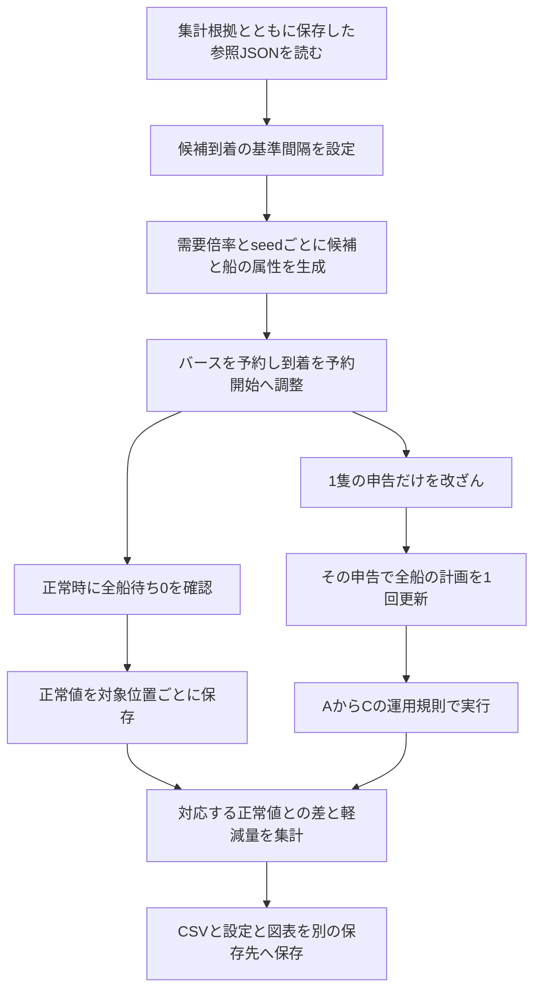

# 計算と実験の実装説明

2026年11月11日に、実到着の計画への調整をなくし、1隻から複数船同時改ざんへ比較を広げる方針を採用した。改修は未着手であり、以下は到着調整ありの現コードの説明である。[改修計画](今後の計画.md#新しく採用した方針と改修順序)と区別する。

更新日：2026年11月11日。計算は[simulation.py](../simulation.py)、実行の流れは[main.py](../main.py)、コマンド引数は[cli.py](../cli.py)、設定・表の保存と概要表示は[result_output.py](../result_output.py)、描画は[plotting.py](../plotting.py)に置く。神戸港の平均間隔は[保存済み参照記録](../data/kobe_reference_20261105/README.md)から読む。クラス・最適化ソルバーは使わず、NumPyとPandas、関数と繰返しで構成する。

## 1. 全体の流れ



## 2. 到着候補と船の属性

候補の平均間隔は参照値を需要倍率で割る。主実験の参照値は13日103件の翌日予定から算出した3.029126…時間である。候補の指数分布は仮定で、実到着分布の当てはめではない。

`generate_ship_data()`では、指数乱数の間隔を足し、168未満の候補を持つ船を生成する。固定隻数の確認用では最初の候補を0とする。期間指定ではV1も最初の間隔の後に到着する。全バースは初め空いている。

船の属性は別の乱数生成器`seed+100000`で、船ごとに基準荷役時間、荷物の最寄りバースの順に作る。このため同じseed・同じバース数なら、需要水準で隻数が異なっても先頭から対応する船の属性は同じとなる。ただし対象集合全体が同一になるわけではない。

```text
基準荷役時間 h_i ~ Gamma(shape=2, scale=2.4)
最寄りバース q_i ∈ {1,2,3,4}（一様乱数）
係数 f_ib = 1 + 0.1 × |b − q_i|
荷役時間 h_ib = h_i × f_ib
```

係数は船ごとに異なるが、同じ試行の比較では固定する。noiseや荷役の予測誤差は加えない。距離は番号の差という簡略化であり、岸壁長や実測のメートルではない。

## 3. 予約と正常時の到着調整

`create_plan()`は申告時刻を安定ソートし、各船について以下を計算する。

```text
計画開始 s_i = max(申告時刻 r_i, バースbの計画利用可能時刻)
計画完了 e_i = s_i + h_ib
```

候補`(開始, 完了, バース番号, 荷役時間)`が最小のバースを選ぶ。これはFCFSを基本とした逐次的規則で、全体最適化ではない。実到着時刻は表に残すが計画の判断には使わない。

`create_normal_plan()`は到着候補でこの予約を作り、船番号で予約開始を対応づけ、実到着・正常申告をその開始にする。予約の割当・順番・開始・完了は保持する。

```text
candidate_arrival_time = 調整前の候補
actual_arrival_time = 正常予約の開始
reported_arrival_time = 正常時は実到着と同じ
arrival_adjustment_time = 実到着 − 候補
```

例えば1バース、候補0・2・3、荷役各3なら、実到着0・3・6、調整時間0・1・3、正常時の待ちは0となる。候補からの追加時間を消したり、待ちを計算後に0に置き換えたりしない。調整上限・速度・燃料は扱わない。

## 4. 改ざんと計画更新

`apply_attack()`は入力をコピーし、対象船の申告だけを`max(0, 実到着±幅)`にする。実到着、基準荷役時間、荷物位置、係数、他船の情報は動かさない。

全船の申告を使って条件別に1回計画を更新する。幅0や丸めで申告が正常値と同じなら、保存済みの正常予約を使う。更新後の計画を全方式が共有する。正常計画を攻撃条件の運用者が参照して修復する機能はない。

## 5. 3方式の実行

Aは`execute_fixed_plan()`で、計画バースと順番を維持する。

```text
実開始 t_i = max(計画開始 s_i, 実到着 a_i, バースの実利用可能時刻)
```

B・Cは`execute_adjusted_plan()`を共有し、Bだけ計画バースに限定する。Cは空きバース中で荷役時間が最短、同じなら小さい番号を選ぶ。両方式とも前倒し時間を制限しない。

空きバースを選ぶ判断は`select_available_berth()`へ分けている。呼び出し側では到着済みかを確認し、使える空きバースを選び、荷役を開始する流れを追える。1隻の実行結果は`create_execution_result()`で作り、完了・待ち・在港時間の計算を固定方式と共有する。

```text
B・Cの開始可能時刻 u_i = 実到着 a_i
```

その時点で到着済みの待ち船を、更新後の計画順で確認する。未到着船や使用可能な空きバースがない船を飛ばして次も確認する。船を入れたら、選んだバースが空く時刻を`現在時刻+変更先の荷役時間`へ更新する。荷役中の船は中断・移動しない。後続船への悪影響を先読みして回避する処理はない。

時計は、未処理船の将来の実到着時刻と、実行中の将来の完了時刻のうち最も早い値へ進める。前倒し制限の解除イベントは不要になった。未来の実到着を時計に使うことと、未到着船を先読みしてバースを選ぶことは区別する。

### 手計算で確認する例

1バース、調整済み実到着0・3・6、荷役各3、V3を4時間早く申告する。更新後の順番はV1→V3→V2、計画開始は0・3・6になる。

| 方式 | V2の実開始・待ち | V3の実開始・待ち |
| --- | --- | --- |
| A | 9・6 | 6・0 |
| B/C | 3・0 | 6・0 |

B/Cは3時に未到着のV3を飛ばし、到着したV2を開始する。計画開始6時のV2も3時間前倒しできる。前倒し開始が他船を遅らせる例や、変更先の荷役時間を使うことも自動テストで確認する。

正常計画の作成と実行の選択が対応しているため、全方式で正常予約と待ち0が保たれる。Cは実到着がすべて異なる今回の入力では正常運用を再現する。これは最適性の証明や一般の港での完全な影響除去を意味しない。

## 6. 実験の組合せと正常値の共有

`run_experiment()`は実験全体を進める入口とし、次の役割を関数に分けている。コードはこの順に読むと、条件確認から結果集計までを追える。

| 関数 | 役割 |
| --- | --- |
| `run_experiment()` | 入力条件を確認し、需要水準・試行ごとの正常計画作成と比較を進行 |
| `create_normal_plan()` | 到着候補から正常予約と調整後の到着を作成 |
| `calculate_plan_diagnostics()` | 到着調整量・予約間隔・期間外到着などを集計 |
| `run_comparison_cases()` | 正常運用を共有しながら、対象船・幅・方向の条件を比較 |
| `run_normal_cases()` | 各方式の正常運用を実行し、全船の待ち0を確認 |
| `run_attack_case()` | 1隻・1方向・1幅の申告変更と計画更新、方式別実行、正常との差を計算 |
| `summarize_results()` | 試行ごとの指標を条件別に集計 |

実行ルールは`execute_policy()`で選ぶ。前倒し上限の引数・定数・記録列と`recorded_start_limit()`は廃止した。`earliest_start_time`は、固定では計画開始と実到着の遅い方、調整2方式では実到着を表す。

補足実験がなくなったため、`group`引数と実験区分の設定辞書は使わない。`run_comparison_cases()`へ対象船・幅・方式を直接渡す。CSVの形式を維持するため、`experiment_group`列は引き続き`main`として記録する。

`run_experiment(full_study=True)`は、既定の100試行では需要倍率0.75・1・1.5ごとにseed42〜141で正常計画を1回作る。到着順10・50・90%の順位を端数切上げで選び、±2・4・8時間を比較する。実到着が同じなら元の入力順を保つ。

同じ正常データを全条件に使い、各条件の計画を方式間で共有する。主実験では正常実行は需要・seed・方式ごとに1回で、幅・対象の変更ごとには実行し直さない。正常の船別実行はメモリ上で`target_position=baseline`として保持し、対象別の指標はその同じ実行から算出する。

異なる正常入力は300組、正常実行900ケース、攻撃実行16,200ケースである。前倒し上限を比較する補足実験は廃止した。需要水準間でもseedと船の属性を共有するため、300個の相互に独立した標本ではない。正常指標2,700行は対象ごとの参照値を含み、正常入力2,700組を意味しない。

## 7. 評価と集計

```text
待ち w_i = t_i − a_i
在港 v_i = c_i − a_i = w_i + h_ib
他船平均待ち = 対象船を除くw_iの合計 / (隻数−1)
攻撃影響 = 攻撃時の値 − 同方式・需要・試行・対象位置の正常値
軽減量 = Aの攻撃影響 − 各方式の攻撃影響
```

他船の待ち隻数・最大待ち、対象船の待ち、総・平均・最大待ち、総・平均在港、全船完了、バース変更隻数の11指標を保存する。バース変更は各条件の更新後計画と実行を比較する。

正常値は改ざん幅ごとには重複させない。`summarize_results()`でキー（実験区分、需要、試行、対象位置、方式）を使い、攻撃行へ正常値を対応づける。各セル100試行の平均・標本標準偏差、差の平均・標準偏差・最小・最大と増減回数を返す。単なる全船一括平均ではなく、各試行の指標を同じ重みで平均する。

## 8. 保存と確認

`main.py`は通常実行・主実験とも`data/kobe_reference_20261105/kobe_reference.json`を読み、保存済みの正確な平均間隔`3.029126213592233`時間を計算へ渡す。参照場所とハッシュ照合の対象3ファイルは`result_output.py`の`REFERENCE_DIR`・`REFERENCE_FILES`で定義する。CSVの取得・再集計やExcel読み取りはしない。参照JSONがなければ停止し、仮定値へ切り替えない。到着候補と荷役時間の入力条件は維持し、調整2方式の前倒し時間制約だけを廃止した。

通常実行も主実験も、試行別結果`run_metrics.csv`、集計`summary.csv`、実験条件`config.json`を保存する。船別入力・計画・運用や対応比較は計算中だけ保持し、通常保存しない。正常計画の最大到着調整・期間外到着隻数・最終実到着の概要は設定に残す。参照記録は`data/`から読み、結果への再コピーや原本の再集計はしない。図は通常実行で1図、主実験で4図のPNG・PDFを保存し、`--no-plot`で省略できる。既定の保存先は`results/`直下とし、直下にファイルがあれば停止する。過去結果のサブフォルダだけなら保存できる。通常実行では1週間分・V5・±4時間・3方式を計算する。

引数の定義は`cli.create_parser()`、読み取りと保存先のチェックは`cli.parse_args()`に置く。試行数100はCLIと`run_experiment()`の既定値へそれぞれ直接書く。参照が1〜2か所の数値は定数を設けず、長い一覧・辞書はまとめる方針とする。バース数・候補生成期間・通常の改ざん幅・比較方式は`simulation.py`の`NUM_BERTHS`・`DURATION_HOURS`・`SHIFT_HOURS`・`POLICIES`で共有する。主実験の幅2・4・8時間、荷役分布のshape=2・scale=2.4は、計算箇所と設定記録へ直接書く。固定隻数や手動の平均間隔、参照場所・取得日上限もシミュレーションのCLIからは指定しない。`main.py`と設定JSONの作成は同じ実験条件を参照する。計算関数の引数は、手計算例や自動テストで小さい条件を指定できるように残す。

参照JSONの読み込みや計算から返されたエラーの表示には同じparserを使う。`main.py`にはこれらを呼び出す順序を残し、出力は役割ごとに次の関数へ渡す。

- `result_output.create_config()`：実行条件、コード5ファイルと参照記録3ファイルのハッシュをまとめる。
- `result_output.save_results()`：試行別結果・集計の2表と設定JSONを保存する。
- `result_output.print_summary()`：実行件数と指標の概要を画面表示する。
- `plotting.plot_results()`：条件別比較と説明用スケジュールの描画関数を呼ぶ。描画モジュールは図を保存するときだけ読み込む。

`create_config()`内のハッシュ計算は`calculate_file_hashes()`へまとめ、コードと参照記録の両方に同じ処理を使う。

比較図3種類は`plot_waiting_comparison()`の共通描画処理を使う。スケジュール図では、大きくなっていた例の選択と描画を`select_schedule_example()`と`draw_ship_schedule()`に分ける。各描画関数では、データを用意し、描き、軸を整え、保存する流れを追える。

描画設定は`plotting.py`の先頭にまとめる。`COLORS`は3方式にMatplotlib標準色の`C0`〜`C2`を対応させ、図をまたいで方式の色を揃える。`SCHEDULE_COLORS`は対象船・他船・到着線の色、`PLOT_STYLE`は共通の文字サイズ・ひげの幅・グリッドの濃さ・保存解像度を定義する。図の幅・高さ（インチ）は各`plt.subplots()`、船名の文字サイズ7は`draw_ship_schedule()`へ直接書く。共通設定は`plt.rc_context()`で描画中だけ適用する。軸ラベル・範囲・目盛り・グリッドを整える処理は、比較図用の`setup_waiting_axis()`とスケジュール図用の`setup_schedule_axes()`に分ける。配置調整・PNG/PDF保存・図を閉じる処理は`save_figure()`にまとめる。上限比較図を削除し、スケジュール図は正常＋3方式の4段にした。条件別比較の軸の値・標準偏差の扱いは維持する。

設定にはモデル版、基準間隔の由来、分布・係数式・乱数順、seed、対象位置、幅、方式、調整方式の開始ルール、期間末の扱い、コードSHA-256と資料URLを残す。参照記録のSHA-256は`reference_sha256`に記録し、参照記録自体には原本13件のSHA-256と元行を残す。

2026年11月9日にローカルの収集・同期・Excel作成・集計コードを削除した。作成済みExcelと既存結果は保管し、参照原本13件はZIPにまとめた。11月5日の保存結果は当時のコード3ファイルのハッシュを保持しているため、その独立検算にはZIPから原本を復元し、実験時のコード版を使う（[README](../README.md)参照）。

グラフ01〜03は指定したセルの100試行平均、上側だけ標本標準偏差1個分のひげを描く。横軸が数値の場合は実際の数値間隔で配置する。図04は基準需要・中盤・早い申告4時間という事前指定セル内でAの他船待ちが最大の例であり、平均を代表する例とはしない。

16件の自動テストで計算ルール・保存内容・100試行の既定値・過去結果フォルダの許可と既存ファイルの上書き防止を確認する。3方式化した10試行の時点では全1,710運用・112,404船別行と全11指標・対応集計を検算し、可読性整理後も全7表の一致を確認した。100試行への変更では、保存済み10試行と最初の10試行の指標・集計の一致も確認する。これらは研究仮定の現実性を証明するテストではない。

その後ユーザー指示で保存を最小化し、詳細CSV・検算専用スクリプト・検算記録を通常保存から外した。その保存整理では数値と図を維持し、今回の100試行化では平均・標準偏差と図を更新した。再確認は保存した条件で再実行し、`run_metrics.csv`・`summary.csv`と比較する。再現用コード・参照ハッシュは設定に残し、ソース履歴はGitで管理する。

実行方法は[README](../README.md)、具体的な結果と解釈は[主実験レポート](予備比較レポート.md)を参照する。
