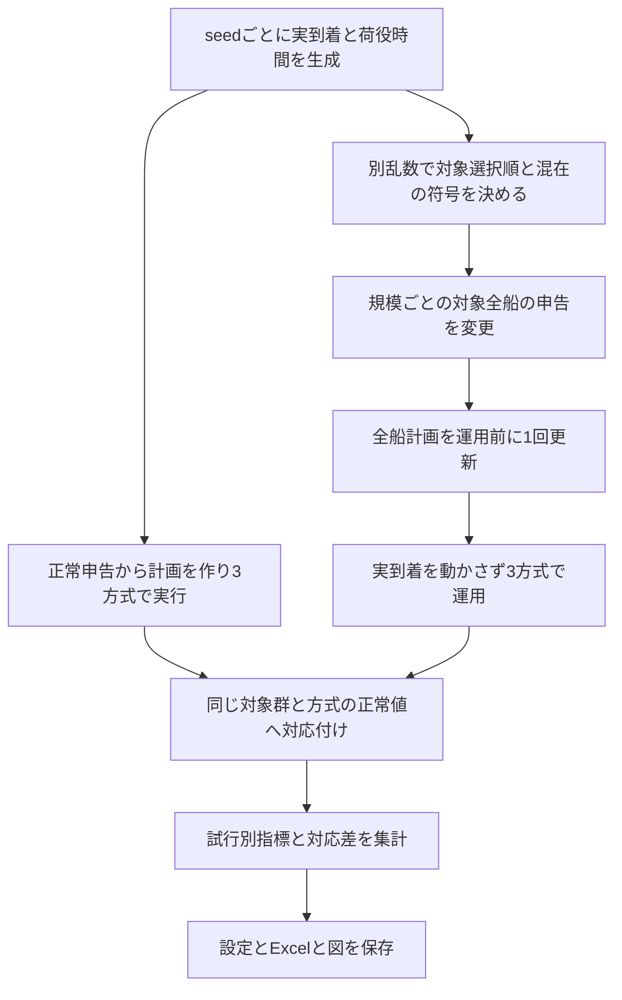

# 複数船の到着情報改ざん実験の実装説明

更新日：2026年11月11日。モデル版`discrete_4berth_multi_ship_v6`。前提は[要件](要件定義書.md)、実行と保存一覧は[README](../README.md)、数値は[結果レポート](予備比較レポート.md)を参照する。

## 1. 全体の流れ

`main.py`は引数確認、保存済み参照値の読み込み、計算、保存・描画・表示の順に処理する。計算は`simulation.py`、引数は`cli.py`、出力は`result_output.py`、描画は`plotting.py`に置く。計算に保存・画面表示を混ぜず、クラスやソルバーは使わない。



## 2. データ生成と計画

`generate_ship_data()`は平均間隔を保存済み参照値とし、指数乱数を累計して168時間未満の実到着を生成する。確認用の固定隻数では先頭を0とする。正常申告を実到着と同じにし、計画作成後も到着を変更しない。

船の属性は`seed+100000`の別乱数で、船ごとに基準荷役時間、最寄りバースの順に作る。基準はGamma(2,2.4)、バース別時間は基準×`(1+0.1×番号差)`。同じ入力の全比較で共有する。これらの分布・係数は仮定である。

`create_plan()`は申告の安定ソート順で、各バースの候補を開始、完了、番号の順に比較する。

```text
計画開始 = max(申告時刻, バースの計画利用可能時刻)
計画完了 = 計画開始 + そのバースの荷役時間
```

実到着は結果へ引き継ぐが計画の判断には使わない。実到着0・2・3時間／1バース／荷役各3時間なら、正常の開始0・3・6、待ち0・1・3となる。正常待ちを事後に0へ置換せず、待つ試行も保持する。

## 3. 対象集合と改ざん

`select_targets()`は主実験で`seed+200000`の乱数を使い、全船の順列を1回作る。最初の1隻と、順列の先頭`ceil(船数×0.1/0.3/0.5)`隻を対象にする。小さい集合は大きい集合に含まれ、幅・方向・方式を変えても同じ対象を使う。通常の確認用実行はV5を指定する。

順列作成後に最初の符号を乱数で決め、選択順に符号を交互に割り当てる。混在で早い・遅いの隻数差は最大1。割合・幅が変わっても既存対象の符号を保つ。全対象を早める条件、遅らせる条件、混在の補足を分け、1隻の混在は作らない。

`apply_attack()`は船名と変更量の辞書を受け取り、対象の申告だけを`max(0, 実到着+変更量)`へ置き換える。対象外の申告と全船の実到着・荷役時間は不変。存在しない対象や有限でない変更量はエラーにし、空集合は入力と同じになる。

`run_attack_case()`は全対象を変更した後で計画を1回更新する。幅0など申告が変わらない場合は正常計画を使う。対象IDは`target_ships`、丸め後の実際の変更量は`report_shifts`へJSON形式で記録する。対象選択用seed、対象数、実際の割合もExcelの試行別シートに残す。正常との差を求めるために渡す正常運用は評価にだけ使い、バース選択には使わない。

## 4. 運用

| 方式 | 処理 |
| --- | --- |
| 固定 | 計画バース内の順番を維持し、`max(計画開始,実到着,同じバースの前船完了)`で開始 |
| 同じバース内調整 | 到着済み船を更新後の計画順で確認し、計画バースが空いていれば開始 |
| バース変更 | 同じ計画順で確認し、空きバース中でその船の荷役時間が最短のものを選ぶ。同時間なら番号順 |

`execute_policy()`が固定と調整の関数を呼び分ける。調整は到着と完了のイベントへ進み、未到着船を飛ばす。全船に適用し、前倒し上限なし。実到着順FIFOへの切り替えはない。空きの選択は`select_available_berth()`、時間の計算は`create_execution_result()`へ分ける。

実到着前開始、同じバースでの重複、開始後の中断・移動を認めない。正常計画や未来の実到着で攻撃下の優先順を判断しない。期間内の船は、完了が168時間を越えても全船処理する。

運用中に申告を正常へ戻したり、正常計画へ復帰させたりする処理はない。待ちが途中で解消するのは、到着と荷役完了に応じて空きが生じるためである。固定方式の待ちには計画開始までの待ちも含まれ、待ちの全量がバース不足によるものではない。

## 5. 指標と対応比較

`calculate_metrics()`は全船の総待ち・平均待ち・最大待ち、総在港・平均在港、最終完了、対象群の平均待ち、対象外群の平均待ち・待つ隻数・最大待ち、計画からのバース変更隻数、正常より待ちが増えた全船・対象外船の隻数の13指標を返す。

```text
待ち = 開始 − 実到着
在港 = 完了 − 実到着 = 待ち + 実行バースの荷役時間
改ざん影響Δ = 改ざん時 − 同じ入力・方式・対象集合の正常時
固定からの軽減量 = 固定のΔ − 各調整方式のΔ
```

主指標は全船平均待ちのΔ。割合で対象外群の構成が変わるため、群別平均だけで規模を比較しない。群が空なら平均・最大は未定義、隻数は0とする。正常より増えた隻数は、待ちがある船の隻数とは区別し、船ごとの正常待ちを引いて数える。

1ケース内では、全船平均のΔは`(対象隻数×対象群平均のΔ + 対象外隻数×対象外群平均のΔ) ÷ 全船数`となる。例えば10隻中3隻の待ちが平均1時間減り、残り7隻が平均0.5時間増えると、全船平均は0.05時間増える。群の負担の向きと全体の変化は同じとは限らない。既定は1試行。複数試行を明示した場合には、船数・実際の割合が変わるので、この計算は試行ごとに行ってから平均する。

`run_normal_cases()`は入力ごとに正常3方式を1回ずつ計算する。`run_comparison_cases()`は各規模の対象群で正常指標を作り、幅・方向の改ざん運用と比較する。混在も同じ正常運用を使う。

`summarize_results()`は試行・規模・方式で正常値を結び、主実験／補足・規模・幅・方向・方式ごとに集計する。改ざん平均と標本標準偏差、正常平均、対応差の平均・標準偏差・最小・最大、増減回数、固定からの軽減量を求める。±1e-9以内を変化なしとし、負の差も残す。正常0で増加率を出さない。

## 6. メモリと保存

`run_experiment()`は1入力ずつ処理する。全試行の船別運用を蓄積せず、全指標を残しつつ、`select_example_schedules()`で事前指定セルの固定方式のΔが最大の1試行だけを図用に保持する。主実験のセルは対象30%・混在・幅4時間。同値なら先の試行を保つ。平均的な例とは説明しない。

返す表は船別入力、説明用運用、試行別指標、集計、正常計画の診断の5表。`keep_schedules=True`は検証用に全運用を保持するAPI引数で、CLIでは使用しない。既定の正常3＋改ざん99の運用数は、説明用データの保持量に左右されない。

`calculate_plan_diagnostics()`は最後の実到着・正常計画の最終完了と、168時間内に切り取った荷役時間÷(バース数×168時間)を返す。これはモデル内の正常バース使用割合で、実港の稼働率ではない。

保存は`result_output.py`で`config.json`と`results.xlsx`を作る。Excelは「条件別集計」「試行別結果」「船別データ」の順で、計算済みの数値と生成した入力を保存する。`translate_excel_table()`で見出し・方式・申告条件・評価指標を日本語へ変換する。内部の識別子と計算値は変更しない。見出し固定・フィルター・数値書式・日本語の行高は`format_result_sheet()`で整える。隻数・試行番号・シードなどの整数値はそのまま、小数は`excel_number_format()`で有効数字3桁以内の表示書式を選び、末尾の0を省く。割合は%に換算して3桁以内とする。2桁では時刻や小さな差が粗く見えるため3桁を採用した。計算誤差程度の残差（絶対値10⁻¹²未満）は0と表示する。保存値は丸めず、表示だけを整える。Excelのセル編集だけでは再計算しない。

`create_summary_overview()`は主指標の全船平均待ちを取り出し、規模・幅・方向ごとに3方式を並べる。`save_summary_sheet()`は「条件別集計」の上段に99行7列の比較一覧、下段に元の13指標の詳細を置く。上段は条件4列と正常値・改ざん値・差の3列に絞り、差には符号と増減の色を付ける。両表をフィルターで絞り込め、移動リンクで行き来できる。`format_summary_sheet()`が読み方・表題・条件の区切りを整える。数値の集計方法は変更しない。

正常3運用を規模ごとに参照し12指標行、改ざん99行、計111行。下段の詳細集計は99セル×13指標＝1,287行。上段の99行はこのうち全船平均待ちだけを見やすく再表示したもので、運用回数を増やしていない。既定の1試行では標準偏差を空欄とし、試行間のばらつきは評価しない。正常参照や同じ入力を独立標本と数えず、結果CSVやソースのコピーは作らない。

「船別データ」は`ship_data`を試行ごと・船ごとに保存する。実到着時刻、正常時の申告、基準荷役時間、最寄りバース、全バースの荷役係数と荷役時間、再現用シードを含む。今回の1試行は63行。改ざん後の申告や実行スケジュールの船別詳細とは区別し、各改ざん条件で同じ入力を繰り返し保存しない。


## 7. 図

`save_figure()`で図番号・タイトル・実験条件を下部に配置し、その分の余白を確保してPNG/PDFへ保存する。図内の申告方向・方式など、パネルごとの見出しは上に残す。考察資料とWordも図タイトルは下、表タイトルは上とする。

`plot_comparisons()`は規模・幅の2断面を描く。縦軸は全船平均待ちのΔ、既定1試行ではひげを描かず点と線で表示する。複数試行を明示した場合だけ、上側へ対応差の標本標準偏差1個分を描く。混在に1隻の点はない。`plot_group_burden()`は対象群・対象外群・全船を分け、`plot_waiting_overview()`は同じ断面の絶対値も示す。

`queue_profile()`は到着で+1、開始で−1として同時刻をまとめ、時刻別の待ち船数を作る。待ち0の船は同時に相殺される。`plot_queue_example()`は正常と改ざんを3方式で比較し、`plot_schedule_example()`は同じ試行の待ち増分が最大の船の周辺を6段で描く。別々の対象船の影響が含まれる時間全体を、1件の波及継続時間とは呼ばない。
