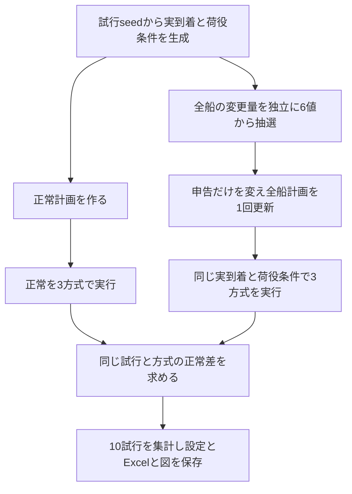

# 全船ランダム到着情報改ざんの実装説明

更新日：2026年11月13日。モデル版`discrete_4berth_all_ships_random_v8`。[要件](要件定義書.md)、[実行・出力一覧](../README.md)、[数値と考察](予備比較レポート.md)を参照する。

## 1. 処理の流れ

`main.py`は引数確認、保存済み参照値の読み込み、実験計算、保存、描画、表示の順に処理する。`simulation.py`の計算には保存・CLI・表示を混ぜない。クラスや最適化ソルバーは使わない。



## 2. 入力生成と計画

`generate_ship_data()`は指数乱数を累計して168時間未満の実到着を作る。平均間隔は保存済み参照値。確認用の固定隻数の場合のみ先頭を0とする。正常申告は実到着と同じにし、計画開始へ到着を合わせない。

船の属性はseed+100000で、各船について基準荷役時間、最寄りバースの順に作る。基準はGamma(2,2.4)、バース別は基準×(1+0.1×最寄りとの番号差)。4バースの係数は1.0〜1.3。これらは実測に当てはめた値ではなく、比較のための仮定である。

`create_plan()`は申告時刻で安定ソートし、各船を順に割り当てる。同時刻なら入力行順を保つ。各バースで次を求め、開始時刻、完了時刻、番号の順に小さい候補を選ぶ。

```text
計画開始 = max(申告時刻, そのバースの計画利用可能時刻)
計画完了 = 計画開始 + そのバースの荷役時間
```

実到着は表へ引き継ぐが計画の判断には使わない。正常待ちを0へ置換せず、待つ試行も待たない試行も保持する。

## 3. 船ごとの改ざん

`create_report_shifts()`はseed+200000の乱数を使う。元データの船の行順に、−8・−4・−2・＋2・＋4・＋8時間から独立に等確率で1つずつ抽選し、船IDと変更量の辞書を返す。全船が対象で、早い・遅いの隻数や変更幅の出現数を均等にそろえない。

`apply_attack()`は申告だけを`max(0, 実到着+変更量)`に置き換えたコピーを返す。実到着・荷役条件・元データは不変。存在しないIDや有限でない変更量はエラーとする。確認用には一部船・空辞書・変更0の入力も扱えるが、現在の実験は必ず全船を変更する。

抽選は1試行につき1回である。`run_comparison_cases()`は正常計画と改ざん後計画を各1回作り、同じ入力と同じ改ざん後計画を3方式で実行する。方式ごとの再抽選や、運用中の正常申告への復帰は行わない。

「船別データ」の`requested_report_shift`は抽選値、`attacked_reported_arrival_time`は変更後申告、`actual_report_shift`は変更後申告−実到着である。開始前の申告を0に丸める場合は抽選値と適用後の変更量が異なる。

## 4. 運用

表1 実行処理

| 関数・方式 | 処理 |
| --- | --- |
| `execute_fixed_plan()` | 計画バース内順番を守り、max(計画開始, 実到着, 同じバースの前船完了)で開始 |
| `execute_adjusted_plan()`・同じバース内調整 | 到着済みを計画順で確認し、計画バースが空いていれば開始 |
| 同関数・バース変更 | 同じ計画順で確認し、空きバースのうち荷役時間最短を選ぶ。同時間なら番号順 |

`execute_policy()`が呼び分ける。調整方式は到着・完了のイベントへ進み、同時刻の到着と完了をまとめて扱う。未到着船を飛ばし、前倒しの時間上限を設けない。選択は`select_available_berth()`、1隻の開始・完了・待ち・在港の計算は`create_execution_result()`へ分ける。

実到着前開始・同一バースの重複・開始後の中断や移動を認めない。期間後に完了する船も全船処理する。正常計画や未来の実到着で攻撃下の開始を判断せず、実到着順FIFOへ切り替えない。固定の待ちには計画開始までの待ちも含まれる。

## 5. 評価と集計

`calculate_metrics()`は総待ち・平均待ち・最大待ち、総在港・平均在港、最終荷役完了、計画からのバース変更隻数、正常より待ちが増えた隻数の8指標を返す。全船が対象なので対象外群の指標は作らない。

待ち＝開始−実到着、在港＝完了−実到着である。船別の悪化判定には同じIDの正常待ちを使い、1e-9時間を超える増加を数える。正常運用を引数で渡すのは評価時だけで、バース選択には使わない。

`summarize_results()`は試行・方式で正常値を対応付ける。改ざん値の平均・標本標準偏差、正常平均、対応差の平均・標準偏差・最小・最大、増加・減少・不変の試行数を方式ごとに求める。負の差も保持し、±1e-9以内は変化なしとする。1試行の標準偏差は空欄。

同じ10試行を方式間で共有し、集計は試行ごとの値を同じ重みで平均する。全船611隻をまとめて重み付けした平均とは異なる。全体平均が小さくても個別船の増減が相殺している可能性があるため、最大待ちと悪化隻数も読む。

## 6. 保持と保存

`run_experiment()`は試行ごとに入力・改ざん・3方式の正常と改ざん運用を計算する。既定では全運用の船別行を蓄積せず、`example_wait_increase()`で固定方式の平均待ち増分が最大の1試行を図用に保持する。同値なら先の試行。これは例の選定で、全試行の集計値を選別しない。

返すのは船別入力、説明用運用、試行別指標、集計、正常計画の診断の5表。`keep_schedules=True`は全運用を保持する検証用APIである。正常30＋改ざん30の計60運用は保持量に左右されない。

`calculate_plan_diagnostics()`は最後の実到着・計画完了と、168時間内に切り取った正常荷役時間÷(4×168)を返す。これはモデル内の使用割合で、実港の稼働率ではない。

`result_output.py`がJSONとExcelを保存する。`create_config()`は6値・抽選確率・乱数規則・0未満の丸め・方式間共有・実到着固定・入力参照とコードのハッシュも記録する。船別入力は改ざん前を保持し、抽選量などを追加して1試行・1船につき1行にする。

`create_summary_overview()`と`save_summary_sheet()`は上段に平均待ちの3行4列、下段に8指標×3方式＝24行を置く。上段は正常・改ざん・差だけを比較し、差に符号と色を付ける。表題・読み方・移動リンクを添える。試行別は6運用×10試行＝60行、船別入力は今回611行。見出し・区分・方式・指標は日本語。

`excel_number_format()`は数値を丸めず、整数は小数なし、小数は有効数字3桁以内で不要な末尾0を省く。絶対値1e-12未満の残差は0表示。保存値自体は精度を保ち、Excelの編集だけで再シミュレーションは行わない。

## 7. 図

`save_figure()`は図番号・タイトル・条件を下へ配置しPNG/PDFで保存する。パネル見出しは上に置く。

`plot_waiting_comparison()`は左に正常／改ざんの10試行平均、右に各試行の正常差を点、平均を黒い横線で描く。点の横ずらしは重なりを減らす表示用で、別の乱数ではない。誤差棒や信頼区間は描かない。

`queue_profile()`は到着で+1、開始で−1とし、同時刻をまとめる。`plot_queue_example()`は正常と改ざんの待ち船数を3方式で並べる。`plot_schedule_example()`は同じ例の固定方式で船別待ち増分が最大の船を中心に前12・後36時間を描く。赤は早い偽申告、青は遅い偽申告。正常のパネルも同じ船を同色にして追跡できるようにする。正常時に既に改ざんされているという意味ではない。
