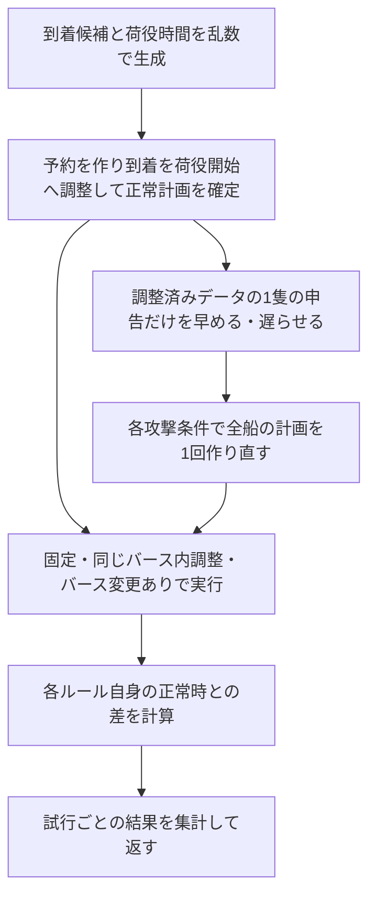

# シミュレーションの実装説明

更新日：2026年11月5日（到着を正常計画の荷役開始へ調整し、正常時の待ち0を基準とする方式へ変更）

計算は[simulation.py](../simulation.py)、実行・保存・表示は[main.py](../main.py)が担当する。第1〜7節は計算、第8〜12節は実行・出力を説明する。実行方法・引数・出力一覧は[README](../README.md)を参照する。

## 1. 全体の流れ

計算にはNumPyとPandasを使う。クラスや最適化ライブラリは使わず、関数と繰り返し処理で構成する。時間の単位はすべて時間である。



`simulation.py`は計算結果の表を返す。ファイル保存・画面表示・コマンド引数の読み取りは[main.py](../main.py)が担当する。計算ファイルを直接実行しても実験は始まらない。

## 2. generate_ship_data()：到着候補と荷役時間を作る

```python
generate_ship_data(num_ships=10, num_berths=3, seed=42,
                   mean_interarrival_time=2.37, duration_hours=None)
```

### 到着時刻

調整前の到着候補の間隔を指数分布から作る。`mean_interarrival_time`はその平均であり、平均2.37時間は実測に基づかない暫定値である。

- `duration_hours`が指定されている場合：到着間隔を順に足し、到着時刻が期間終了より小さい船を生成する。168時間なら、対象は週内に到着候補を持つ船となる。後の調整で実到着が期間外となっても対象から外さない。隻数は試行ごとに変わる。
- `duration_hours=None`の場合：指定隻数を生成する。到着間隔を累積し、最初の値を引いてV1を時刻0にする従来の計算を保つ。

期間指定では、V1も最初に生成した到着間隔の後に到着する。固定隻数では従来どおりV1を時刻0に置く。どちらも全バースが空の状態から始める。週単位の初期条件は仮設定であり、研究で採用する扱いは相談して決める。

同じ設定・seed・ライブラリ環境なら同じ元データを作れる。ただし、期間指定と固定隻数では乱数を使う順番が異なり、同じseedでも同じ船の荷役時間になるとは限らない。

### 荷役時間

船ごとに基準時間を1つ、ガンマ分布から生成する。shape=2、scale=2.4なので、基準時間の平均は4.8時間となる。

```text
バース別荷役時間 = 船ごとの基準荷役時間 × バース係数
```

係数は2バース以上なら0.9〜1.1の等間隔、1バースなら1.0とする。3バースでは0.9・1.0・1.1を船ごとに並べ替える。配置と荷役時間は、同じ試行の全条件・全ルールで固定する。noiseは加えない。

距離に基づく1.0・1.1・1.2などの係数は、荷物の位置を決めた後に実装する。現在の係数を距離係数とは説明しない。

生成した1行は1隻で、船番号、到着候補を仮置きした`actual_arrival_time`・`reported_arrival_time`、基準荷役時間、各バースの係数・荷役時間を持つ。`generate_ship_data()`だけでは到着調整をしない。実験では次の関数で正常計画を確定する。

### create_normal_plan()：待ち0の正常計画を確定する

1. 到着候補を使って`create_plan()`を1回呼び、重複しないバース・順番・荷役開始・完了の予約を作る。
2. 入力をコピーし、調整前の候補を`candidate_arrival_time`に残す。
3. 船番号で予約開始を対応づけ、`actual_arrival_time`と正常な`reported_arrival_time`を予約開始にする。
4. `arrival_adjustment_time = 実到着 − 到着候補`を記録する。バース別荷役時間は変更しない。
5. 正常計画のバース・順番・開始・完了を保持し、計画表の到着情報だけ調整後にそろえる。調整済み元データと正常計画を返す。

例えば候補が0・2・3時間、1バースで荷役が各3時間なら、予約開始と調整後の実到着は0・3・6時間、到着調整時間は0・1・3時間になる。正常時の荷役は0〜3、3〜6、6〜9時間となり、全船の待ちは0である。

この調整は、実験開始前に到着予定とバース利用予定が調整済みという研究上の仮定を表す。航行速度・燃料・調整上限を計算しない。候補からの追加時間は消えたわけではなく、港での待ち時間とは別に記録する。調整後の実到着間隔は、候補の指数分布とは異なる。攻撃後には実到着を再調整しない。

## 3. apply_attack()：申告だけを書き換える

```python
apply_attack(data, target_ship, shift_hours)
```

元データをコピーし、対象船の申告時刻だけを「実到着＋変更幅」にする。変更幅が負なら早い申告、正なら遅い申告で、0未満は0に丸める。実到着、荷役時間、他船の情報は変更しない。

例えば実到着10時間の船なら、−4時間で申告6、＋4時間で申告14になる。実到着2時間なら−4時間の申告は0となり、実際に変更できた幅は−2時間になる。

対象船の存在は`run_experiment()`で確認する。週内にV5が存在しない試行を作り直して選別せず、設定エラーとして知らせる。実験プログラムの対象はV5固定である。

## 4. create_plan()：全船の計画を作る

```python
create_plan(data)
```

申告到着時刻の早い順に船を並べる。同じ申告時刻なら入力の行順を維持する。生成データの行順はV1、V2、…なので、同時刻では船番号順になる。

各船について、各バースの候補を計算する。

```text
計画開始 = max(申告到着時刻, そのバースが計画上空く時刻)
計画完了 = 計画開始 + その船・バースの荷役時間
```

開始が最も早いバースを選び、同じなら完了が早いバース、さらに同じなら番号が小さいバースを選ぶ。Pythonの`min()`で、`(開始, 完了, 番号, 荷役時間)`のタプルを比較する。

計画には全船の順番`assignment_order`、船番号、到着情報、バース、荷役時間、計画開始・完了を記録する。実到着時刻は記録用であり、この段階の判断に使わない。

正常条件は`create_normal_plan()`で確定した予約をそのまま使う。攻撃条件では、改ざん後の申告が正常申告と異なる場合に限り、全船の計画を運用前に1回作り直す。変更幅0や0への丸めで申告が変わらない場合は、同じ正常予約を使う。各条件の計画を全ルールが共有する。正常計画と攻撃計画は`plans.csv`で比較できる。

## 5. 計画を実行する2つの関数

### execute_fixed_plan()：固定計画

計画のバース・バース内の順番を維持し、以下で開始する。

```text
実開始 = max(計画開始, 実到着, そのバースが実際に空く時刻)
実完了 = 実開始 + 荷役時間
```

未到着船を飛ばさず、到着済みの船も計画開始より早く荷役しない。従来の`assign_berths(data)`は、`create_plan()`とこの関数を呼ぶ形で残している。

### execute_adjusted_plan()：到着状況で調整

```python
execute_adjusted_plan(data, plan, policy="reassign")
```

`pending`はまだ荷役を始めていない船、`actual_available`は各バースが空く時刻、`current_time`は現在の時計を表す。

1. 計画順で待ち船を確認し、実到着が現在時刻以下の船だけを候補にする。
2. その船が使える空きバースを調べる。
3. 荷役時間が最も短いバースで開始し、同じなら番号が小さいバースを選ぶ。
4. 開始した船を待ち船から外し、バースの空く時刻を更新する。
5. 待ち船が残る場合は、次の到着または荷役完了へ時計を進め、繰り返す。

`same_berth`では、その船の計画バースだけを使う。`reassign`では、すべての空きバースを使える。いずれも未到着船を飛ばし、計画開始より早い開始を許す。先の船が使えるバースを持たない場合も、後の船が別の空きバースを使えるか確認する。

同時刻の到着と完了はまとめて扱う。その時刻に到着済みの全待ち船を、計画順で確認する。荷役中の船は移動・中断しない。船ごとに1回だけ開始し、実到着前に開始せず、同じバースで重複しない。

正常計画は到着候補順に、最も早い開始、次に最も短い荷役、最後にバース番号で予約を決めている。到着をその開始に合わせると、各到着時点の空きバースに対する現行の選択が元の予約と一致する。そのため正常条件だけを特別扱いせず、3ルールで実行しても予約が保たれ、待ち0となる。バース変更ルールそのものは変更していない。

次の到着時刻は時計を進めるために使うが、バース選択には未到着船の未来の情報を使わない。別バースへ変更した場合は、その船・変更先バースに対応する荷役時間を使う。

### 小さな例

1バースで、V1は到着0・荷役1、V2は到着2・荷役1、V3は到着5・荷役2とする。正常時の待ち時間は全船0である。

V3を4時間早く申告すると、計画順はV1→V3→V2となる。

| ルール | V2の実開始 | V2の待ち時間 | 理由 |
| --- | ---: | ---: | --- |
| 固定計画 | 7 | 5 | V3の到着と荷役完了を待つ |
| 到着状況で調整 | 2 | 0 | V3が未到着なので、到着済みのV2を先に処理する |

## 6. 待ち時間・評価・集計

```text
待ち時間 = 実開始 − 実到着
在港時間 = 実完了 − 実到着
```

`calculate_metrics()`は全船の総・平均・最大待ち時間、総・平均在港時間、全船の完了時刻、対象船の待ち時間、対象船以外の平均待ち時間の8指標を返す。在港時間は荷役完了までで、出港までの時間を含めない。

`summarize_results()`はルールごと・条件ごとに試行平均と標本標準偏差を計算する。週内の隻数が違っても、まず各試行の船平均を求め、その値を試行間で平均する。すべての船をまとめた平均とは異なる。

```text
攻撃影響 = そのルールの攻撃時の値 − 同じルール・同じ試行の正常値
軽減量 = 固定計画の攻撃影響 − 調整ルールの攻撃影響
```

船別の差は船番号、試行別の差は試行番号で対応づける。±1e-9時間以内の差は変化なしとする。1試行の標本標準偏差は未定義で、CSVでは空欄になる。

`paired_comparison.csv`の`mean_mitigation_vs_fixed`は攻撃影響の平均軽減量で、正なら軽減を表す。固定計画自身は0、固定計画を含めずに実行した場合は比較できないため空欄とする。正常値が0でも計算できる時間差を用い、0を分母にした増加率は計算しない。

## 7. run_experiment()と返す表

`run_experiment()`は、試行ごとにseedを1増やし、到着候補・荷役時間を1回生成し、`create_normal_plan()`で正常計画を確定する。そこから申告だけを変更し、条件別の計画を指定ルールで実行する。正常時の待ちが1e-9時間を超えた場合は設定エラーと同様に`ValueError`で停止し、試行の再生成や待ち時間の書換えはしない。各ルールの正常結果を先に保存し、攻撃結果との比較に使う。

関数を省略引数で呼ぶ場合は固定隻数・固定計画になるが、正常計画は新方式で到着調整する。旧結果と同じ数値を再現する互換モードは設けない。`main.py`は期間168時間・10試行・3ルールを明示して呼ぶ。関数の`policies`では比較ルール、`duration_hours`では対象期間、`mean_interarrival_time`では平均到着間隔を指定できる。

入力は試行数1以上、固定隻数2以上、バース数1以上、seed0以上、有限で正の期間・到着間隔、有限で0以上の改ざん幅、重複のない既知のルールとする。生成後に対象船の存在も確認する。個々の関数に外部の不正な表を渡す場合の全項目検証は提供していない。

| 戻り値 | 内容 |
| --- | --- |
| `ship_data` | 試行ごとの到着候補、調整後の実到着・正常申告、調整時間、荷役時間・係数 |
| `plans` | 正常・各攻撃条件の運用前の全船の計画。ルール間で共通 |
| `schedules` | 条件・ルール別の実行結果、計画バース`planned_berth`、実行バース`assigned_berth`、正常時との差 |
| `run_metrics` | 条件・ルール別の8指標、隻数`num_ships`、待ち時間が出た隻数`waiting_ships` |
| `summary` | 条件・ルール別の平均・標本標準偏差 |
| `paired_comparison` | 同じルールの正常時との差と、固定計画に比べた平均軽減量 |

期間内に到着候補を持つ全船の荷役完了まで計算する。調整後の実到着・申告が168時間を超えた船や、週末時点で荷役中の船も除外しない。到着の調整は正常計画を定義する段階で行い、実行後の待ちを0に置き換えない。

到着候補間隔・バース数の根拠、距離係数、対象位置の比較は[今後の計画](今後の計画.md)に残る課題である。

## 8. 実行・出力処理の流れ

`main.py`は計算結果をCSV・JSON・PNGとして保存し、概要をターミナルへ表示する。

```text
main()：引数を読む
    ↓
run_experiment()：元データ・計画・実行・評価・集計の6表を返す
    ↓
--no-saveでなければ、CSV6個とconfig.jsonを保存
    ↓
保存する場合かつグラフ有効なら、save_plot()でPNGを保存
    ↓
ルール別の平均、正常時の待ち時間の有無、攻撃影響と軽減量を表示
```

追加のクラスや外部サービスは使わず、`main()`と`save_plot()`で構成する。

## 9. 引数を計算へ渡す

`argparse`で型・選択肢を読み取り、`run_experiment()`へ名前付き引数で渡す。

- 通常は期間168時間、10試行、3バース、3ルールで比較する。
- `--ships`を指定した場合は固定隻数とし、期間指定を使わない。`--ships`と`--duration`の同時指定は拒否する。
- `--policy all`では3ルール、個別名ではそのルールだけを計算する。
- 対象はV5固定。対象を変更するコマンド引数は設けない。
- `--interval`は調整前の到着候補の指数分布の平均を渡す。初期値2.37時間は暫定値であり、調整後の実到着間隔の平均ではない。

不正な実験条件で生じる`ValueError`は`parser.error()`で表示する。期間内に対象船が生成されない場合も、試行を選び直さずエラーにする。

## 10. CSVと設定JSONの保存

`--no-save`がなければ保存先を作り、戻り値の辞書のキーをファイル名として各表を保存する。CSVは`index=False`で行索引を省略し、`encoding="utf-8-sig"`でExcelでも読みやすい形式にする。表示用の丸めはCSVに適用しない。

新しい初期保存先は`results_coordinated/`とし、以前の試行用の`results_new/`や、保存済みの固定計画100試行の`results/`と区別する。同じ保存先の同名ファイルは上書きするため、条件を変える実験では`--output`を変える。

`config.json`には次を記録する。

- モデル識別子`coordinated_arrivals_v1`、正常予約開始への到着調整、調整上限なし、全ルールの正常時0を必須とすること。
- 試行数、バース数、固定隻数または到着候補の生成期間、実際の試行別隻数。
- 試行別の到着調整時間合計、最終実到着時刻、期間末以降に実到着する隻数。
- 最初・最後のseed、対象船V5、改ざん幅、平均到着間隔。
- 荷役分布、係数の組、船ごとの並べ替え方式、noiseなしの計算方式。
- 比較ルール、正常予約を保持し申告が変わった条件だけ運用前に1回更新すること、バース変更時の選択規則。
- 全バース空きという初期状態、最初の到着の扱い、同時イベントをまとめる規則。
- 期間終了後も対象船の荷役を完了すること、時間の単位。
- NumPy・Pandasのバージョン。

期間指定では固定隻数`num_ships`は`null`となり、`ships_per_trial`で実際の隻数を確認できる。`berth_factors`は並べ替え前の係数の組であり、B1などの固定倍率ではない。船ごとの配置は`ship_data.csv`を参照する。

`plans.csv`は条件ごとの初期計画を保存し、ルールで重複させない。`schedules.csv`以降の表は`policy`でルールを区別する。

`--no-save`の場合は、保存先作成、CSV・JSON・PNG保存、既存PNG削除をすべて省略する。

## 11. save_plot()：ルールも比較するグラフ

Matplotlibを関数内で読み込み、`Agg`を使って画面を開かずにPNGを作る。

左は全船、右は対象船以外の平均待ち時間を示す。横軸は正常・早い申告・遅い申告で、それぞれにルール別の棒を並べる。色と凡例が運用ルールを表す。値は各試行の船平均を試行間で平均した値であり、標準偏差や信頼区間の線は付けない。

図中は英語表記とし、タイトルに対象船・変更幅・試行数を含める。小数点以下3桁の値を付け、`waiting_time_comparison.png`として180dpiで保存する。

保存する際は古い同名PNGを削除し、新しいCSVとの混在を避ける。`--no-plot`なら新しいPNGは作らない。Matplotlib自体が未導入の場合は案内を表示し、CSV・JSONを利用できる状態で終える。

## 12. ターミナル表示と実行の入口

対象期間、実際の隻数の範囲、バース数、対象船、改ざん幅を表示する。各ルールについて次を表示する。

- 正常・各攻撃条件の平均待ち時間、平均在港時間、対象船の待ち時間、他船の平均待ち時間。
- 正常時に待ち時間が出た試行数。
- 同じルールの正常時からの平均待ち時間の差と、悪化・改善・変化なしの回数。
- 固定計画を同時に比較した場合は、対象船以外への攻撃影響の平均軽減量。

軽減量は「固定計画の正常時からの増加量−調整ルールの正常時からの増加量」であり、攻撃時の値だけを直接引くものではない。正常時の待ち0は計算内で必須とし、表示と船別CSVでも確認できる。到着候補から後ろへ調整した時間の全船平均・最大、期間末以降の到着隻数も表示する。この平均は全試行の全船に対する平均で、評価指標の試行平均とは集計方法が異なる。

`if __name__ == "__main__": main()`によって、直接実行した場合だけ実験を始める。別ファイルから読み込んだだけでは実験や保存を開始しない。
