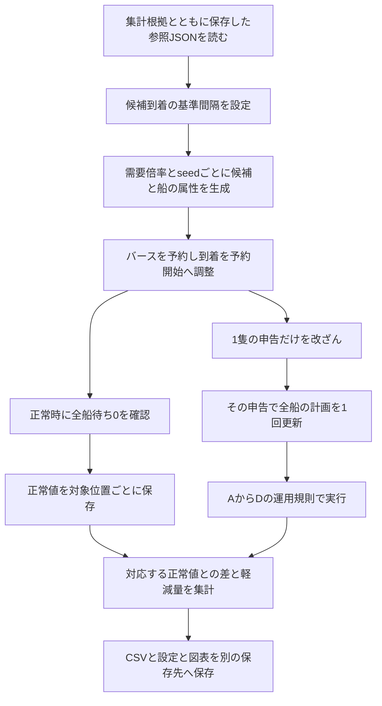

# 計算と実験の実装説明

更新日：2026年11月9日。計算は[simulation.py](../simulation.py)、実行の流れは[main.py](../main.py)、コマンド引数は[cli.py](../cli.py)、設定・表の保存と概要表示は[result_output.py](../result_output.py)、描画は[plotting.py](../plotting.py)に置く。神戸港の平均間隔は[保存済み参照記録](../data/kobe_reference_20261105/README.md)から読む。クラス・最適化ソルバーは使わず、NumPyとPandas、関数と繰返しで構成する。

## 1. 全体の流れ



## 2. 到着候補と船の属性

候補の平均間隔は参照値を需要倍率で割る。主実験の参照値は13日103件の翌日予定から算出した3.029126…時間である。候補の指数分布は仮定で、実到着分布の当てはめではない。

`generate_ship_data()`では、指数乱数の間隔を足し、168未満の候補を持つ船を生成する。固定隻数の確認用では最初の候補を0とする。期間指定ではV1も最初の間隔の後に到着する。全バースは初め空いている。

船の属性は別の乱数生成器`seed+100000`で、船ごとに基準荷役時間、荷物の最寄りバースの順に作る。このため同じseed・同じバース数なら、需要水準で隻数が異なっても先頭から対応する船の属性は同じとなる。ただし対象集合全体が同一になるわけではない。

```text
基準荷役時間 h_i ~ Gamma(shape=2, scale=2.4)
最寄りバース q_i ∈ {1,2,3,4}（一様乱数）
係数 f_ib = 1 + 0.1 × |b − q_i|
荷役時間 h_ib = h_i × f_ib
```

係数は船ごとに異なるが、同じ試行の比較では固定する。noiseや荷役の予測誤差は加えない。距離は番号の差という簡略化であり、岸壁長や実測のメートルではない。

## 3. 予約と正常時の到着調整

`create_plan()`は申告時刻を安定ソートし、各船について以下を計算する。

```text
計画開始 s_i = max(申告時刻 r_i, バースbの計画利用可能時刻)
計画完了 e_i = s_i + h_ib
```

候補`(開始, 完了, バース番号, 荷役時間)`が最小のバースを選ぶ。これはFCFSを基本とした逐次的規則で、全体最適化ではない。実到着時刻は表に残すが計画の判断には使わない。

`create_normal_plan()`は到着候補でこの予約を作り、船番号で予約開始を対応づけ、実到着・正常申告をその開始にする。予約の割当・順番・開始・完了は保持する。

```text
candidate_arrival_time = 調整前の候補
actual_arrival_time = 正常予約の開始
reported_arrival_time = 正常時は実到着と同じ
arrival_adjustment_time = 実到着 − 候補
```

例えば1バース、候補0・2・3、荷役各3なら、実到着0・3・6、調整時間0・1・3、正常時の待ちは0となる。候補からの追加時間を消したり、待ちを計算後に0に置き換えたりしない。調整上限・速度・燃料は扱わない。

## 4. 改ざんと計画更新

`apply_attack()`は入力をコピーし、対象船の申告だけを`max(0, 実到着±幅)`にする。実到着、基準荷役時間、荷物位置、係数、他船の情報は動かさない。

全船の申告を使って条件別に1回計画を更新する。幅0や丸めで申告が正常値と同じなら、保存済みの正常予約を使う。更新後の計画を全方式が共有する。正常計画を攻撃条件の運用者が参照して修復する機能はない。

## 5. 4方式の実行

Aは`execute_fixed_plan()`で、計画バースと順番を維持する。

```text
実開始 t_i = max(計画開始 s_i, 実到着 a_i, バースの実利用可能時刻)
```

B・C・Dは`execute_adjusted_plan()`を共有し、Bだけ計画バースに限定する。C・Dは空きバース中で荷役時間が最短、同じなら小さい番号を選ぶ。

```text
B・Cの開始可能時刻 u_i = max(a_i, s_i − L)
Dの開始可能時刻 u_i = a_i
主実験のL = 2時間、補足実験のCはL = 0時間
```

`s_i`はその条件の更新後計画の開始である。実到着・開始可能という条件を満たす待ち船を計画順で確認する。船を入れたら、選んだバースが空く時刻を`現在時刻+変更先の荷役時間`へ更新する。未到着や開始不可の船を飛ばし、別の船が使えるバースも確認する。

時計は、未処理船の将来の開始可能時刻と、実行中の将来の完了時刻のうち最も早い値へ進める。開始制限が解除される時刻に到着・完了がなくても処理する。未来の実到着を時計に使うことと、運用者が未到着船を先読みしてバースを選ぶことは区別する。

### 手計算で確認する例

1バース、調整済み実到着0・3・6、荷役各3、V3を4時間早く申告する。更新後の順番はV1→V3→V2、計画開始は0・3・6になる。

| 方式 | V2の実開始・待ち | V3の実開始・待ち |
| --- | --- | --- |
| A | 9・6 | 6・0 |
| B/C、上限2時間 | 4・1 | 7・1 |
| D、制限なし | 3・0 | 6・0 |

B/CでV2が開始可能になる4時には到着・完了がない。この時刻をイベントに含めないと結果が変わるため、自動テストで確認する。

正常計画の作成と実行の選択が対応しているため、全方式で正常予約と待ち0が保たれる。Dは実到着がすべて異なる今回の入力では正常運用を再現する。これは最適性の証明や一般の港での完全な影響除去を意味しない。

## 6. 実験の組合せと正常値の共有

`run_experiment(full_study=True)`は、需要倍率0.75・1・1.5ごとにseed42〜51で正常計画を1回作る。到着順10・50・90%の順位を端数切上げで選び、±2・4・8時間を比較する。実到着が同じなら元の入力順を保つ。

同じ正常データを全条件に使い、各条件の計画を方式間で共有する。主実験では正常実行は需要・seed・方式ごとに1回で、幅・対象の変更ごとには実行し直さない。正常の船別実行は`target_position=baseline`として保存し、対象別の指標はその同じ実行から算出する。

補足実験は中盤・±4時間のC・上限0時間を計算する。主実験の2時間・Dと同じ正常データを使う。異なる正常入力は30組、正常実行150ケース、攻撃実行2,220ケースである。需要水準間でもseedと船の属性を共有するため、30個の相互に独立した標本ではない。正常指標390行は対象ごとの参照値を含み、正常入力390組を意味しない。

## 7. 評価と集計

```text
待ち w_i = t_i − a_i
在港 v_i = c_i − a_i = w_i + h_ib
他船平均待ち = 対象船を除くw_iの合計 / (隻数−1)
攻撃影響 = 攻撃時の値 − 同方式・需要・試行・対象位置の正常値
軽減量 = Aの攻撃影響 − 各方式の攻撃影響
```

他船の待ち隻数・最大待ち、対象船の待ち、総・平均・最大待ち、総・平均在港、全船完了、バース変更隻数の11指標を保存する。バース変更は各条件の更新後計画と実行を比較する。

正常値は改ざん幅ごとには重複させない。`summarize_results()`でキー（実験区分、需要、試行、対象位置、方式）を使い、攻撃行へ正常値を対応づける。各セル10試行の平均・標本標準偏差、差の平均・標準偏差・最小・最大と増減回数を返す。単なる全船一括平均ではなく、各試行の指標を同じ重みで平均する。

補足実験にはAを再計算しないので、補足の`mean_mitigation_vs_fixed`は空欄になる。上限0/2/無制限の比較は、同じ需要・試行・対象・幅・方向で直接対応づける。

## 8. 保存と確認

`main.py`は通常実行・主実験とも`data/kobe_reference_20261105/kobe_reference.json`を読み、保存済みの正確な平均間隔`3.029126213592233`時間を計算へ渡す。参照場所とコピー対象3ファイルは`result_output.py`の`REFERENCE_DIR`・`REFERENCE_FILES`で定義する。CSVの取得・再集計やExcel読み取りはしない。参照JSONがなければ停止し、仮定値へ切り替えない。数値は直前の再集計方式と同じで、主実験の条件も維持する。

通常実行も主実験も、計算結果7表、参照記録3ファイル、設定JSONを保存する。参照記録は保存済みのJSON・CSVをそのままコピーし、原本を再集計しない。図は通常実行で1図、主実験で5図のPNG・PDFを保存し、`--no-plot`で省略できる。出力先が非空なら停止し、既存結果を書き換えない。通常実行では1週間分・V5・±4時間・4方式を計算する。

引数の定義は`cli.create_parser()`、読み取りと保存先のチェックは`cli.parse_args()`に置く。バース数・候補生成期間・改ざん幅・前倒し上限・比較方式は`simulation.py`の`NUM_BERTHS`・`DURATION_HOURS`・`SHIFT_HOURS`・`STUDY_SHIFT_HOURS`・`EARLY_START_LIMIT`・`POLICIES`で定義する。固定隻数や手動の平均間隔、参照場所・取得日上限もシミュレーションのCLIからは指定しない。`main.py`と設定JSONの作成は同じ実験条件を参照する。計算関数の引数は、手計算例や自動テストで小さい条件を指定できるように残す。

参照JSONの読み込みや計算から返されたエラーの表示には同じparserを使う。`main.py`にはこれらを呼び出す順序を残し、出力は役割ごとに次の関数へ渡す。

- `result_output.create_config()`：実行条件、コード5ファイルと参照記録3ファイルのハッシュをまとめる。
- `result_output.save_results()`：計算結果7表のCSVと設定JSONを保存し、参照記録3ファイルをコピーする。
- `result_output.print_summary()`：実行件数と指標の概要を画面表示する。
- `plotting.plot_results()`：条件別比較、前倒し上限比較、説明用スケジュールの3つの描画関数を呼ぶ。描画モジュールは図を保存するときだけ読み込む。

設定にはモデル版、基準間隔の由来、分布・係数式・乱数順、seed、対象位置、幅、方式、前倒し上限、期間末の扱い、コードSHA-256と資料URLを残す。参照記録のSHA-256は`reference_sha256`に記録し、参照記録自体には原本13件のSHA-256と元行を残す。

2026年11月9日にローカルの収集・同期・Excel作成・集計コードを削除した。作成済みExcelと既存結果は保管し、参照原本13件はZIPにまとめた。11月5日の保存結果は当時のコード3ファイルのハッシュを保持しているため、その独立検算にはZIPから原本を復元し、実験時のコード版を使う（[README](../README.md)参照）。

グラフ01〜03は指定したセルの10試行平均、上側だけ標本標準偏差1個分のひげを描く。横軸が数値の場合は実際の数値間隔で配置する。図04は同じ条件の前倒し0/2/無制限。図05は基準需要・中盤・早い申告4時間という事前指定セル内でAの他船待ちが最大の例であり、平均を代表する例とはしない。

13件の自動テストと、保存CSVからの独立検算を実施した。検算スクリプトは結果フォルダに保存し、全船保持、時間制約、荷役時間の対応、申告のみの改ざん、計画共有、全11指標、平均・標準偏差・対応差を再計算する。これらは研究仮定の現実性を証明するテストではない。

実行方法は[README](../README.md)、具体的な結果と解釈は[主実験レポート](予備比較レポート.md)を参照する。
