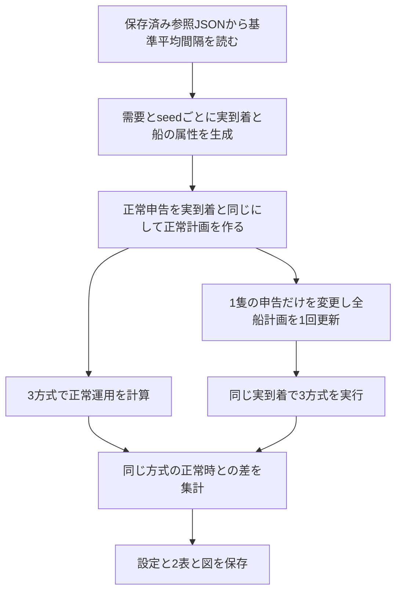

# 計算と実験の実装説明

更新日：2026年11月11日。実到着を計画に合わせない1隻版、モデル版`discrete_4berth_fixed_arrivals_v4`。前提は[要件定義書](要件定義書.md)、実行コマンドと保存一覧は[README](../README.md)、実験の数値と考察は[比較レポート](予備比較レポート.md)を参照する。

## 1. 全体の流れと関数の分担

[main.py](../main.py)は引数確認、保存済み参照JSONの読み込み、計算、保存・描画・表示の順に処理する。計算は[simulation.py](../simulation.py)、引数は[cli.py](../cli.py)、記録・表示は[result_output.py](../result_output.py)、描画は[plotting.py](../plotting.py)に分ける。クラスや最適化ソルバーは使わない。



| 関数 | 役割 |
| --- | --- |
| `run_experiment()` | 条件を確認し、需要・試行ごとに入力・正常計画・比較を準備して集計する |
| `generate_ship_data()` | 実到着と正常申告、基準荷役時間、最寄りバース、バース別荷役時間を作る |
| `create_plan()` | 申告だけを基に、全船のバース・順番・開始と完了の計画を作る |
| `select_targets()` | 結果を見ず、実到着順の10・50・90%の1隻を選ぶ |
| `run_comparison_cases()` | 正常運用を共有し、各対象・幅・方向の比較を行う |
| `run_normal_cases()` / `run_attack_case()` | 正常の3方式／1改ざん条件の3方式を実行し、評価値を作る |
| `execute_policy()` | 固定と調整方式の呼び分け |
| `summarize_results()` | 対応する正常値を結び、平均・ばらつき・増減回数を集計する |

計算関数に保存や画面表示は含めない。`simulation.py`の直接実行でも実験は始めない。

## 2. 実到着と船の属性

平均到着間隔は、保存済み参照値3.029126…時間÷需要倍率とする。参考予定件数を基に規模を置くための値であり、実到着分布を推定した値ではない。根拠と原本は[参照記録](../data/kobe_reference_20261105/README.md)に置く。

`generate_ship_data()`は指数分布の間隔を順に足し、168時間未満に実到着する船を生成する。V1も最初の間隔の後に到着する。確認用の固定隻数指定では先頭を0とする。生成後の実到着は正常計画・改ざん・運用によって変更しない。

```text
実到着 a_i = 指数乱数の到着間隔の累計
正常申告 r_i = a_i
基準荷役時間 h_i ~ Gamma(shape=2, scale=2.4)、平均4.8時間
最寄りバース q_i ∈ {1,2,3,4}（一様乱数）
バース別荷役時間 h_ib = h_i × (1 + 0.1 × |b − q_i|)
```

船の属性は別の乱数生成器`seed+100000`で、船ごとに基準時間、最寄りバースの順に作る。同じseed・バース数なら需要水準が違っても先頭から対応する船の属性は同じになる。隻数や対象船まで同一になる意味ではない。係数1.0〜1.3、分布形、平均4.8時間は仮定であり、実測からの推定ではない。

## 3. 計画作成と正常時の待ち

`create_plan()`は申告時刻で安定ソートする。同時なら入力順を保つ。各船について各バースの候補を計算し、開始時刻、完了時刻、バース番号の順に最小の候補を選ぶ。

```text
計画開始 s_i = max(申告時刻 r_i, バースbの計画利用可能時刻)
計画完了 e_i = s_i + h_ib
```

割り当てたバースの計画利用可能時刻を完了時刻へ更新する。実到着は結果表へ引き継ぐが、計画判断には使わない。正常も改ざんも同じ計画関数を使う。

例えば1バース、実到着0・2・3時間、荷役各3時間なら、正常計画の開始は0・3・6時間。実到着は0・2・3のままなので、正常時の待ちは0・1・3時間になる。待ちを事後に置換したり、待ちが出た試行を除外したりしない。

`calculate_plan_diagnostics()`は設定の記録に使う最後の実到着と正常計画の最終完了を返す。168時間後の新規到着は生成しないが、期間内に来た船は完了が168時間を越えても全船処理する。

## 4. 1隻の申告改ざんと計画更新

`apply_attack()`は元データをコピーし、対象船だけの申告を`max(0, 実到着±指定幅)`にする。実到着、荷役時間、他船の申告は変えない。早い申告で0に丸められた場合、指定幅と実際の変更量は異なる。

申告が変われば全船計画を運用前に1回作り直し、3方式で共有する。改ざん幅0などで申告が変わらなければ正常計画をそのまま使う。運用中の繰り返し計画更新は行わない。船側は嘘の更新情報に従って到着を変更しない。

主実験の対象は実到着順の`ceil(隻数×0.1/0.5/0.9)`番目で、条件ごとに1隻である。序盤・中盤・終盤の3隻を同時に改ざんする意味ではない。

## 5. 3方式の実行

| 方式 | 計算 |
| --- | --- |
| A 固定 | 計画バース内の順番を維持し、`max(計画開始, 実到着, 同じバースの前船完了)`で開始 |
| B 同じバース内調整 | 到着済み船をその条件の計画順で確認し、計画バースが空いていれば開始 |
| C バース変更 | 同じ計画順で確認し、空きバースの中からその船の荷役時間が最短のものを選ぶ。同時間なら番号順 |

固定は`execute_fixed_plan()`、調整2方式は`execute_adjusted_plan()`を使う。調整では到着と完了のイベントへ時刻を進め、未到着船を飛ばす。B・Cは全船に適用し、計画開始より何時間でも前倒しできる。実到着順のFIFOへ切り替える方式ではない。

空きの選択は`select_available_berth()`、開始・完了・待ちなど1隻分の時間計算は`create_execution_result()`へ分ける。実到着前には始めず、荷役を重複させない。開始後の中断・移動はしない。先に入れた船が荷役中なら後続船が待つことがあり、Cでも他バースが空いていなければ待つ。

正常時は正常計画、攻撃時は更新後計画を使う。正常計画や未来の実到着を、攻撃下のバース選択や優先順位の判断に渡さない。シミュレーターが時刻を次の到着へ進める処理と、運用規則が未来を先読みする処理は区別する。

## 6. 評価と正常時の対応付け

`calculate_metrics()`で全船の総待ち・平均待ち・最大待ち、総在港・平均在港、全船完了時刻、対象船の待ち、他船の平均待ち・待つ隻数・最大待ち、計画からのバース変更隻数の11指標を求める。待ちは実到着から開始まで、在港は実到着から完了までとする。

```text
待ち = 実際の開始 − 実到着
在港 = 実際の完了 − 実到着 = 待ち + 実行バースでの荷役時間
改ざん影響 Δ = 改ざん時の指標 − 同じ入力・方式の正常時の指標
固定に対する軽減量 = AのΔ − 調整方式のΔ
```

`run_attack_case()`は各方式の運用から試行別の指標を計算する。`summarize_results()`では需要・試行・対象位置・方式をキーに、各改ざん幅・方向の値と正常値を結ぶ。各セル100試行の改ざん平均と標本標準偏差、正常平均、対応差の平均・標準偏差・最小・最大・増減回数、固定からの軽減量を`summary`へまとめる。

負の差は改善としてそのまま残す。±1e-9以内だけを変化なしと数える。正常値が0の場合の増加率は出さない。主指標は他船の平均待ちの差とし、対象船・全船の指標も確認する。全体平均は各ケースを同じ重みで平均し、全船をまとめた重み付き平均とは区別する。

## 7. 正常運用の共有と保存・描画

需要3水準×100seedの300入力から、正常は3方式で900運用、改ざんは3対象位置×3幅×2方向×3方式で16,200運用を計算する。正常は対象位置・幅ごとに実行し直さない。他船を定義する対象位置ごとの正常指標は記録するので、`run_metrics`には正常参照2,700行と攻撃16,200行がある。正常参照の重複を独立した試行と数えない。

`create_config()`は新モデル版、実到着調整なし、seed、条件、正常待ちの概要、コードと参照記録のハッシュを記録する。正常待ちの全船概要では、需要・試行・方式で正常参照の重複を除く。`save_results()`は設定と試行別・集計の2表だけを保存する。計画は各条件の運用を計算するときに使う。返す表は船別入力・運用・試行別指標・集計・正常計画の診断の5表とし、独立した計画表や集計と重複する対応比較表は保持しない。正常差は集計表の列へまとめ、詳細CSVやソースのコピーは保存しない。

`plot_comparisons()`は幅・需要・対象位置について他船待ちの正常差を描く。点は平均、上側のひげは対応差の標本標準偏差1個分で、信頼区間ではない。負の差も表示する。`plot_waiting_overview()`は正常・改ざん時の全船平均待ちと他船の増減を並べる。

`select_schedule_example()`は事前指定した基準需要・中盤・早い申告4時間のセル内で、Aの他船待ちの正常差が最大の試行を説明用に選ぶ。`plot_schedule_example()`は各方式の正常／改ざんを6段で表示する。選択は集計後の説明用であり、試行の除外や平均的な例という主張には使わない。図の保存は`save_figure()`へまとめる。
