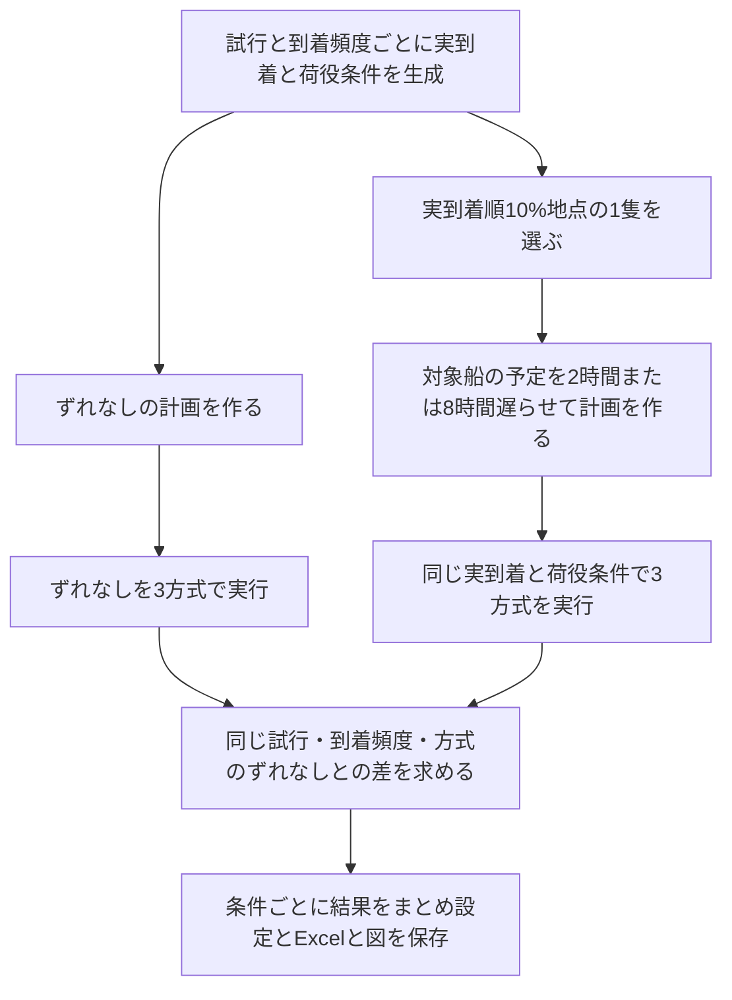

# 到着予定と実際のずれを比較する実装説明

更新日：2026年11月25日。モデル版`discrete_4berth_one_ship_late_v9`。[要件](要件定義書.md)、[実行・出力一覧](../README.md)、[数値と考察](予備比較レポート.md)を参照する。

内部の識別子 `normal` と `attack` は予定ずれの有無を表す。2時間と8時間は `shift_hours` で区別する。改ざんはずれの一要因であり、原因別の過程は計算しない。

## 1. 処理の流れ

`main.py`は引数確認、実験計算、保存、描画、表示の順に処理する。`simulation.py`の計算には保存・CLI・表示を混ぜない。クラスや最適化ソルバーは使わない。



## 2. 入力生成と計画

`generate_ship_data()`は指数乱数を累計して168時間未満の実到着を作る。平均間隔は `main.py` に記載した3.186時間を到着頻度倍率で割った値。固定値の横に根拠資料のパスを記載している。確認用の固定隻数の場合のみ先頭を0とする。ずれなしの予定情報は実到着と同じにし、計画開始へ到着を合わせない。

船の属性はseed+100000で、各船について基準荷役時間、最寄りバースの順に作る。基準はGamma(2,2.4)、バース別は基準×(1+0.1×最寄りとの番号差)。4バースの係数は1.0〜1.3。これらは実測に当てはめた値ではなく、比較のための仮定である。

`create_plan()`は申告時刻で安定ソートし、各船を順に割り当てる。同時刻なら入力行順を保つ。各バースで次を求め、開始時刻、完了時刻、番号の順に小さい候補を選ぶ。

```text
計画開始 = max(申告時刻, そのバースの計画利用可能時刻)
計画完了 = 計画開始 + そのバースの荷役時間
```

実到着は表へ引き継ぐが計画の判断には使わない。ずれなし待ちを0へ置換せず、待つ試行も待たない試行も保持する。

## 3. 対象1隻の選び方

`select_target_ship()` は実到着順に並べ、隻数×0.10を切り上げた順位の船を選ぶ。同着の順は入力順。たとえば63隻なら7隻目を選ぶ。`apply_attack()` は予定到着を変えたコピーを作る。実験では対象1隻に2時間または8時間を加える。

`run_comparison_cases()` はずれなし、2時間、8時間の計画をそれぞれ1回作り、各計画を3方式で実行する。同じ試行・到着頻度の実到着、荷役条件、対象船を共有する。差の計算には同じ方式のずれなしの実行を使う。

## 4. 運用

表1 実行処理

| 関数・方式 | 処理 |
| --- | --- |
| `execute_fixed_plan()` | 計画バース内順番を守り、max(計画開始, 実到着, 同じバースの前船完了)で開始 |
| `execute_adjusted_plan()`・同じバース内調整 | 到着済みを計画順で確認し、計画バースが空いていれば開始 |
| 同関数・バース変更 | 同じ計画順で確認し、空きバースのうち荷役時間最短を選ぶ。同時間なら番号順 |

`execute_policy()`が呼び分ける。調整方式は到着・完了のイベントへ進み、同時刻の到着と完了をまとめて扱う。未到着船を飛ばし、前倒しの時間上限を設けない。選択は`select_available_berth()`、1隻の開始・完了・待ち・在港の計算は`create_execution_result()`へ分ける。

実到着前開始・同一バースの重複・開始後の中断や移動を認めない。期間後に完了する船も全船処理する。ずれなしの計画や未来の実到着で予定ずれあり条件での開始を判断せず、実到着順FIFOへ切り替えない。固定の待ちには計画開始までの待ちも含まれる。

## 5. 評価と集計

`calculate_metrics()`は総待ち・最大待ち、総在港・平均在港、最終荷役完了、計画からのバース変更隻数、ずれなしより待ちが増えた隻数の7指標を返す。実験では対象船の待ちを加えた8指標を集計する。

待ち＝開始−実到着、在港＝完了−実到着である。総待ち時間は各船の待ち時間の合計である。船別の悪化判定には同じIDのずれなし待ちを使い、1e-9時間を超える増加を数える。ずれなし運用を引数で渡すのは評価時だけで、バース選択には使わない。

`summarize_results()`は試行・到着頻度・方式でずれなしの値を対応付ける。予定ずれ値の平均・標本標準偏差、ずれなし平均、対応差の平均・標準偏差・最小・最大、増加・減少・不変の試行数を方式ごとに求める。負の差も保持し、±1e-9以内は変化なしとする。1試行の標準偏差は空欄。

既定の各条件1試行では、集計にその試行の値を載せる。複数試行を指定した場合は、試行ごとの値を等重みで平均する。総待ち時間の差が小さくても船ごとの増減が相殺している場合があるため、最大待ちと悪化隻数も読む。

### 待ち理由と開始枠の競合

`calculate_waiting_reasons()`は、実到着・実開始・完了・計画開始の各時刻で期間を区切り、荷役開始前の船ごとに4種類の状態を集計する。優先順は、全バース使用中、指定バース使用中だが別バースは空き、計画順番待ち、計画開始待ち。先行船の完了は計画バース内の割当順で対応付ける。船ごとの4区分を全船分合計して保存する。4区分の合計は全船の総待ち時間に一致する。複数条件が重なるときは先の区分に数えるため、因果的な寄与率とは解釈しない。詳しい条件は[要件の表3](要件定義書.md#5-評価)を参照する。

`count_start_competitions()`はバース変更について、実到着と荷役完了の各時刻を1回ずつ調べる。同時刻に新たに始める船を入れる前に空き数を求め、到着済みで未開始の候補隻数が空き数を上回り、かつ空きが1つ以上あると競合1回とする。各候補船には参加1回を加える。全体の競合回数と船別参加回数は異なる単位である。固定と同じバース内調整の競合欄は未計測のため空欄にする。

両関数は運用後の結果を読むだけで、開始時刻・バース・優先順位・乱数に影響しない。試行別結果に4区分の船平均と競合回数を加え、船別明細は`waiting_details`で返す。各運用の予定到着と対象船IDも明細に持たせる。

## 6. 保持と保存

`run_experiment()` は試行・到着頻度ごとに船を生成し、ずれなし・2時間・8時間の各3方式を計算する。図2・3向けに到着頻度1倍・8時間の実行を保持する。複数試行を指定すると、固定方式の全船の総待ち時間の増分が最大の試行を使う。同値なら先の試行。`keep_schedules=True` は全運用を保持する検証用API。

返すのは船別入力、図用の運用、試行別指標、集計、ずれなし計画の診断、全運用の待ち明細の6表。既定の計27運用は保持するスケジュールの範囲にかかわらず計算する。計画のバース使用割合は168時間内の荷役時間を4×168で割る。

`create_config()` は到着頻度、対象船の選び方、遅れ幅、乱数規則を記録する。設定JSONに、平均到着間隔の根拠資料へのパスも保存する。Excelの条件別集計は上段に全船の総待ち時間18行、下段に8指標×18条件の詳細を置く。試行別結果と待ち理由は倍率・幅・方式で絞り込める。船別データは試行・倍率・船につき1行を保存する。

`excel_number_format()`は数値を丸めず、整数は小数なし、小数は有効数字3桁以内で不要な末尾0を省く。絶対値1e-12未満の残差は0表示。保存値自体は精度を保ち、Excelの編集だけで再シミュレーションは行わない。

## 7. 図

`save_figure()`は図番号・タイトル・条件を下へ配置しPNGで保存する。パネル見出しは上に置く。

`plot_waiting_comparison()` は到着頻度ごとに2時間・8時間での全船の総待ち時間の対応差を描く。`queue_profile()` は到着で+1、開始で−1とし、同時刻をまとめる。図2は説明用試行での3方式の待ち船数、図3は対象船の実到着前後の荷役区間で、両条件に同じ対象船を青で示す。
