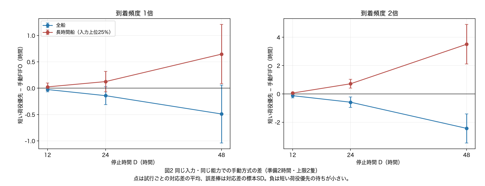
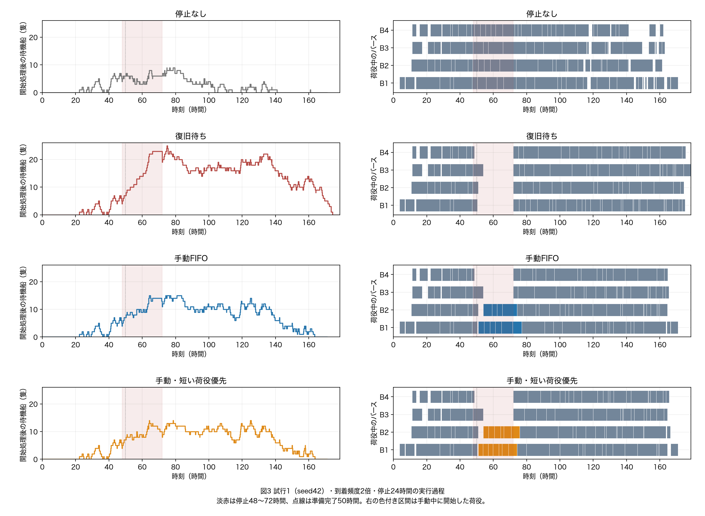
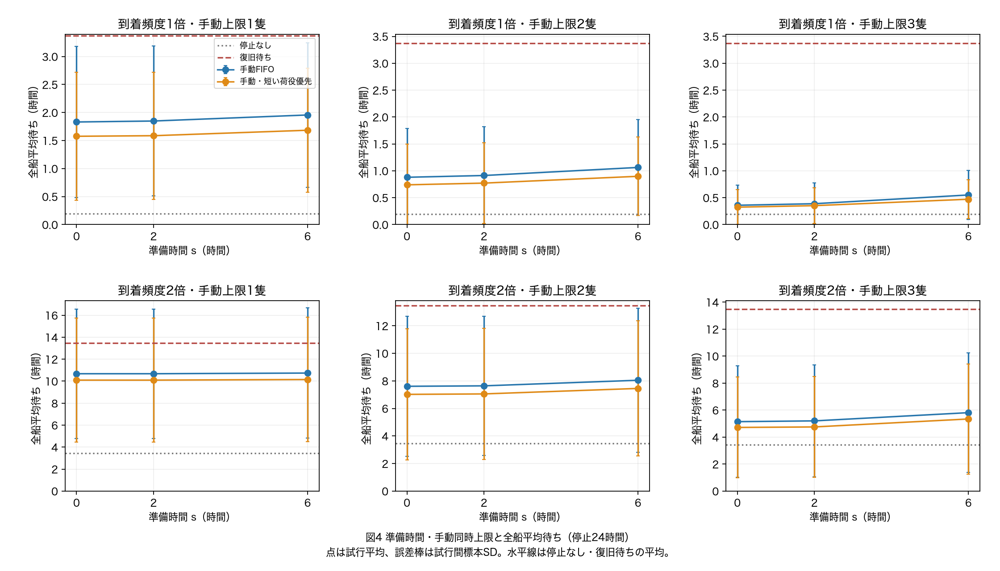
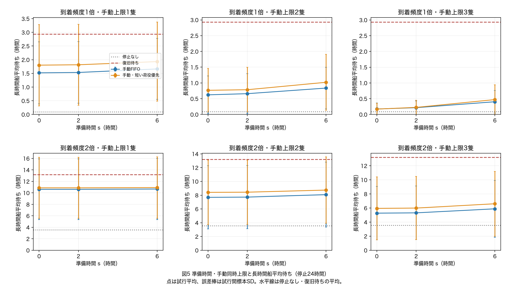
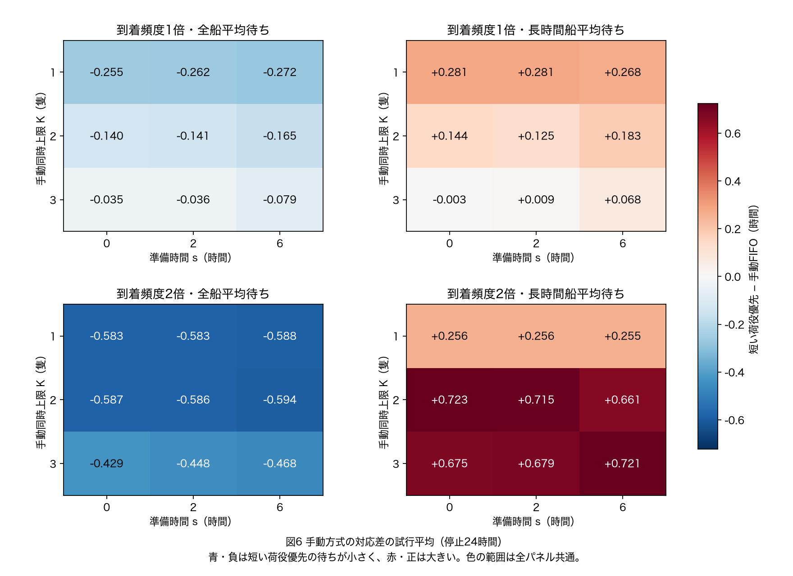

# TOS停止時の手動運用：実験結果と考察

> **旧結果の注意**：この文書と `results/` は補助実験の旧9組で生成した結果です。現在の `simulation.py` は基準条件から一つずつ変更する5組に統一されています。再実行と再集計が終わるまで、この文書を現行の5組の実験結果として引用しないでください。

主実験・補助実験を各10試行で実施した。中心となる結果は、**短い荷役優先で全船平均待ちが小さくなる一方、長時間船の待ちと最大待ちが大きくなる条件がある**こと。例えば到着頻度2倍・24時間停止では、手動FIFO比で全船平均待ちが0.586時間小さく、長時間船平均待ちは0.715時間大きい。

以下は仮想入力での結果であり、実港での効果や統計的有意差は示さない。生データは [実験結果Excel](../results/実験結果.xlsx)、条件・コードのハッシュは [実験条件JSON](../results/実験条件.json)。計算規則は [モデル仕様](モデル仕様.md)に対応する。

## 1. 実験条件と件数

4バース、停止開始48時間、船の生成期間168時間。期間内の全船を完了まで処理した。通常・復旧後は4バースの到着順FIFO、停止中は復旧待ち又は準備後の限定的な手動継続とした。荷役は全バース共通のGamma(2,2.4)、平均4.8時間。手動で開始済みの荷役を中断しない。

神戸港の保存済み翌日予定件数から、基準平均間隔3.029126213592233時間を使用した。基準約7.92隻/日、2倍約15.85隻/日は生成の参考規模で、実績値ではない。実際に生成した1週間の船数は、基準で平均61.1隻（51〜70隻）、2倍で平均118.2隻（104〜139隻）だった。

表1 比較の構成

| 項目 | 主実験 | 補助実験 |
| --- | --- | --- |
| 停止時間D | 6・12・24・48時間 | 24時間 |
| 準備時間s | 2時間 | 0・2・6時間 |
| 手動同時上限K | 2隻 | 1・2・3隻 |
| 到着頻度 | 基準・2倍 | 同じ |
| 試行 | seed42〜51の10入力 | 同じ |
| 使用運用数 | 260 | 400 |

共通80運用を再利用し、実際の計算は580運用・58条件。580個の独立標本ではなく、各条件10試行である。Excelは条件別58行、試行別580行、共有入力1,793行、船別実行51,997行、試行1の判断イベント10,704行を保存した。各条件内では同じ試行の到着・荷役・長時間船区分を共有する。

数値は各試行の指標を等重みで平均し、小数3桁で示す。SDは10試行間の標本標準偏差。最大待ちは「各試行の最大待ちの平均」で、全試行を通じた最大ではない。長時間船は入力荷役の上位25％（端数切上げ）で固定する。

## 2. 主実験：停止が長いほどどう変わるか

停止なしの全船平均待ちは、基準で0.191時間（SD0.171）、2倍で3.445時間（SD3.040）だった。停止なしでも待ちは発生する。

表2 全船平均待ちの10試行平均（時間、s=2・K=2）

| 到着頻度 | 停止D | 停止なし | 復旧待ち | 手動FIFO | 短い荷役優先 |
| --- | --- | --- | --- | --- | --- |
| 基準 | 6 | 0.191 | 0.355 | 0.282 | 0.282 |
| 基準 | 12 | 0.191 | 0.814 | 0.437 | 0.412 |
| 基準 | 24 | 0.191 | 3.370 | 0.913 | 0.771 |
| 基準 | 48 | 0.191 | 13.107 | 2.102 | 1.613 |
| 2倍 | 6 | 3.445 | 4.209 | 4.006 | 3.981 |
| 2倍 | 12 | 3.445 | 6.363 | 5.010 | 4.885 |
| 2倍 | 24 | 3.445 | 13.481 | 7.639 | 7.053 |
| 2倍 | 48 | 3.445 | 30.949 | 14.291 | 11.858 |

同じFIFOの順序を用いる復旧待ちと手動FIFOを比較すると、24時間停止・2倍頻度では平均待ちが13.481から7.639時間へ5.841時間小さくなった。ここは限定的な手動継続の便益として読める。その上で選船順を変える差が7.639から7.053時間への0.586時間であり、二つを混同しない。

図1 停止時間と全船平均待ち。誤差棒は試行間SD。

## 3. 主実験：平均改善と長時間船の負担

表3 短い荷役優先−手動FIFOの対応差（時間、平均±標本SD）

| 頻度 | D | 全船平均待ちの差 | 長時間船平均待ちの差 | FIFOより悪化した船の平均隻数 | 全船平均の減少／不変／増加試行 |
| --- | --- | --- | --- | --- | --- |
| 基準 | 6 | 0.000±0.000 | 0.000±0.000 | 0.1 | 0／10／0 |
| 基準 | 12 | −0.025±0.046 | ＋0.025±0.073 | 1.3 | 3／7／0 |
| 基準 | 24 | −0.141±0.172 | ＋0.125±0.195 | 3.1 | 8／2／0 |
| 基準 | 48 | −0.489±0.548 | ＋0.647±0.562 | 5.4 | 8／1／1 |
| 2倍 | 6 | −0.026±0.045 | ＋0.001±0.024 | 13.8 | 6／4／0 |
| 2倍 | 12 | −0.125±0.158 | ＋0.059±0.061 | 22.7 | 9／0／1 |
| 2倍 | 24 | −0.586±0.372 | ＋0.715±0.314 | 30.2 | 10／0／0 |
| 2倍 | 48 | −2.433±1.026 | ＋3.505±1.395 | 35.5 | 10／0／0 |

負なら短時間優先の待ちが小さく、正なら大きい。悪化隻数は全週の船が対象で、微小な悪化も含む。平均差が0でも個々の船の増減が相殺される場合があり、全船の待ちが同じとは限らない。

2倍・24時間停止では、全船平均待ちは10試行とも減少したが、長時間船の平均待ちも10試行とも増加した。長時間船の水準は7.720から8.435時間へ増え、試行最大待ちの平均も20.232から23.468時間へ増えた。

48時間停止・2倍では、全船平均は14.291から11.858時間へ小さくなる一方、長時間船平均は13.909から17.414時間へ増えた。試行最大待ちの平均は31.957から45.013時間となった。全船平均だけを見て「短時間優先が優れている」と結論付けると、この負担を見落とす。

基準・6時間停止では全船平均差は全10試行で不変だった。基準・48時間停止、2倍・12時間停止では各1試行で短時間優先の全船平均が増加した。短時間優先の優位を保証するモデルではない。

図2 全船と長時間船の対応差。誤差棒は同じ入力で計算した対応差のSD。

## 4. 停止中到着群と手動稼働

停止中に到着した船を入力時刻で同じ群に固定した。24時間停止・2倍頻度の群平均待ちは、復旧待ち23.550、手動FIFO13.722、短時間優先9.205時間。全週平均とは異なり、停止中到着群への影響に絞った値である。

群の全船開始までの復旧後時間は、それぞれ21.374、13.140、12.346時間だった。これはその群が開始し終わるまでの時間であり、全船完了・港全体の回復・システム復旧時間ではない。

同条件の手動中の新規開始は平均9.1隻から13.3隻へ増え、手動時間帯の延べバース稼働は44.730から44.698隻・時間でほぼ同じだった。短い船を先に終えることで、ほぼ同じ荷役稼働時間内の開始隻数が増えたと読める。ただし船ごとの確認作業量は計算しておらず、人手の節約を意味しない。

図3 試行1・2倍頻度・停止24時間の経過。差の大きい試行を選んだ図ではない。待機船数の縦軸範囲は4方式で共通。

## 5. 補助実験：準備時間・手動能力への依存

停止を24時間に固定し、準備0・2・6時間と上限1・2・3隻を比較した。表の差は短時間優先−手動FIFO。全て10試行平均、時間単位。

表4 基準頻度の補助実験

| s | K | FIFO全船待ち | 短時間優先全船待ち | 全船平均の差 | 長時間船平均の差 |
| --- | --- | --- | --- | --- | --- |
| 0 | 1 | 1.832 | 1.576 | −0.255 | ＋0.281 |
| 0 | 2 | 0.880 | 0.740 | −0.140 | ＋0.144 |
| 0 | 3 | 0.359 | 0.324 | −0.035 | −0.003 |
| 2 | 1 | 1.849 | 1.586 | −0.262 | ＋0.281 |
| 2 | 2 | 0.913 | 0.771 | −0.141 | ＋0.125 |
| 2 | 3 | 0.388 | 0.352 | −0.036 | ＋0.009 |
| 6 | 1 | 1.956 | 1.684 | −0.272 | ＋0.268 |
| 6 | 2 | 1.063 | 0.898 | −0.165 | ＋0.183 |
| 6 | 3 | 0.551 | 0.472 | −0.079 | ＋0.068 |

表5 2倍頻度の補助実験

| s | K | FIFO全船待ち | 短時間優先全船待ち | 全船平均の差 | 長時間船平均の差 |
| --- | --- | --- | --- | --- | --- |
| 0 | 1 | 10.678 | 10.096 | −0.583 | ＋0.256 |
| 0 | 2 | 7.607 | 7.020 | −0.587 | ＋0.723 |
| 0 | 3 | 5.144 | 4.714 | −0.429 | ＋0.675 |
| 2 | 1 | 10.678 | 10.096 | −0.583 | ＋0.256 |
| 2 | 2 | 7.639 | 7.053 | −0.586 | ＋0.715 |
| 2 | 3 | 5.201 | 4.752 | −0.448 | ＋0.679 |
| 6 | 1 | 10.740 | 10.152 | −0.588 | ＋0.255 |
| 6 | 2 | 8.045 | 7.451 | −0.594 | ＋0.661 |
| 6 | 3 | 5.810 | 5.342 | −0.468 | ＋0.721 |

今回調べた範囲では、平均の順序変更効果よりも、同時能力を増やす効果が大きい例がある。2倍頻度・準備2時間では、FIFOのK=2→3で平均待ちが7.639から5.201時間へ2.439時間小さくなった。同じK=2の順序変更による0.586時間より大きい。これは各対策の費用や実現可能性を考慮した優先順位ではない。

準備0→2時間の差は小さく、特に2倍・K=1では両方式とも実行結果が変わらなかった。既に始まっている荷役を続け、荷役中総隻数がK未満になるまで新規開始できない設定のため、準備が早く終わっても開始できない時間がある。準備短縮が常に無意味という意味ではない。6時間まで延ばすと多くの条件で待ちが増えた。

全18組の補助条件で全船平均差は負だったが、長時間船平均差は基準・s=0,K=3のみ僅かに負で、それ以外は正だった。能力に余裕のある基準・K=3では全船平均の方式差が0.035〜0.079時間と小さい。平均改善と負担の関係は能力・頻度に依存する。

図4 準備時間・能力別の全船平均待ち。水平線は停止なし・復旧待ち。

図5 同じ条件での長時間船平均待ち。

図6 準備時間・能力別の対応差。全船平均と長時間船を同じ色の範囲で示す。

## 6. 卒論で明らかにできることと残る課題

今回のモデルでは、限られた手動能力を短い船に配分すると、特に到着頻度が高く停止が長い条件で全船平均待ちが小さくなる一方、長時間船と最大待ちへの負担が増すことを示せる。「手動で続ければよい」に加えて、**同じ能力をどの船へ配分するかで、平均と負担の分布が変わる**ことが研究の中心になる。

補助実験からは、順序の変更と能力の確保を区別する必要性、準備短縮が開始済み荷役の制約で直ちに効かない場合も示せる。条件比較としての示唆であり、実港への一律の手順提案や必要人員の算定ではない。

公的資料は手動継続とその限界を支えるが、準備2時間・K=2の実測根拠ではない。到着・荷役分布、正確な荷役見積り、全バース同質、復旧後の照合遅延なしは仮定である。停止開始の違い、見積り誤差、長待ち船の救済、切替の人員・費用は今回比較していない。新規アルゴリズムや既存研究に対する最適性は主張しない。

## 7. 検証

19件の自動テスト、2試行の一時出力確認、10試行の全580運用の保存値監査を実施した。51,997行の船別実行について、入力一致・全船保持・到着前開始なし・バース重複なし・停止中の開始制限・手動上限・待ち指標・同じ船の対応差を照合した。

設定内のコード・参照JSONのハッシュは現行ファイルと一致する。神戸港の参照JSON・CSV・原本ZIP・保管用Excel等6ファイルのSHA-256は作業前と一致し、参照値の更新・再集計・同期は行っていない。図6点は日本語表示・配置を確認した。
