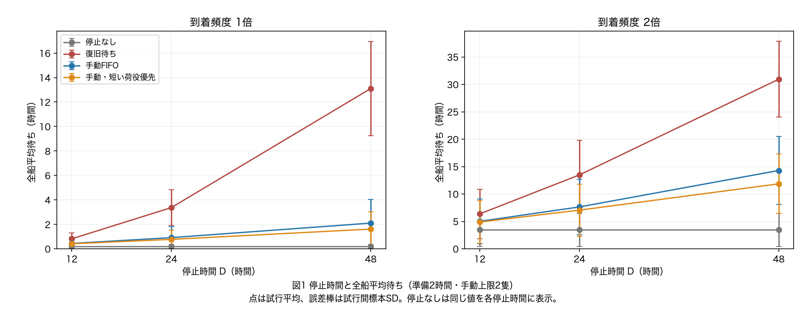

# TOS停止時の手動運用：実験結果と考察

手動同時上限2隻・準備2時間に固定し、10試行で実施した。中心となる結果は、**短い荷役優先で全船平均待ちが小さくなる一方、長時間船の待ちと最大待ちが大きくなる条件がある**こと。例えば到着頻度2倍・24時間停止では、手動FIFO比で全船平均待ちが0.586時間小さく、長時間船平均待ちは0.715時間大きい。

以下は仮想入力での結果であり、実港での効果や統計的有意差は示さない。生データは [実験結果Excel](../results/実験結果.xlsx)、条件・コードのハッシュは [実験条件JSON](../results/実験条件.json)。計算規則は [モデル仕様](モデル仕様.md)に対応する。

## 1. 実験条件と件数

4バース、停止開始48時間、船の生成期間168時間。期間内の全船を完了まで処理した。通常・復旧後は4バースの到着順FIFO、停止中は復旧待ち又は準備後の限定的な手動継続とした。荷役は全バース共通のGamma(2,2.4)、平均4.8時間。手動で開始済みの荷役を中断しない。

神戸港の保存済み翌日予定件数から、基準平均間隔3.029126213592233時間を使用した。基準約7.92隻/日、2倍約15.85隻/日は生成の参考規模で、実績値ではない。実際に生成した1週間の船数は、基準で平均61.1隻（51〜70隻）、2倍で平均118.2隻（104〜139隻）だった。

表1 比較の構成

| 項目 | 設定 |
| --- | --- |
| 停止時間D | 12・24・48時間 |
| 準備時間s | 2時間固定 |
| 手動同時上限K | 2隻固定 |
| 到着頻度 | 基準・2倍 |
| 試行 | seed42〜51の10入力 |
| 運用数 | 200 |

停止なしは試行・頻度ごとに1回だけ計算し、全体で20条件・200運用。200個の独立標本ではなく、各条件10試行である。Excelには条件別20行、試行別200行、共有入力1,793行、船別実行17,930行と、試行1の判断イベントを保存した。各条件内では同じ試行の到着・荷役・長時間船区分を共有する。

数値は各試行の指標を等重みで平均し、小数3桁で示す。SDは10試行間の標本標準偏差。最大待ちは「各試行の最大待ちの平均」で、全試行を通じた最大ではない。長時間船は入力荷役の上位25％（端数切上げ）で固定する。

## 2. 主実験：停止が長いほどどう変わるか

停止なしの全船平均待ちは、基準で0.191時間（SD0.171）、2倍で3.445時間（SD3.040）だった。停止なしでも待ちは発生する。

表2 全船平均待ちの10試行平均（時間、s=2・K=2）

| 到着頻度 | 停止D | 停止なし | 復旧待ち | 手動FIFO | 短い荷役優先 |
| --- | --- | --- | --- | --- | --- |
| 基準 | 12 | 0.191 | 0.814 | 0.437 | 0.412 |
| 基準 | 24 | 0.191 | 3.370 | 0.913 | 0.771 |
| 基準 | 48 | 0.191 | 13.107 | 2.102 | 1.613 |
| 2倍 | 12 | 3.445 | 6.363 | 5.010 | 4.885 |
| 2倍 | 24 | 3.445 | 13.481 | 7.639 | 7.053 |
| 2倍 | 48 | 3.445 | 30.949 | 14.291 | 11.858 |

同じFIFOの順序を用いる復旧待ちと手動FIFOを比較すると、24時間停止・2倍頻度では平均待ちが13.481から7.639時間へ5.841時間小さくなった。ここは限定的な手動継続の便益として読める。その上で選船順を変える差が7.639から7.053時間への0.586時間であり、二つを混同しない。

図1 停止時間と全船平均待ち。誤差棒は試行間SD。

## 3. 主実験：平均改善と長時間船の負担

表3 短い荷役優先−手動FIFOの対応差（時間、平均±標本SD）

| 頻度 | D | 全船平均待ちの差 | 長時間船平均待ちの差 | FIFOより悪化した船の平均隻数 | 全船平均の減少／不変／増加試行 |
| --- | --- | --- | --- | --- | --- |
| 基準 | 12 | −0.025±0.046 | ＋0.025±0.073 | 1.3 | 3／7／0 |
| 基準 | 24 | −0.141±0.172 | ＋0.125±0.195 | 3.1 | 8／2／0 |
| 基準 | 48 | −0.489±0.548 | ＋0.647±0.562 | 5.4 | 8／1／1 |
| 2倍 | 12 | −0.125±0.158 | ＋0.059±0.061 | 22.7 | 9／0／1 |
| 2倍 | 24 | −0.586±0.372 | ＋0.715±0.314 | 30.2 | 10／0／0 |
| 2倍 | 48 | −2.433±1.026 | ＋3.505±1.395 | 35.5 | 10／0／0 |

負なら短時間優先の待ちが小さく、正なら大きい。悪化隻数は全週の船が対象で、微小な悪化も含む。平均差が0でも個々の船の増減が相殺される場合があり、全船の待ちが同じとは限らない。

2倍・24時間停止では、全船平均待ちは10試行とも減少したが、長時間船の平均待ちも10試行とも増加した。長時間船の水準は7.720から8.435時間へ増え、試行最大待ちの平均も20.232から23.468時間へ増えた。

48時間停止・2倍では、全船平均は14.291から11.858時間へ小さくなる一方、長時間船平均は13.909から17.414時間へ増えた。試行最大待ちの平均は31.957から45.013時間となった。全船平均だけを見て「短時間優先が優れている」と結論付けると、この負担を見落とす。

基準・48時間停止、2倍・12時間停止では各1試行で短時間優先の全船平均が増加した。短時間優先の優位を保証するモデルではない。

図2 全船と長時間船の対応差。誤差棒は同じ入力で計算した対応差のSD。

## 4. 停止中到着群と手動稼働

停止中に到着した船を入力時刻で同じ群に固定した。24時間停止・2倍頻度の群平均待ちは、復旧待ち23.550、手動FIFO13.722、短時間優先9.205時間。全週平均とは異なり、停止中到着群への影響に絞った値である。

群の全船開始までの復旧後時間は、それぞれ21.374、13.140、12.346時間だった。これはその群が開始し終わるまでの時間であり、全船完了・港全体の回復・システム復旧時間ではない。

同条件の手動中の新規開始は平均9.1隻から13.3隻へ増え、手動時間帯の延べバース稼働は44.730から44.698隻・時間でほぼ同じだった。短い船を先に終えることで、ほぼ同じ荷役稼働時間内の開始隻数が増えたと読める。ただし船ごとの確認作業量は計算しておらず、人手の節約を意味しない。

図3 試行1・2倍頻度・停止24時間の経過。差の大きい試行を選んだ図ではない。待機船数の縦軸範囲は4方式で共通。

## 5. 卒論で明らかにできることと残る課題

今回のモデルでは、限られた手動能力を短い船に配分すると、特に到着頻度が高く停止が長い条件で全船平均待ちが小さくなる一方、長時間船と最大待ちへの負担が増すことを示せる。「手動で続ければよい」に加えて、**同じ能力をどの船へ配分するかで、平均と負担の分布が変わる**ことが研究の中心になる。

結論の対象は12・24・48時間の停止であり、12時間未満の停止への効果は今回評価していない。準備時間と同時上限は固定しているため、それらを変えた場合にも同じ方式差が残るかは検証していない。本結果は準備2時間・上限2隻という仮定の下での比較であり、実港への一律の手順提案や必要人員の算定ではない。

公的資料は手動継続とその限界を支えるが、準備2時間・K=2の実測根拠ではない。到着・荷役分布、正確な荷役見積り、全バース同質、復旧後の照合遅延なしは仮定である。停止開始の違い、見積り誤差、長待ち船の救済、切替の人員・費用は今回比較していない。新規アルゴリズムや既存研究に対する最適性は主張しない。

## 6. 検証

現行の `test_simulation.py` にある19件の自動テストが通ることを確認した。手計算・境界・物理制約・入力共有・固定条件・保存内容を検証する。少数試行を一時ディレクトリで実行し、5シートExcel・設定JSON・3図のPNG/PDFを確認した後、10試行を再生成した。

設定JSONは20条件・200運用で、船別実行行数は10条件×全試行の共有入力1,793隻＝17,930行。変更前の結果から停止なし・12・24・48時間の条件を取り出し、条件IDを除いた5シートの対応する全行について値が一致することを確認した。実装4ファイルと参照JSONのSHA-256も現行ファイルと一致する。図の表示・配置と日本語ラベルを確認した。これは仮定したモデルの計算検証であり、実港での効果の実証ではない。
