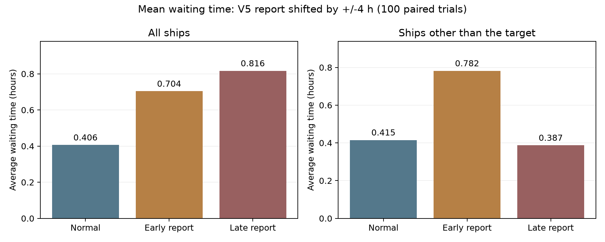

# 過去資料：バース係数を固定した旧実験

現在の結果は[予備比較レポート](../予備比較レポート.md)、当時のCSV・JSON・グラフは[旧結果](../../results_archive/20261006_固定係数/)を参照。

# 9月後半までの実装と予備比較

実験・記録日：2026年10月6日。7月28日のゼミ報告の9月末目標に対応する作業を実施した記録です。

このレポートと `results/` は、バース係数を固定した旧方式の実験記録である。2026年10月7日に採用した船ごとの並べ替え方式の結果ではない。以下の数値は当時の記録として保持する。

## 目的

到着時刻の申告が改ざんされたとき、バース割当と船の待ち時間にどの程度影響が出るかを調べる。
まずは特定船1隻の時刻を早める・遅らせる2種類に絞り、正常時と比較する。

## 方法

船ごとに2-Erlang分布の基準荷役時間を作り、バース係数と±5%の誤差で補正した。
同じ船の基準時間を全バースで共有することで、バース間の荷役時間に相関を持たせた。
今回生成した全100試行・計1,000隻をまとめた荷役時間の相関係数は、バースの組合せにより0.9973〜0.9974だった。
これは生成方式の確認値であり、実際の神戸港で観測した相関ではない。

割当計画は申告到着時刻のFCFSで作成した。
計画後のバースと順番は固定し、実到着が計画より遅ければ開始時刻と後続船を遅らせた。
実到着前の荷役や、同じバースでの同時荷役は認めない。
待ち時間と在港時間は実到着時刻から計算した。

| 条件 | 設定 |
| --- | --- |
| 船数 | 10隻 |
| バース数 | 3 |
| 到着間隔 | 指数分布、平均2.37時間 |
| 基準荷役時間 | 2-Erlang分布、shape=2、scale=2.4、平均4.8時間 |
| バース係数 | B1=0.9、B2=1.0、B3=1.1 |
| 荷役時間の誤差 | 基準時間×バース係数に対して±5%の一様乱数 |
| 攻撃対象 | 各試行のV5 |
| 攻撃内容 | 申告時刻だけを4時間早める、または4時間遅らせる |
| 比較条件 | 正常、早い申告、遅い申告 |
| 試行回数 | 各条件100回。seed 42〜141 |
| データの共有 | 同じ試行内の3条件で実到着時刻と全バースの荷役時間を共有 |

時刻を早めた結果が0未満になる場合は0に丸めた。今回の早い申告では100回中5回が該当した。
その5回の変更幅は4時間より小さく、実変更幅を `schedules.csv` に保存している。

## 結果

表は100試行の平均。括弧内は各試行の値の標本標準偏差。単位は時間。

| 指標 | 正常時 | 早く申告 | 遅く申告 |
| --- | ---: | ---: | ---: |
| 全船の平均待ち時間 | 0.406 (0.642) | 0.704 (0.726) | 0.816 (0.643) |
| 全船の総待ち時間 | 4.061 (6.423) | 7.037 (7.263) | 8.165 (6.428) |
| 全船の最大待ち時間 | 1.765 (2.114) | 3.327 (2.360) | 4.739 (1.612) |
| 全船の平均在港時間 | 5.059 (1.419) | 5.363 (1.465) | 5.476 (1.437) |
| 全船の荷役完了時刻 | 28.382 (6.443) | 28.725 (6.435) | 28.709 (6.524) |
| 対象船の待ち時間 | 0.323 (1.001) | 0.000 (0.000) | 4.680 (1.590) |
| 対象船以外の平均待ち時間 | 0.415 (0.692) | 0.782 (0.807) | 0.387 (0.584) |



グラフの棒は平均値を表す。左が全10隻、右が対象船を除く9隻。
Normalは正常時、Early reportは早い申告、Late reportは遅い申告を示す。

同じ試行の正常時との差（攻撃時 − 正常時）も計算した。

| 指標 | 攻撃 | 平均差 | 差の標本標準偏差 | 悪化／改善／変化なし |
| --- | --- | ---: | ---: | --- |
| 全船の平均待ち時間 | 早い申告 | +0.298 | 0.300 | 79／3／18回 |
| 全船の平均待ち時間 | 遅い申告 | +0.410 | 0.256 | 91／6／3回 |
| 対象船以外の平均待ち時間 | 早い申告 | +0.367 | 0.339 | 81／1／18回 |
| 対象船以外の平均待ち時間 | 遅い申告 | −0.028 | 0.313 | 35／38／27回 |

## 現時点で読み取れること

今回の設定では、どちらの攻撃も全船の平均待ち時間を増やした。
ただしすべての試行で悪化したわけではなく、改善や変化なしの試行もあった。

早い申告では対象船が割当順を先に取る一方、実際にはまだ到着していない場合がある。
その船を待つバースでは、後続船にも遅れが生じる。
今回の対象船の待ち時間は全100試行で0だったが、対象船以外の平均待ち時間は0.415時間から0.782時間に増えた。
「対象船自身の待ち時間」と「港全体への影響」を分けて見る必要がある。

例えば試行1（seed 42）の早い申告では、V6の待ち時間が正常時より2.516時間、V7が2.855時間増えた。
実際に順番やバースがどう変わったかは `schedules.csv` から追跡できる。

遅い申告では、対象船が計画開始まで待つことが主な負担となった。
対象船の平均待ち時間は0.323時間から4.680時間に増えた。
対象船以外の平均待ち時間はわずかに減ったため、全体平均の増加を「全船が一様に遅れた」と解釈することはできない。

在港時間の差は待ち時間の差と必ずしも一致しない。
攻撃で割当バースが変わると、その船の荷役時間も変わるためである。

## 前提と限界

この結果は、仮定したデータ生成と「予約計画を固定して実行する」運用についての予備結果である。
未到着船の代わりに別の船を入れる運用なら、結果が変わる可能性がある。
バースの長さ・水深、船型の制約、クレーン数、潮位、故障などは含めていない。

神戸市の[年報](https://www.city.kobe.lg.jp/a49918/tokei/annualreports.html)で公開統計の項目を確認し、[2024年の速報資料](https://www.city.kobe.lg.jp/documents/58977/2024kousei.pdf)で港全体のコンテナ取扱個数を確認した。
個別船の荷役開始・終了時刻に基づく推定は行っていない。
今回の時間や係数は実測値として扱わず、実際の神戸港で同じ影響が起きると断定しない。

試行によるばらつきも大きい。ここでは平均・標準偏差・対応する試行の差を報告し、統計的な有意差や一般的な攻撃の優劣までは結論づけない。

## 旧方式の再現方法と当時の確認

2026年10月7日に出力処理を別ファイルへ移したため、実行コマンドは `run_experiment.py` に変更した。計算方法と保存済みの実験結果は同じである。

現在のコードで実行すると、新方式の結果になる。旧結果を再現する場合は、係数配置の変更前のコミット `6c8d68a` を別のチェックアウトで使用し、以下を実行する。元の結果を上書きしないよう保存先を分ける。

```bash
python run_experiment.py --output results_fixed
python -m unittest -v
```

結果のCSV5個、設定JSON、グラフは `results/` に保存済み。
テスト10件で、手計算との一致、申告時刻だけの変更、実到着前の荷役の禁止、同一バースの非重複、改ざん幅0で正常時と一致することなどを確認した。

9月末目標の「正常時と攻撃時の予備比較」まで実施した。
10月以降の候補は、改ざん幅・対象船を変えた比較と、実測データが入手できた場合のパラメータの見直しである。
