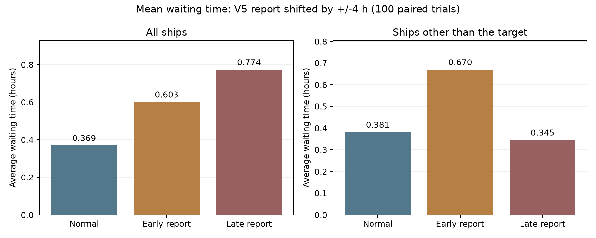

# 船ごとのバース係数を並べ替えた予備比較

実験・更新日：2026年10月7日。計算実装はコミット `d74c8b2` 時点。

当時の実装で100試行を実行し、`results/`を更新した記録である。後にnoiseを除去したため、以下はnoiseありの旧方式の結果であり、noise除去後のコードの結果ではない。数値と保存データは当時のまま保持し、noiseなしの結果は[現在の予備比較レポート](../予備比較レポート.md)を参照。
旧固定係数方式のCSV・設定JSON・グラフは[旧結果の保存先](../../results/archive/20261006_固定係数)、当時のレポートは[過去資料](予備比較レポート_20261006_固定係数.md)に保管した。

## 目的と方法

対象船1隻の申告到着時刻だけを早める・遅らせる場合を、正常時と同じ元データで比較する。
実到着と荷役時間は変更しない。割当は申告時刻のFCFSで事前に決め、バース・順番・計画開始時刻を固定して実行する。再割当は行わない。

| 条件 | 設定 |
| --- | --- |
| 船数・バース数 | 10隻・3バース |
| 到着間隔 | 平均2.37時間の指数分布。最初の到着は0 |
| 基準荷役時間 | 船ごとの2-Erlang分布、shape=2、scale=2.4、平均4.8時間 |
| バース係数 | 0.9・1.0・1.1を船ごとにランダム配置 |
| 荷役時間の誤差 | ±5％の一様乱数 |
| 攻撃対象・幅 | V5の申告を±4時間変更 |
| 試行 | 各条件100回、seed 42〜141。同じ試行の3条件で元データを共有 |

早い申告が0未満になった5試行は0に丸めたため、その試行の実変更幅は4時間未満である。
生成した計1,000隻のバース別荷役時間の相関係数は0.9647〜0.9693だった。実港の観測値ではなく、生成方式の確認値である。

## 結果

100試行の平均（括弧内は標本標準偏差）。単位は時間。

| 指標 | 正常時 | 早く申告 | 遅く申告 |
| --- | ---: | ---: | ---: |
| 全船の平均待ち時間 | 0.369 (0.618) | 0.603 (0.699) | 0.774 (0.598) |
| 全船の総待ち時間 | 3.695 (6.176) | 6.026 (6.986) | 7.740 (5.978) |
| 全船の最大待ち時間 | 1.631 (2.045) | 3.009 (2.386) | 4.673 (1.577) |
| 全船の平均在港時間 | 4.891 (1.393) | 5.139 (1.466) | 5.309 (1.396) |
| 全船の荷役完了時刻 | 28.197 (6.399) | 28.402 (6.392) | 28.537 (6.368) |
| 対象船の待ち時間 | 0.261 (0.840) | 0.000 (0.000) | 4.631 (1.546) |
| 対象船以外の平均待ち時間 | 0.381 (0.667) | 0.670 (0.776) | 0.345 (0.541) |



左は全10隻、右はV5以外の9隻。棒は平均値であり、標準偏差・信頼区間は示していない。左右の縦軸の上限は異なる。

同じ試行の正常時との差（攻撃時 − 正常時）：

| 指標 | 攻撃 | 平均差 | 差の標本標準偏差 | 悪化／改善／変化なし |
| --- | --- | ---: | ---: | --- |
| 全船の平均待ち時間 | 早い申告 | +0.233 | 0.317 | 71／8／21回 |
| 全船の平均待ち時間 | 遅い申告 | +0.405 | 0.236 | 93／4／3回 |
| 対象船以外の平均待ち時間 | 早い申告 | +0.288 | 0.358 | 73／6／21回 |
| 対象船以外の平均待ち時間 | 遅い申告 | -0.036 | 0.303 | 35／33／32回 |

## 読み取れることと限界

今回の設定では、全船の平均待ち時間は早い申告で0.233時間、遅い申告で0.405時間増えた。ただし、改善や変化なしの試行もある。

早い申告ではV5の待ち時間は全試行で0だった一方、他船の平均待ち時間は0.381時間から0.670時間へ増えた。未到着の予約船を待つ運用による他船への影響を確認できる。
遅い申告ではV5の平均待ち時間が4.631時間となり、他船の平均は0.345時間へわずかに減った。全体平均の悪化が、すべての船の悪化を意味するわけではない。

在港時間には待ち時間と荷役時間が含まれる。割当バースが変われば荷役時間も変わるため、在港時間の差と待ち時間の差は必ずしも一致しない。
旧方式との比較では係数配置と乱数生成順の両方が変わるため、数値の差を係数配置だけの効果とは解釈しない。

時間・係数・攻撃幅は仮定値であり、神戸港の個別船の実測から推定したものではない。船長・水深・クレーン・故障などの制約も扱っていない。
実港での被害量、統計的な有意差、一般的な攻撃の優劣は、この実験だけでは断定しない。再割当による軽減は今後の検証対象である。

## 実行と確認

再現にはnoiseありの実装（例：コミット`7bea568`）が必要である。以下はその版で使うコマンドであり、現在のnoiseなしのコードでは同じ数値にならない。現在の作業環境で保存済み結果を上書きするためのコマンドとしては使わない。

```bash
.venv/bin/python main.py --trials 100 --ships 10 --berths 3 --seed 42 --attack-ship V5 --shift 4 --output results_with_noise_reproduction
.venv/bin/python -m unittest -v
```

今回は一時保存先で生成・確認した後、`results/`へコピーした。
CSV5個・設定JSON・グラフを保存し、元データ1,000行、スケジュール3,000行、試行別評価300行を確認した。
自動テスト12件に加え、全300スケジュールの実到着前の開始禁止・同一バースの非重複、係数配置、平均・標準偏差・対応差・悪化／改善回数の再集計を確認した。グラフの表示も確認した。
