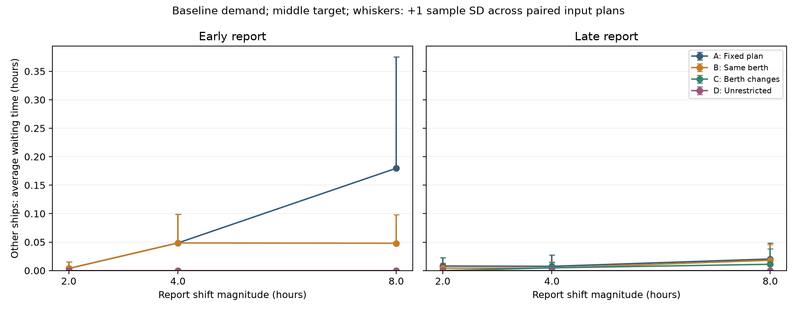
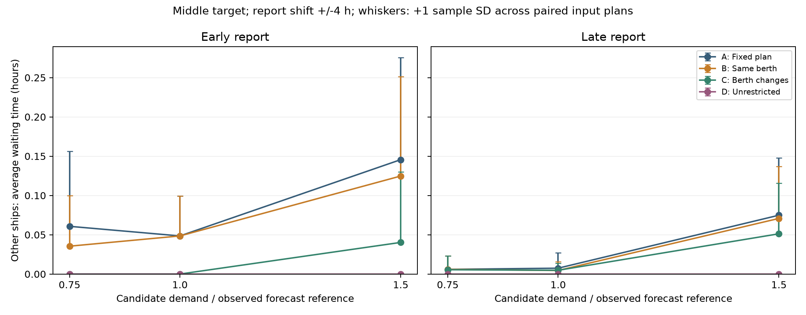
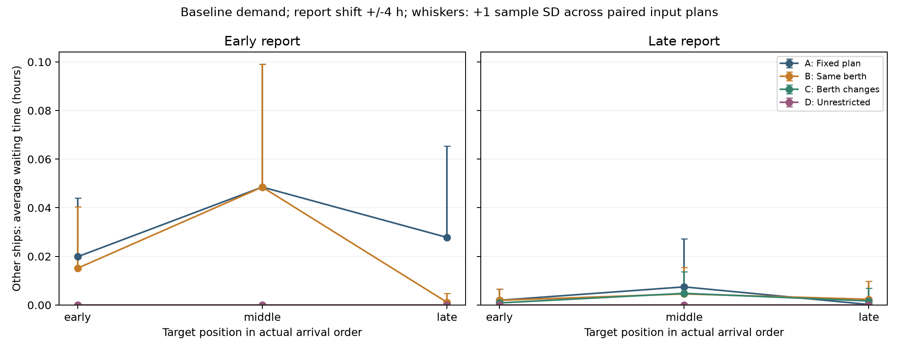
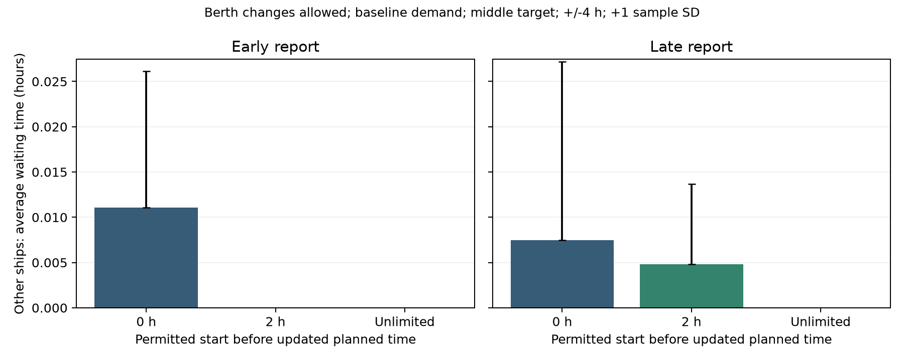
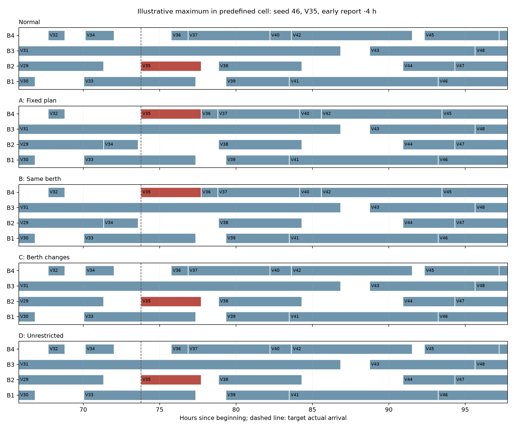

> 過去資料：前倒し制限あり4方式の記録。現在は[3方式のレポート](../予備比較レポート.md)を参照。末尾の確認実験は採用前の記録で、一時結果はユーザー指示により削除した。過去の実行コマンドは当時のコードを前提とする。

# 主実験の結果・考察と執筆用の研究整理

実施日：2026年11月5日。モデル版：`discrete_4berth_bounded_advance_v2`。

**採用した範囲の実装・主実験・補足実験・図表・検算は完了した。** 正常時に全船の待ちが0となる4バースの計画から、1隻の申告時刻だけを変更して比較した。平均ではバース変更を許す方式が他船待ちを軽減したが、局所的な変更で悪化する例もあった。無制限の自由調整で待ち0となる性質は、今回のモデル構造に依存する。

保存場所は[results/final_20261105](../../results/final_20261105/)。旧方式の結果を上書きせず、以前の現行レポートは[正常到着調整v1の記録](予備比較レポート_20261105_正常到着調整v1.md)へ保管した。旧方式の数値と今回の数値を同じ条件として直接比較しない。

## 1. 研究の問いと先行研究に対する位置づけ

題目案：**到着予定情報の改ざんがバース運用に及ぼす影響―計画変更の許容範囲による軽減効果の比較―**。

1. 正常待ち0の計画から、1隻の情報変更がどの条件で他船へ波及するか。
2. 同じバース内の調整と、他バースへの変更で何が変わるか。
3. 計画開始の前倒し制約が、軽減効果にどう影響するか。

関連する5件の一次資料を、今回の範囲との違いで整理する。発想そのものの新規性や、網羅的な文献調査による世界初の確認を主張しない。

| 文献 | 既に扱われていること | 本研究で限定して比較すること |
| --- | --- | --- |
| [Imai・Nishimura・Papadimitriou (2001)](https://doi.org/10.1016/S0191-2615(99)00057-0) | 動的なバース割当問題と解法 | 離散型を採用し、最適解法の開発ではなく簡単な規則の比較に絞る |
| [Umang・Bierlaire・Erera (2017、参照版は2013年技術報告)](https://transp-or.epfl.ch/documents/technicalReports/NitBierEra2013.pdf) | 不確実な到着・荷役時間へのリアルタイム対応。元の開始時刻を守る貪欲法も提示 | 荷役時間を確定させ、1隻の申告だけを変えて影響を分離する。開始制約自体を新規としない |
| [van der Steeg・Oudshoorn・Yorke-Smith (2023、オンライン公開2022)](https://link.springer.com/article/10.1007/s10696-022-09473-8) | 潮汐港のバース計画と運用中の混乱回復のシミュレーション | 潮汐・複雑な最適化を外し、同一入力で計画変更範囲の差を説明する |
| [Mubder (2024)](https://liu.diva-portal.org/smash/get/diva2:1867564/FULLTEXT01.pdf) | JIT到着に向けた予約と港湾資源の調整を論じる事例研究 | 正常時は調整済みと置く。前倒し0・2時間・無制限は本研究の仮定であり、この文献から数値を借りたものではない |
| [Hacks・Pahl (2024)](https://findresearcher.sdu.dk/ws/portalfiles/portal/276248091/cyper_Security.pdf) | ETA・ETDの改ざんを含む港湾のサイバー攻撃シナリオ | 改ざんという発想を新規とせず、正常時との差、他船への波及、運用規則の効果と反例を数値で整理する |

卒論の貢献は、**正常待ち0・1隻の申告だけの変更・同一入力での対応比較により、軽減の平均効果と悪化する機構を説明すること**に置く。新しい最適化アルゴリズムや攻撃検知手法の提案ではない。同じ時刻のずれなら誤報と意図的改ざんで計算結果は同じであり、攻撃意図を識別した研究とも説明しない。

## 2. 神戸港データをどこに使ったか

対象は神戸港全体ではなく、KICTのPC-14・PC-15(E)・PC-16・PC-17を参考にした仮想ターミナルである。4バースは、[商船三井の2026年8月19日発表](https://www.mol.co.jp/info/article/2026/0819.html)と[川崎汽船の同日発表](https://www.kline.co.jp/ja/news/terminal/terminal-20260819.html)にある、9月1日からのPC14〜17の4バース体制を根拠にした。CSVの船席コード数をそのまま物理的なバース数と数えたものではない。

`入港船予定表`の各取得日の最後のCSVを1つ選び、その翌日の上記船席への入港予定だけを集計した。取得日2026年10月23日〜11月4日の13スナップショット、予定日10月24日〜11月5日の**103予定船日**を使用した。

| 翌日予定の対象日 | 10/24 | 10/25 | 10/26 | 10/27 | 10/28 | 10/29 | 10/30 | 10/31 | 11/1 | 11/2 | 11/3 | 11/4 | 11/5 |
| --- | --- | --- | --- | --- | --- | --- | --- | --- | --- | --- | --- | --- | --- |
| 予定船日数 | 4 | 5 | 8 | 7 | 12 | 8 | 14 | 10 | 5 | 5 | 11 | 7 | 7 |

同一選択CSV内の「コールサイン（空欄なら船名）＋予定日」が同じ行は1件とする。履歴Excelの全行を混ぜる方法を避け、日別スナップショットを分けた。ただし、同じ実寄港の予定日変更は別日に現れ得るし、同一船の同日複数寄港はまとめられ得る。このため、103を実績寄港数とは呼ばない。

```text
1日の平均予定件数 = 103 / 13 = 7.9231
候補の基準平均間隔 = 24 × 13 / 103 = 3.029126…時間
168時間の期待候補隻数 = 168 / 3.029126… = 55.4615隻
```

需要倍率を0.75・1・1.5とし、候補の平均間隔を基準値÷倍率にする。間隔は順に4.038835・3.029126・2.019417時間となる。予定件数は候補発生の規模を決める参考に限って使い、実到着の時間帯分布・指数分布への適合・荷役時間・実待ち時間を推定したとは説明しない。10seedで得た基準需要の平均隻数61.1は期待値55.46と一致する必要はなく、結果が近づくようseedを選び直していない。

参照の定義・選択原本名・SHA-256は[kobe_reference.json](../../results/final_20261105/kobe_reference.json)、日別件数は[kobe_daily_forecasts.csv](../../results/final_20261105/kobe_daily_forecasts.csv)、元行との対応は[kobe_reference_rows.csv](../../results/final_20261105/kobe_reference_rows.csv)で追跡できる。原本と既存Excelは変更していない。

## 3. 実験条件

| 項目 | 設定と根拠 |
| --- | --- |
| バース | 離散型4。全船が全バースを利用可能。施設数は公式資料を参考にし、適合制約は省略 |
| 期間 | 168時間未満の到着候補を生成。調整後に期間末を越える船も最後まで処理 |
| 初期・末期 | 開始時は全バース空き。前週からの荷役と翌週の新規到着はない |
| 到着候補 | 指数分布。基準間隔は予定規模を参考にし、分布形は仮定 |
| 基準荷役時間 | Gamma(shape=2, scale=2.4)、平均4.8時間。実測値ではない |
| 荷物位置 | 最寄りバースを1〜4から一様乱数。実距離は扱わない |
| バース係数 | 最寄り1.0、隣1.1、2つ隣1.2、3つ隣1.3。教授の指摘を離散的に表した仮定 |
| 正常計画 | 候補順に最早開始、同時なら最早完了のバースを予約。到着・正常申告を予約開始へ調整 |
| 攻撃 | 実到着順10・50・90%順位の1隻。申告±2・4・8時間、0未満は0に丸める |
| 更新 | 改ざん後、運用前に全船の計画を1回更新。実到着・荷役時間・他船申告は固定 |
| 繰返し | 各セル10試行、seed42〜51。到着と属性は独立した乱数生成器を使用 |
| 前倒し上限 | 主実験2時間、補足0時間、自由調整は無制限。実港の実測値ではない |

運用規則を次の4方式にする。A〜Dは同じ条件の更新後計画を共有する。

| 方式 | 実行規則 |
| --- | --- |
| A 固定 | 更新後の計画バース・順番・開始時刻を守る。未到着船を待つ |
| B 同一バース | 未到着・開始不可の船を飛ばし、同じ計画バースを使う。開始前倒しは最大2時間 |
| C バース変更 | Bと同じ船の選び方で、空きバース中の荷役最短を使う。開始前倒しは最大2時間 |
| D 自由調整 | Cの開始前倒し制限を外す。最適化は行わない |

B・Cの開始可能時刻は、`max(実到着, 更新後計画開始−前倒し上限)`である。時計を到着・制限解除・荷役完了のイベントへ進め、荷役中の移動はしない。未来の実到着はバース選択に使わない。A→Bでは順番と前倒しの両方が変わるため、それぞれ単独の因果効果とは分離しない。B→Cはバース変更の許容、C→Dは開始制約の解除を比較する。

主実験は`3需要×10seed×3対象位置×2方向×3幅×4方式=2,160`攻撃実行。中盤・±4時間・Cについて上限0時間を`3需要×10seed×2方向=60`追加した。正常入力は**30組**、正常運用150回、攻撃2,220回、合計2,370回の運用実行である。需要水準も同じseedを共有しており、30組は異なる入力の数で、30個の相互に独立した標本とは数えない。

主指標は「対象船を除く全船の平均待ち」で、待ち0の他船も分母に含める。待ち隻数・最大待ち・対象船待ち・全船の待ちと在港・最大完了時刻・バース変更隻数を合わせて11指標保存した。バース変更隻数は**その条件の更新後計画からの変更**であり、正常計画からの変更数や移動費用ではない。正常値との差を同じ需要・seed・対象位置・方式で対応させ、0を分母にした増加率は使わない。

各セル10試行の平均と標本標準偏差を保存した。標準偏差はばらつきであり、信頼区間・有意差ではない。同じ正常入力を対象位置や幅を変えて再利用するので、2,220ケースを独立標本として扱わない。

## 4. 正常待ち0と到着調整量

全方式・全正常実行で全船の待ち0を確認した。事後に待ちを0へ書き換える処理、失敗試行の除外、seedの選別は行っていない。到着を予約開始へ合わせることで0を作り、そのための調整を別に保存している。

| 需要倍率 | 隻数平均［最小–最大］ | 平均到着調整(h) | 最大到着調整(h) | 168h以降に到着した隻数※ |
| --- | --- | --- | --- | --- |
| 0.75 | 45.7［36–57］ | 0.072 | 5.767 | 1 |
| 1.0 | 61.1［51–70］ | 0.210 | 6.186 | 0 |
| 1.5 | 90.4［78–99］ | 1.155 | 12.291 | 11 |

※期間外到着は各需要10試行の合計。平均到着調整は各計画内平均を10試行で等重み平均、最大は10試行全船の最大。最大調整12.291時間を許している点は、単に正常待ち0だけを見て隠さない。全船がこの調整を現実の減速航行で実現できるとは検証していない。

候補が168時間内でも調整後に外へ出る船は全体で12隻あった。最大実到着は174.232時間であり、168時間できれいに終わる周期的な港運用を再現したものではない。[plan_diagnostics.csv](../../results/final_20261105/plan_diagnostics.csv)に計画ごとの値を残した。

## 5. 主実験の概要

| 方式 | 早い申告：他船平均待ち(h) | 遅い申告：他船平均待ち(h) | 早い申告：待ち他船数 | 遅い申告：待ち他船数 |
| --- | --- | --- | --- | --- |
| A 固定 | 0.069763 | 0.028183 | 2.507 | 2.559 |
| B 同一バース | 0.037944 | 0.027034 | 2.170 | 2.400 |
| C バース変更・2時間 | 0.005955 | 0.020281 | 0.704 | 1.985 |
| D 自由調整 | 0.000000 | 0.000000 | 0.000 | 0.000 |

表は需要・対象位置・幅・試行を等重みでまとめた記述的な概要である。船数で全行を一括加重した平均でも、現実の攻撃発生頻度を表す重み付き平均でもない。全体ではCの他船待ちはA・Bより小さいが、これだけで各条件での優位を断定しない。早い申告と遅い申告で、対象船自身と他船への影響も異なる。

同じ需要・seed・位置・幅・方向の540組を直接比べると次のようになった。改善は後者の他船平均待ちが小さい場合、±1e-9時間以内は変化なしとした。

| 比較（後者−前者） | 改善 | 悪化 | 変化なし | 平均差(h) |
| --- | --- | --- | --- | --- |
| A→B | 92 | 8 | 440 | -0.016484 |
| B→C | 178 | 16 | 346 | -0.019371 |
| A→C | 206 | 19 | 315 | -0.035855 |
| C→D | 88 | 0 | 452 | -0.013118 |

例えばB→Cは178組で改善し、16組で悪化した。A→Bにも悪化8組がある。「使える選択肢を増やせば、この貪欲規則の実行結果が必ず改善する」とはいえない。これらは同じ30入力の繰返し条件の回数で、改善確率の統計推定としては扱わない。

他船待ちに影響がなかった主実験のケース数はA301/540、B327/540、C452/540、D540/540であった。**申告を変更すれば必ず他船待ちが発生するモデルではない**。また、全条件での他船1隻の最大待ちは10.626時間で、全他船平均が小さくても局所的な影響は残る。

### 5.1 改ざん幅



図1：基準需要・中盤対象。各点は10試行平均、上側のひげは標本標準偏差1個分。両パネルの縦軸は共通。線は試した条件を結ぶだけで、未実験の幅を推定するものではない。Aの早い申告では幅8時間で影響が大きくなった一方、Bでは4時間と8時間が同じ平均であった。幅に対して全方式が単調に悪化するとは主張しない。

基準需要・中盤・±4時間の数値は次のとおりである。

| 方式 | 申告 | 他船平均待ち(h) | 対象船待ち(h) | 変更隻数 |
| --- | --- | --- | --- | --- |
| A 固定 | 早い | 0.048508 | 0.000 | 0.0 |
| A 固定 | 遅い | 0.007455 | 4.178 | 0.0 |
| B 同一バース | 早い | 0.048508 | 0.000 | 0.0 |
| B 同一バース | 遅い | 0.004557 | 2.563 | 0.0 |
| C バース変更・2時間 | 早い | 0.000000 | 0.000 | 3.5 |
| C バース変更・2時間 | 遅い | 0.004797 | 2.378 | 2.9 |
| D 自由調整 | 早い | 0.000000 | 0.000 | 3.5 |
| D 自由調整 | 遅い | 0.000000 | 0.000 | 2.2 |

早い申告ではA・Bの他船平均待ちは0.048508時間、Cでは0だった。遅い申告では、対象船自身の待ちがAで4.178時間、Cでも2.378時間残る。Cの遅い申告の他船待ち0.004797時間は、Bの0.004557時間よりわずかに大きい。主実験全体の平均だけでこの違いを隠さない。

同セルの標本標準偏差は、早い申告Aが0.050627時間、遅い申告Aが0.019741時間、遅い申告Cが0.008866時間であり、試行間のばらつきがある。小さな平均差を有意差と呼ばない。

### 5.2 需要倍率



図2：中盤対象・±4時間、10試行平均と上側1標本標準偏差。需要1.5では、Aの早い申告0.145576時間、Cでも0.040260時間の他船待ちが生じた。基準需要で早い申告のCが0だった結果を、高需要へ一般化できない。

ただしAの早い申告は需要0.75で0.060731時間、需要1で0.048508時間と、低需要側では単調でない。需要変更で船数や対象船も変わるうえ、他船平均の分母も変わる。単純な比例関係や「需要倍率＝稼働率」とは解釈しない。

### 5.3 対象船の位置



図3：基準需要・±4時間、10試行平均と上側1標本標準偏差。対象は到着順10・50・90%であり、時刻の10・50・90%ではない。Aの早い申告は前半0.019860、中盤0.048508、後半0.027816時間で、中盤が最大だった。後続船数だけで影響の大きさは決まらず、予約の隙間と荷役時間にも左右される。

後半対象の遅い申告では、A0.000221時間に対しB0.002367、C0.001671時間となる例もある。位置の比較は説明変数としての条件比較で、早期攻撃が常に最大被害という結論にはならない。

## 6. 前倒し上限の補足実験



図4：基準需要・中盤対象・±4時間。0時間は補足実験、2時間と無制限は主実験の同じ入力を用いた。平均と上側1標本標準偏差を示す。全需要水準での他船平均待ち(h)は次のとおり。

| 需要倍率 | 申告 | 上限0h | 上限2h | 無制限 |
| --- | --- | --- | --- | --- |
| 0.75 | 早い | 0.005077 | 0.000000 | 0.000000 |
| 0.75 | 遅い | 0.005966 | 0.005497 | 0.000000 |
| 1.0 | 早い | 0.011072 | 0.000000 | 0.000000 |
| 1.0 | 遅い | 0.007455 | 0.004797 | 0.000000 |
| 1.5 | 早い | 0.088560 | 0.040260 | 0.000000 |
| 1.5 | 遅い | 0.074877 | 0.051224 | 0.000000 |

上限0→2時間の60対応組では、改善21・悪化3・変化なし36だった。高需要・早い申告の平均は0.088560→0.040260時間へ減った。ただし上限を緩めても各ケースで必ず改善するわけではなく、変更後の船の選ばれ方やバース占有が後続へ影響する。

**Dの全ケース待ち0は、強い仮定による比較基準として読む。** 今回は実到着がすべて異なり、正常計画を作った時と同じ「その時点で最早開始できるバースの中で荷役最短」という選択を、実到着時に全バースで行える。正常時に各船が直ちに開始する順序と割当を帰納的に再現でき、変更申告による順序が割り込む待ち船も生まれない。この構造のため、申告順に優先を付けても今回のDでは正常運用に戻る。

これは理論最適化で求めた下限ではなく、一般の同時到着、バース適合制約、準備時間や荷役時間の誤差を含む港の完全防御でもない。申告情報への依存が開始制約に残る0・2時間と、依存を外したDの差を示すための比較である。

## 7. 悪化例の仕組み

需要1.5、seed49（試行8）、到着順10%のV10を4時間遅く申告した99隻のケースを取り上げる。他船平均待ちはB0.368052時間に対しC0.456813時間、Aでも0.408782時間だった。CはBより約0.088761時間（5.326分）大きい。

以下は同じ実到着・荷役行列・更新後計画を使ったBとCの船別値。開始は共通時刻軸、荷役時間と待ちは時間(h)である。V18は攻撃対象ではなく波及を受けた船である。

| 船 | Bのバース | Cのバース | Bの開始 | Cの開始 | Bの荷役時間 | Cの荷役時間 | Bの待ち | Cの待ち |
| --- | --- | --- | --- | --- | --- | --- | --- | --- |
| V18 | B1 | B4 | 41.647 | 41.639 | 2.431 | 3.160 | 1.253 | 1.245 |
| V19 | B4 | B1 | 41.647 | 41.647 | 9.182 | 11.936 | 0.000 | 0.000 |
| V20 | B1 | B4 | 44.078 | 44.799 | 9.884 | 12.849 | 0.524 | 1.245 |
| V34 | B2 | B1 | 63.754 | 65.146 | 6.246 | 5.678 | 1.213 | 2.605 |

CではV18がB4へ約30.6秒早く入ったが、B1での2.431時間に対してB4では3.160時間かかり、荷役が約43.8分長くなった。局所的にはその時点の空きバース中で最短でも、少し待って計画バースへ入る選択とは比較していない。

続くV19はBではB4を使えたが、Cではそこが埋まっているためB1へ入り、荷役が9.182→11.936時間と長くなる。V20の待ちは0.524→1.245時間、さらにV34の待ちは1.213→2.605時間となった。この事例は、**早く開始できることと、後続を含めて早く終わることは一致しない**理由を示す。単にバース数や自由度が不足したという説明だけでは足りず、今回の局所的な選択規則にも限界がある。

同じキーで[schedules.csv](../../results/final_20261105/schedules.csv)を絞ると全船を確認できる。例の選択は結果を見た後の機構説明であり、平均を代表する無作為抽出や独立した確認実験ではない。

## 8. 説明用のスケジュール図



図5：基準需要・中盤・早い申告4時間という指定セル内で、Aの他船平均待ちが最大だったseed46（試行5、対象V35）を描いた。赤が対象船、青が他船、破線が対象船の実到着。正常・A・B・C・Dで同じ時刻範囲を使う。対象実到着の8時間前〜24時間後を表示した部分図である。強い影響を説明するための例であり、10試行の平均を代表する図ではない。

早い申告で未到着船の予約が先に入ると、Aではその船を待った占有順が後続へ波及する。Bでは未到着船を飛ばせても、同一バースと開始可能時刻の制約で影響が残る場合がある。Cは別バースで吸収できる場合があるが、第7節のような悪化も起こり得る。

## 9. 検算と再現性

13件の自動テストで、手計算、正常計画と入力保存、距離係数、同一seedの属性対応、申告のみの変更、計画で実到着を先読みしないこと、開始制限解除のイベント、変更先の荷役時間、全方式の物理制約、幅0、比較条件、期間末、参照予定の重複処理を確認した。

さらに、計算本体を呼ばない[audit_results.py](../../results/final_20261105/audit_results.py)で保存CSVから全2,370回・155,788船別行を検算した。全船保持、実到着前に開始しないこと、同じバースの荷役重複がないこと、制限時刻、変更先荷役時間、対象以外の申告不変、方式間の更新後計画共有、11指標、集計平均・標準偏差・対応差が一致した。コード3ファイルと参照原本13件のSHA-256も確認した。

設定は[config.json](../../results/final_20261105/config.json)、検算と本文数値の根拠は[validation.json](../../results/final_20261105/validation.json)。正常指標390行は対象ごとの参照を含み、正常入力390組ではない。保存表の詳細と実行手順は[README](../../README.md)、式とフローは[実装説明](../実装説明.md)にまとめた。

2026年11月9日に`main.py`から出力・描画処理を分離した。以下の保存済み結果の検算はコードハッシュも照合するため、実験時のコミット`9cd41aa`のコードで行う。計算方法と本レポートの保存結果は変更していない。詳細は[README](../../README.md)を参照。

同日、通常実行も主実験と同じ参照場所・CSV取得日上限から基準平均間隔を求めるよう変更した。通常実行の基準値は3.0時間から約3.029時間へ変わるが、本レポートの主実験は元から同じ参照値を使っており、条件と保存結果は更新していない。

その後、実行時のCSV再集計をやめ、同じ正確な平均間隔と根拠3ファイルを[保存済み参照記録](../../data/kobe_reference_20261105/README.md)から読む形にした。ローカルの収集・同期・Excel作成コードを削除し、Excel・参照原本13件のZIP・本レポートの既存結果は保管した。過去結果の検算は[READMEの原本復元・実験時コードの展開手順](../../README.md)を使う。

```bash
# 主実験を別の空の保存先で再実行する
.venv/bin/python main.py --study --output results/reproduction_20261105

# 保存済み結果の検算はREADMEの原本復元・実験時コードの展開手順を参照
```

## 10. 結論と限界

研究の問いに対する結論は次の3点である。

1. **波及は改ざん幅だけで決まらない。** 正常待ち0でも1隻の申告変更から他船待ちが発生する一方、発生しない条件も多い。対象位置、予約の余裕、需要、荷役時間と配置を合わせて説明する必要がある。
2. **バース変更は平均では軽減したが、必ず改善する規則ではない。** B→Cの540対応組で改善178、悪化16となった。少し早く開始する代わりに長い荷役や後続のバース変更を生む反例を確認した。
3. **開始制約に軽減効果が依存する。** 0→2時間の前倒しは平均を下げたが、一部は悪化した。無制限では今回の構造上0となるため、実港での完全防御の証拠には使えない。

本研究の範囲で、正常0の構築、条件別の比較、制約と局所規則による効果・限界の説明までの計算は終えた。論文では次の限界を残さず書く。

- 参照は約2週間の入港予定情報で、実績到着・荷役開始終了・実待ち時間を用いた検証ではない。収集データは規模の参考に使った。
- 指数・ガンマ・一様分布、係数0.1、前倒し2時間は仮定。値を実港の特性として説明しない。
- 到着調整は上限なし。最大12.291時間の調整が現実の航行で可能か、速度・燃料や他港への影響は評価していない。候補からの延期を待ちに含めず、調整後実到着からの待ちを測っている。
- 4バースで全船適合、荷役時間は正確に既知、天候・潮汐・クレーン・抜港・複数攻撃・中途更新は対象外。全船計画を運用前に1回更新する規則への依存がある。
- 開始時に全バース空きで、前後週の流入がない。需要倍率を稼働率や混雑実績と読み替えない。
- 条件ごと10seedの記述的比較である。平均差・改善回数を有意差、一般的な最適性、実港の被害額や改善率として断定しない。
- 攻撃と通常誤報を数値から区別しない。新規性は比較範囲の整理に置き、世界初や卒論審査の合格を保証しない。

執筆は、背景・関連研究、問題設定、計算方法、実験結果、考察・限界の順に、このレポートと[要件](../要件定義書.md)・[実装説明](../実装説明.md)を材料に進められる。次の作業は機能追加ではなく本文作成と指導教員への研究範囲の確認である。

## 11. 前倒し上限を外した場合の確認実験（2026年11月11日）

### 11.1 目的・変更範囲・再現

「2時間の前倒し上限を外すと、方式間の差がなくなり、データに基づく考察ができなくなるか」を確認した。これは採用判断のための追加実験で、通常実行・上記の主実験・既存保存結果を変更していない。

固定方式は従来どおり計画開始・バース・順番を守る。同じバース内調整は計画バースを維持し、到着済みなら前倒し上限なしで開始する。バース変更は到着済みなら全空きバースから荷役最短を選ぶ。最後の方式は既存の`unrestricted`と同じ。調整2方式は開始できる待ち船を更新後の計画順で確認し、未到着船を飛ばす。荷役開始後は中断・移動しない。

4バース、候補生成168時間、基準間隔3.029126213592233時間、需要0.75/1/1.5倍、seed42〜51、対象位置10/50/90%、申告±2/4/8時間、荷役分布・係数、正常時の到着調整を維持した。元の主実験と同じ30組の入力で、54通りの改ざん条件×10試行×3方式＝1,620攻撃運用、正常30組×3方式＝90運用を計算した。全112,404船別行を保存した。比較する船は各条件で1隻であり、同時に複数船を改ざんしていない。

結果は追加結果フォルダ（確認実験の一時結果はユーザー指示で削除済み）、条件はconfig.json（確認実験の一時結果はユーザー指示で削除済み）、再現用の入口はrun_check.py（確認実験の一時結果はユーザー指示で削除済み）。既存の計算関数を呼び、`limit=None`で調整上限を外す。CLIと正式モデルは変更しない。設定・7表・参照記録・追加分析表を保存した。再現コマンドは次のとおり。既存の追加結果がある場合は上書きせず停止するので、再実行前にこの追加結果フォルダを別名へ退避し、元の場所に同スクリプトだけを置く。

```bash
.venv/bin/python results/no_advance_limit_20261111/run_check.py
```

全運用の全船保持・実到着前開始なし・荷役時間の一致・バース内非重複・待ち時間計算を検算した。入力表と正常計画診断は旧主実験に一致し、変更しない固定・自由調整の全11指標も旧主実験と一致した。正常待ち0を全3方式で実行確認した。既存13件の自動テストも成功した。

### 11.2 方式差は残るか

以下は、各ケースで「対象船以外の平均待ち」を求め、それを全540ケースで同じ重みで平均したもの。全船をまとめて重み付けした平均ではなく、現実の港の待ち時間推定でもない。

| 方式 | 他船平均待ち（時間） | 他船に待ちが出たケース / 540 | 対象船の平均待ち（時間） |
| --- | ---: | ---: | ---: |
| 固定 | 0.048973 | 239 | 2.387551 |
| 同じバース内調整・上限なし | 0.037167 | 229 | 0.838440 |
| バース変更・上限なし | 0.000000 | 0 | 0.000000 |

同じバース内調整は、他船平均待ちについて固定より改善95ケース、悪化33ケース、変化なし412ケースだった。全体平均は約24.1%小さいが、常に改善する規則ではない。変化なしには、両方式とも待ち0の条件と、同じ正の待ちが残る条件がある。540ケースは同じ入力を繰り返して条件比較した数で、540個の独立標本ではない。

### 11.3 考察できる非対称性と条件差

| 申告方向 | 固定の他船平均待ち（時間） | 同じバース内調整の他船平均待ち（時間） | 固定の対象船平均待ち（時間） | 同じバース内調整の対象船平均待ち（時間） |
| --- | ---: | ---: | ---: | ---: |
| 早い申告（270ケース） | 0.069763 | 0.037711 | 0.000000 | 0.652603 |
| 遅い申告（270ケース） | 0.028183 | 0.036622 | 4.775102 | 1.024277 |

早い申告では他船平均待ちが減る一方、対象船には新たな待ちが生じる。遅い申告では対象船平均待ちが減る一方、他船平均待ちは増える。この数値は「調整で全員が得をするのではなく、待ちの負担先が変わる」ことを論じる材料になる。早い申告では未到着の対象船を待たずに他船を先に処理でき、遅い申告では到着した対象船を先に入れることで後続を塞ぐ場合がある。ただし全ケースがこの単一の仕組みだけで説明できると断定しない。

同じバース内調整の他船平均待ちは、需要0.75/1/1.5倍について、早い申告で0.024097/0.017215/0.071822時間、遅い申告で0.024424/0.011140/0.074302時間だった。高需要で大きいが、0.75倍から1倍では減るため、需要に対して常に単調増加とは言えない。需要間では船数・対象船・全船の集合も変わる。

改ざん幅2/4/8時間については、同じバース内調整の他船平均待ちが、早い申告で0.018605/0.040915/0.053613時間、遅い申告で0.018895/0.029831/0.061140時間だった。この集計では幅が大きいほど平均待ちが大きい。ただし個々の試行の単調性や有意差は示していない。対象位置別にも差があるが、幅・需要・方向・対象船の組合せに依存する。

根拠は方向別（確認実験の一時結果はユーザー指示で削除済み）、需要別（確認実験の一時結果はユーザー指示で削除済み）、幅別（確認実験の一時結果はユーザー指示で削除済み）、位置別（確認実験の一時結果はユーザー指示で削除済み）。

### 11.4 前倒しが他船を遅らせる具体例

需要0.75倍、seed48（試行7）、終盤のV33を8時間遅く申告した36隻のケースである。方式差が最も大きく悪化したケースを事後に選んだ仕組み説明用の例であり、典型例とは扱わない。時刻はシミュレーション開始からの経過時間。

V33は実到着145.735時、申告153.735時、B2の荷役に14.501時間かかる。V34は149.369時に実到着する。改ざん後の計画では、B2でV34→V33の順に荷役する。

| 方式 | V33の開始〜完了 | V33の待ち | V34のバース・開始〜完了 | V34の待ち |
| --- | --- | ---: | --- | ---: |
| 固定 | 153.735〜168.236 | 8.000時間 | B2・149.369〜152.006 | 0時間 |
| 同じバース内調整 | 145.735〜160.236 | 0時間 | B2・160.236〜162.872 | 10.867時間 |
| バース変更 | 145.735〜160.236 | 0時間 | B1・149.369〜152.269 | 0時間 |

同じバース内調整では、V34がまだ来ていない145.735時にV33を前倒しで入れる。荷役を中断しないため、後から来るV34は10.867時間待つ。対象船の待ちを8時間減らしても、他船の待ちをそれ以上増やし、全船総待ちも8時間から10.867時間へ悪化する。この例で他船平均待ちは0から0.310473時間へ増えた。

バース変更ではV34をB1へ入れられる。B1の荷役はB2より約0.264時間長いが、待ちを回避する。この例は「空きバースの活用」「順番の入れ替わり」「待ちと荷役時間の区別」を船別に説明できる。

### 11.5 全ケース待ち0の意味と研究の限界

バース変更・前倒し無制限は全540攻撃ケースで全船待ち0だった。これは無制限調整の強さだけでなく、正常計画の開始へ実到着を合わせ、全船が全バースを使え、荷役時間を正確に知る構造による。正常時と同じ到着順で、その時点の空きバース中の荷役最短を選べば、正常運用を再現できる。今回の入力では実到着がすべて異なるため、最初の船から順に待ちが生じず、改ざん後の優先順が競合する待ち船も生じない。バースを自由にするだけで常に待ち0になる一般定理ではない。

したがって、この方式の全0について需要や改ざん幅ごとの性能差を論じる余地はない。多くのケースを回したこと自体も新規性にはならない。一方、0になる理由をモデル構造から説明し、同じバースに拘束したときに残る待ちと比較することはできる。

### 11.6 卒論の考察可能性に関する判断

**今回の結果では、前倒し上限を外しても、考察を書くための方式差・条件差・悪化例は残る。考察材料がなくなるという理由で2時間制約を残す必要はない。** ただし、学位審査で十分と評価されるかは研究の位置づけと指導教員の判断による。

研究の問いは「到着調整された正常状態から、1隻の申告改ざんが他船にどう波及し、計画時刻・順番の変更とバース変更でその波及がどう変わるか」に絞れる。考察では、(1)影響が出る・出ない条件、(2)到着済みの船を先に入れる効果と他船への負担、(3)バース変更で待ちを回避する仕組み、(4)自由変更の全0を生むモデルの限界、を数値と船別例で結び付ける。

2時間制限ありの同じバース内調整との対応比較では、上限なしで他船平均待ちが改善18、悪化31、変化なし491ケースだった。上限をなくせば常に改善するわけではない。ただし、制限を外す案を主題にする場合、この比較は設定変更の確認として残せばよく、本文の比較軸を再び増やす必要はない。

前倒し上限を外して正式採用する場合は、通常実行の3方式化・文書・図表を別途更新する。本確認ではまだ実施していない。実港の再現・攻撃検知・防御手法の最適性を主張せず、関連研究との差はこの限定条件での比較として整理する必要がある。
