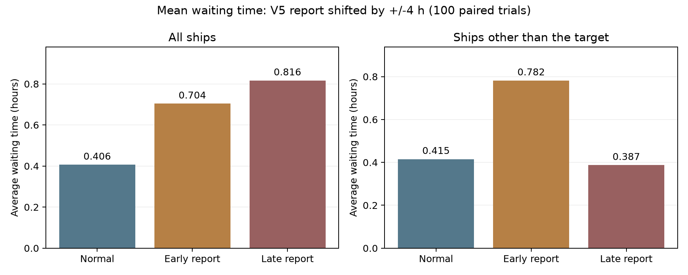

> 2026年11月5日の4バース主実験を行う前の説明を保存した資料です。以下の「現行」は保存当時を指します。現在の結果は[主実験レポート](../予備比較レポート.md)を参照してください。

# 旧方式の予備比較と現方式の動作確認

旧100試行の実験日：2026年10月7日。計算実装はコミット`f8ee27a`時点。追記日：2026年11月5日。

現行コードは正常計画の荷役開始に到着を調整する方式へ変更した。以下の旧100試行と週単位2試行の数値は変更せず、当時の方式の記録として残す。現方式の確認は末尾に分ける。

ユーザーがnoiseなしの方式でプログラムを実行し、`results/`を100試行の結果へ更新した。保存CSVを同じ設定で再計算して一致を確認し、文書も更新した。
以下の100試行は、週単位・複数ルールを追加する前の固定計画の記録である。追加実装の動作確認は末尾に分けて記載する。
noiseありの旧結果は[旧データ](../../results/archive/20261007_noiseあり)、旧レポートは[過去資料](予備比較レポート_20261007_noiseあり.md)に保管した。さらに以前の固定係数方式は[旧固定係数データ](../../results/archive/20261006_固定係数)に保管している。

## 目的と方法

対象船1隻の申告到着時刻だけを早める・遅らせる場合を、正常時と同じ元データで比較する。
実到着と荷役時間は変更しない。申告時刻のFCFSで計画を作り、バース・順番・計画開始時刻を固定して実行する。保存当時は再割当が未実装で、この100試行には調整ルールの結果を含まない。

| 条件 | 設定 |
| --- | --- |
| 船数・バース数 | 10隻・3バース |
| 到着間隔 | 平均2.37時間の指数分布。最初の到着は0 |
| 基準荷役時間 | 船ごとの2-Erlang分布、shape=2、scale=2.4、平均4.8時間 |
| バース係数 | 0.9・1.0・1.1を船ごとにランダム配置 |
| バース別荷役時間 | 基準荷役時間×バース係数。noiseは加えない |
| 攻撃対象・幅 | V5の申告を±4時間変更 |
| 試行 | 各条件100回、seed 42〜141。同じ試行の3条件で元データを共有 |

早い申告が0未満になる5試行は0に丸めたため、実変更幅は4時間未満になる。
生成した1,000隻のバース別荷役時間の相関係数は0.9683〜0.9711。実港の観測値ではなく、生成方式の確認値である。

## 結果

100試行の平均（括弧内は標本標準偏差）。単位は時間。

| 指標 | 正常時 | 早く申告 | 遅く申告 |
| --- | ---: | ---: | ---: |
| 全船の平均待ち時間 | 0.367 (0.621) | 0.601 (0.708) | 0.773 (0.604) |
| 全船の総待ち時間 | 3.675 (6.210) | 6.012 (7.081) | 7.732 (6.042) |
| 全船の最大待ち時間 | 1.614 (2.051) | 2.979 (2.361) | 4.686 (1.608) |
| 全船の平均在港時間 | 4.888 (1.394) | 5.144 (1.485) | 5.309 (1.409) |
| 全船の荷役完了時刻 | 28.178 (6.473) | 28.444 (6.435) | 28.551 (6.395) |
| 対象船の待ち時間 | 0.263 (0.862) | 0.000 (0.000) | 4.646 (1.586) |
| 対象船以外の平均待ち時間 | 0.379 (0.670) | 0.668 (0.787) | 0.343 (0.545) |



左は全10隻、右はV5以外の9隻。棒は平均値で、標準偏差・信頼区間は示していない。左右の縦軸の上限は異なる。

同じ試行の正常時との差（攻撃時−正常時）：

| 指標 | 攻撃 | 平均差 | 差の標本標準偏差 | 悪化／改善／変化なし |
| --- | --- | ---: | ---: | --- |
| 全船の平均待ち時間 | 早い申告 | +0.234 | 0.330 | 73／7／20回 |
| 全船の平均待ち時間 | 遅い申告 | +0.406 | 0.239 | 93／4／3回 |
| 対象船以外の平均待ち時間 | 早い申告 | +0.289 | 0.370 | 75／5／20回 |
| 対象船以外の平均待ち時間 | 遅い申告 | -0.036 | 0.309 | 33／33／34回 |

## 考察と限界

早い申告では、他船の平均待ち時間が正常時の0.379時間から0.668時間へ増え、100試行中75試行で悪化した。未到着の対象船を計画どおりに待つため、同じバースの後続船に遅れが広がる場合がある。
遅い申告では対象船自身の平均待ち時間が4.646時間となり、他船の平均は0.343時間へわずかに減った。全船平均の悪化が、すべての船の悪化を意味するわけではない。
在港時間には荷役時間も含むため、割当バースが変わると待ち時間との差だけでは説明できない場合がある。
noise除去前後の詳細な効果を比較する実験は行っていない。ここでは新方式の正常時と攻撃時を比較する。

時間・係数・攻撃幅は仮定値であり、神戸港の個別船の実測から推定したものではない。船長・水深・クレーン・故障などの制約も扱わない。実港での被害量、統計的な有意差、一般的な攻撃の優劣はこの実験だけでは断定しない。調整ルールの軽減効果は、この固定計画100試行からは判断できない。

## 実行と確認

以下は旧版での再現コマンドである。当時のコード（上記コミット）が必要で、現行コードでは同じ引数でも到着調整が入り数値は一致しない。保存済み結果を保護するため、旧版でも別の保存先を使う。

```bash
.venv/bin/python main.py --trials 100 --ships 10 --policy fixed --berths 3 --seed 42 --shift 4 --output results_no_noise_reproduction
```

元データ1,000行、スケジュール3,000行、試行別評価300行を含むCSV5表が、記録した設定での再計算と一致した。全300条件の実到着前の開始禁止・同一バースの非重複を確認した。noise除去時には自動テスト12件と、一時保存先でCSV・JSON・PNGの出力を確認済み。

## 週単位・複数ルールの追加実装の動作確認

確認日：2026年10月7日。以下は正式な主実験ではなく、計算と出力が意図どおりに動くかの確認である。保存済みの`results/`は保持している。

- 既存の自動テスト12件が成功した。
- 固定隻数・固定計画の3試行について、追加前に一時保存した5表の既存列・数値と一致した。新しいルール列や計画表などは追加している。
- 1バースの手計算例で、早い申告により他船が5時間待つ固定計画と、未到着船を飛ばして待ち0となる調整の結果を確認した。
- 2バースの例で、計画バースB2から空きバースB1へ変更し、変更先の荷役時間を使うことを確認した。
- 168時間、seed42・43、3バース、平均到着間隔2.37時間、V5・±4時間で、2試行×3条件×3ルールを確認した。週内の隻数は76隻・74隻だった。
- 全対象船の処理、実到着前の開始禁止、同一バースの非重複、元データ・初期計画の共有、同じルールの正常時との差を確認した。変更幅0と、申告・完了が週末を超える場合も確認した。
- 一時保存先でCSV6個、設定JSON、PNGの出力を確認した。正常時の待ち時間が発生した試行を除外していない。

この暫定条件では、正常時の全船平均待ち時間は約0.706時間で、2試行とも待ち時間が発生した。この時点では、教授の指摘に沿った「正常時が原則0」の条件は成立していなかった。以下の2026年11月5日の方式変更とは区別する。

この2試行でのルールの差を、実港の効果や統計的な結論として扱わない。今後の作業は[今後の計画](../今後の計画.md)を参照する。

## 到着調整済みの正常計画：2026年11月5日の動作確認

正式な主実験ではなく、ユーザーが採用した「到着・バース利用を事前調整し、正常時は全船待ち0」という前提の実装確認である。到着候補から予約を作り、実到着・正常申告を予約開始に合わせる。候補時刻と調整時間を別に保存し、速度・燃料・調整上限は扱わない。改ざん後は実到着と荷役時間を変更しない。

- 自動テスト18件が成功。1バースの手計算例で、候補0・2・3、荷役各3から実到着0・3・6、調整0・1・3、正常時の待ち全船0を確認した。
- 同例でV3を4時間早く申告すると、固定計画ではV2が6時間待つ。同じバース内調整・バース変更ありでは未到着船を飛ばして全船待ち0となることを確認した。遅い申告と、別バースの荷役時間を使う例も確認した。
- 1・2・3・4バース、到着候補の平均間隔0.1時間、30隻・各2試行という集中した候補でも、3ルールすべてで正常時の待ち0と予約維持を確認した。
- 168時間、seed42・43、3バース、到着候補の平均間隔2.37時間、V5・±4時間、2試行×3条件×3ルールで確認。候補から選んだ対象船は76隻・74隻で、正常時の最大待ちは0時間だった。
- 全条件の対象船・調整済み実到着・バース別荷役時間・条件別計画の共有、実到着前の開始禁止、非重複、変更幅0、同じseedでの再現性、調整後に期間を越えた船の保持を確認した。
- 一時保存先でCSV6個・設定JSON・PNGを確認した。設定のモデル識別子は`coordinated_arrivals_v1`。候補時刻・調整時間、期間の適用先、試行別の調整時間合計・最終実到着・期間外到着隻数を記録する。既存の結果は上書きしていない。

調整ルールのバース選択自体は変更していない。正常計画を作る順番・バース選択と、開始時刻へ調整した到着が対応するため、現行の最短荷役時間の選択でも正常予約が保たれる。正常時に待ちが生じたらエラーにし、値の書換えや試行選別をしない。

到着調整時間を待ちから切り離した分、旧モデルの数値とは条件が異なる。時間全体の短縮や実港での効果を示す検証ではない。今回の2試行から統計的な結論を出さず、数値設定の根拠と計画の余裕を整理してから主実験を行う。

今回の2試行では、バース変更ありは改ざん後も全船の待ち0だった。実到着がすべて異なる場合、待ち0の正常計画から現行の自由な空きバース選択を実行すると、申告順によらず正常時と同じ運用を再現する構造がある。これを実港での完全な防御と解釈せず、全バース利用可能・正確な荷役時間・予約に拘束されない実行という仮定の限界として扱う。詳細は[今後の計画](../今後の計画.md)を参照する。
