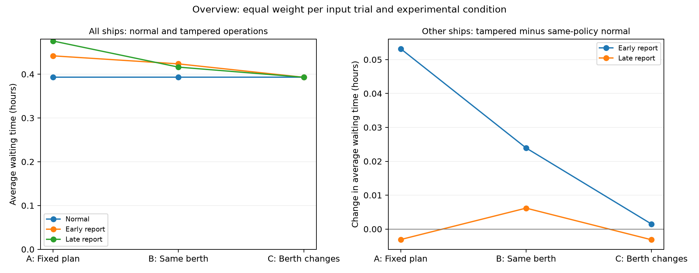
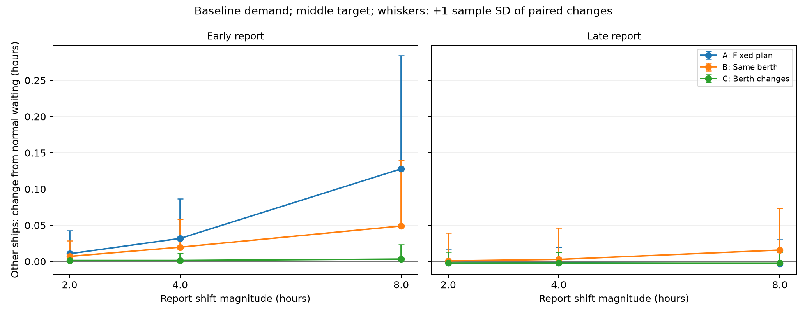
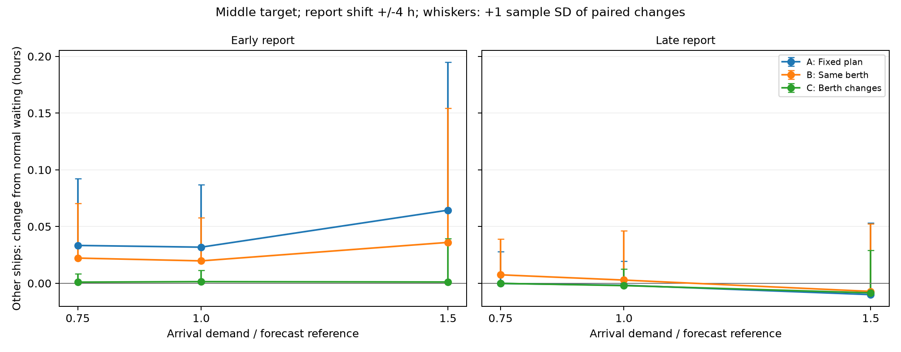
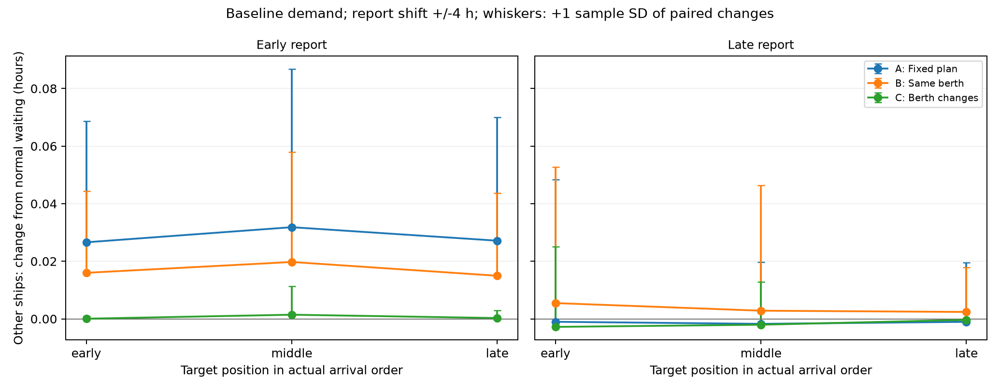
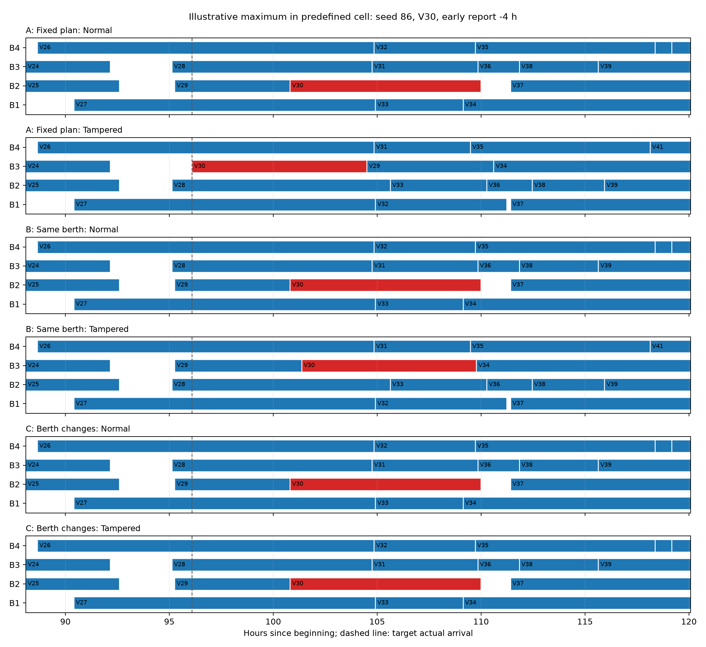

# 実到着を固定した1隻改ざん実験の結果と考察

実施日：2026年11月11日。モデル版：`discrete_4berth_fixed_arrivals_v4`。各条件100試行、seed42〜141。

正常計画の開始へ実到着を合わせる処理を外し、最初に生成した時刻で全船が来る1隻版を実行した。正常時にも待ちを認め、同じ入力・同じ方式の正常時との差を比較する。最新の設定・2表・5図のPNG/PDFは[results直下](../../results/archive/20261111_実到着固定_1隻_100試行/)に置く。複数船の同時改ざんは未実装である。

旧モデルの実験は[過去資料](README.md)に分け、以下の実到着固定モデルの結果と混ぜない。

## 1. 研究の問いと位置づけ

> 船が元の時刻どおりに来る一方、港側が1隻の嘘の到着更新を信じて計画を作り直したとき、正常時から待ちがどれだけ増減し、対象外の船へどう波及するか。運用の調整範囲によって何が変わるか。

改ざんが受け入れられた後の影響を扱う。侵入方法・検知・発生確率・船の航行変更は計算しない。正常申告は実到着に一致し、通常の予測誤差は加えない。

Hacks・Pahl（2024）のETA・ETD改ざんシナリオ、ENISA（2019）のPCSデータ改ざんの脅威整理を背景として使う。[該当ページと利用範囲](../../先行研究/資料の入手元.md#到着情報改ざんの攻撃想定に使う資料)を参照する。同じ攻撃の実被害報告とは説明しない。計画回復や待ち負担の変化自体も既存研究にあるため、新しい最適化・検知手法や世界初を主張しない。関連文献との比較は[従来の文献整理](予備比較レポート_20261105_前倒し制限あり.md#1-研究の問いと先行研究に対する位置づけ)も参照する。

今回整理できる範囲は、1件の情報変更を同一の物理入力で比較した、方向・幅・混雑条件・対象位置ごとの影響と3方式の違いである。大量の同時改ざんによる混乱は今後の複数船実験で確認する。

## 2. 実験条件と計算数

| 条件 | 設定 |
| --- | --- |
| バース | 離散型B1〜B4、各同時1隻。全船が全バースを利用可能 |
| 実到着 | 指数分布の間隔を累計し、168時間未満の到着を生成。計画作成後も動かさない |
| 基準平均間隔 | 24×13÷103＝3.029126213592233時間 |
| 船の多さ | 基準の0.75・1・1.5倍。平均間隔は基準値÷倍率 |
| 基準荷役時間 | Gamma(shape=2, scale=2.4)、平均4.8時間 |
| バース別荷役時間 | 基準時間×(1+0.1×最寄りバースとの番号差)。最寄りは一様乱数 |
| 正常計画 | 実到着と同じ正常申告から、開始・完了・バース番号の順に候補を選ぶ |
| 改ざん対象 | 実到着順10・50・90%の位置を別々に比較。各条件1隻、順位は端数切上げ |
| 申告変更 | ±2・4・8時間。0未満は0へ丸める。他船の申告・実到着・荷役時間は変更しない |
| 更新 | 運用前に全船計画を1回作り直し、3方式で共有する |
| 試行 | 各セル100試行、seed42〜141。船の属性はseed+100000 |
| 期間端 | 最初は全バース空き。期間内の船は168時間後の荷役完了まで保持 |

基準間隔はKICT対象船席の13日103件の翌日予定を参考とし、1日平均約7.92隻、168時間の期待隻数約55.46隻となる。基準需要の100試行平均は56.13隻だった。予定規模の参考であり、実績寄港数・到着分布・荷役時間・実待ち時間の推定ではない。指数・ガンマの分布形、平均4.8時間、係数0.1は仮定である。[集計根拠と保管場所](../../data/kobe_reference_20261105/README.md)を参照する。

| 方式 | 規則 |
| --- | --- |
| A 固定 | 更新後の計画バース・バース内順番を維持し、計画開始より前には始めない |
| B 同じバース内調整 | 計画バースを維持。到着済みの船を計画順で確認し、空き次第開始 |
| C バース変更 | 到着済みの船を計画順で確認し、空きバース中でその船の荷役時間が最短のものを選ぶ |

B・Cは前倒し上限なし。未到着船を飛ばすがFIFOへ切り替える方式ではない。全方式で実到着前開始、同一バースでの重複、開始後の中断・移動を認めない。将来の影響を最適化する処理はない。

3需要×3位置×3幅×2方向＝54条件を100試行・3方式で計算し、改ざん16,200運用、方式ごと5,400ケース。正常は300入力×3方式＝900運用、合計17,100運用である。正常指標は対象外船群の定義のため位置ごとに参照し、CSVは正常2,700行＋改ざん16,200行＝18,900行。集計は162条件×11指標＝1,782行となる。

同じ需要・seedの船データを全条件で共有する。需要間も同じseedと対応する船の属性を使う。16,200個の独立標本とは扱わず、各セルの試行数は100である。

## 3. 正常時の待ちと評価の読み方

正常時の全船平均待ちを、入力100組の平均として示す。今回、正常運用の3方式の指標は一致した。これは観測した結果であり、正常待ちを0にしたり、3方式の値を強制的にそろえたりしていない。

| 船の多さ | 正常時の全船平均待ち（時間、3方式共通） |
| --- | ---: |
| 0.75倍 | 0.073026 |
| 1倍 | 0.200333 |
| 1.5倍 | 0.906304 |

正常時の最大の船別待ちは19.960846時間だった。全需要・試行を同じ重みで平均した全船平均待ちは約0.393221時間。対象位置ごとに対象船を除く「他船」の正常平均は約0.394043時間で、全船平均とは集計対象が異なる。

```text
改ざん影響 Δ = 改ざん時の指標 − 同じ方式・同じ入力の正常時の指標
固定方式に対する軽減量 = AのΔ − 調整方式のΔ
```

正のΔは待ちの増加、負のΔは減少。待ち時間そのものは負にならない。以下は各ケースの指標を等しい重みで平均し、全船をまとめた船数加重平均とは区別する。平均同士の比較だけでなく、増加・減少したケース数も見る。



図5：左は全船平均待ちの正常・改ざん時の絶対値、右は他船平均待ちの正常差。右の0は「正常と同じ」であって「待ちがない」ではない。横軸は方式の区分で、線は比較を見やすくするために結んでいる。

## 4. 申告方向と負担先による違い

他船の正常平均は各欄とも0.394043時間。各方向・方式2,700ケースの平均である。

| 方式 | 申告方向 | 改ざん時の他船平均待ち | 他船の正常差Δ | 対象船の正常差Δ | 全船平均待ちの正常差Δ |
| --- | --- | ---: | ---: | ---: | ---: |
| A 固定 | 早い | 0.447242 | +0.053199 | −0.279859 | +0.048633 |
| A 固定 | 遅い | 0.390956 | −0.003087 | +4.754152 | +0.082498 |
| B 同じバース内調整 | 早い | 0.417972 | +0.023929 | +0.397558 | +0.030301 |
| B 同じバース内調整 | 遅い | 0.400220 | +0.006177 | +1.115812 | +0.022891 |
| C バース変更 | 早い | 0.395532 | +0.001489 | −0.144669 | −0.000405 |
| C バース変更 | 遅い | 0.390890 | −0.003153 | +0.242037 | −0.000275 |

単位は時間。早い申告では、他船の平均増分はA、B、Cの順に小さい。BはAの増分を平均約55.0%減らした。一方、遅い申告ではAからBへ調整すると対象船の増分は小さくなるが、他船の増分は−0.003087から+0.006177へ増える。対象船の改善だけを全船の改善と扱えない。

Aの遅い申告で他船平均が減っていても、対象船は平均4.754152時間余計に待ち、全船平均待ちは増えている。対象船を後ろへ回すことで他船の待ちが減る場合があるため、対象船・他船・全船を分ける必要がある。

方向をまとめると、他船の平均ΔはAが+0.025056、Bが+0.015053、Cが−0.000832時間である。正負の影響が相殺されるので、この平均だけで方式の安全性を判断しない。

| 方式 | 正常より他船平均待ちが増えた | 減った | 変化なし | 合計 |
| --- | ---: | ---: | ---: | ---: |
| A 固定 | 1,857 | 647 | 2,896 | 5,400 |
| B 同じバース内調整 | 1,764 | 613 | 3,023 | 5,400 |
| C バース変更 | 181 | 203 | 5,016 | 5,400 |

±1e-9時間以内を変化なしとした。これは各方式の正常との比較であり、方式間の勝敗数ではない。Aとの対応比較ではBが改善776・悪化363・同じ4,261、Cが改善1,809・悪化491・同じ3,100ケースだった。今回の正常値は方式間で一致したので、この比較では絶対値とΔの大小関係も一致する。

## 5. 幅・需要・対象位置の比較



図1：基準需要・中盤対象の幅別比較。点は他船平均待ちの正常差の100試行平均、上側のひげは対応差の標本標準偏差1個分。ひげは信頼区間や最大値ではない。負のΔも表示する。

全需要・全位置をまとめた早い申告のΔは、幅2/4/8時間に対しAが0.011616/0.037313/0.110669時間、Bが0.008755/0.022119/0.040912時間。平均では幅が大きいほど影響が大きい。一方、遅い申告のAは−0.001275/−0.004015/−0.003972時間で単調ではなく、全条件・全試行で「幅が大きければ他船が悪化する」とは言えない。



図2：中盤対象・改ざん±4時間の需要別比較。全幅・全位置をまとめた早い申告のAのΔは需要0.75/1/1.5倍で0.036234/0.044643/0.078721時間だった。正常時の待ちも需要とともに増えるため、改ざん時の絶対値と追加の影響を区別する。需要間では船数・対象船・船集合が変わる。



図3：基準需要・改ざん±4時間の対象位置別比較。全需要・全幅をまとめた早い申告のAのΔは、序盤/中盤/終盤で0.047086/0.064503/0.048009時間。今回の平均は中盤が大きく、序盤ほど必ず大きいという関係ではなかった。

図1〜3は指定した断面であり、本文の全条件集計と範囲が異なる。全11指標と各セルの平均・ばらつき・増減回数は[summary.csv](../../results/archive/20261111_実到着固定_1隻_100試行/summary.csv)、対応比較の元は[run_metrics.csv](../../results/archive/20261111_実到着固定_1隻_100試行/run_metrics.csv)にある。

## 6. Cでも他船への影響が残る具体例

需要1.5倍、seed86、77隻、中盤のV39を8時間早く申告した例。全5,400ケースでCの他船平均待ちのΔが最大のケースとして、事後に仕組み説明用に選んだ。典型例や平均的な被害量ではない。

V39の実到着は74.604004時間のまま、申告だけを66.604004時間へ変える。

| 船 | 正常のバース | 正常の開始 | 改ざん時のバース | 改ざん時の開始 | 待ちの変化（時間） |
| --- | --- | ---: | --- | ---: | ---: |
| V39（対象） | B4 | 86.722519 | B3 | 79.550985 | −7.171534 |
| V38 | B4 | 82.609480 | B3 | 85.614261 | +3.004781 |
| V37 | B1 | 81.101069 | B1 | 83.464890 | +2.363821 |
| V40 | B2 | 87.168946 | B3 | 89.410913 | +2.241967 |

Cでは混雑して待つ船が生じると、改ざん後の計画順が競合する。V39を先に処理することでその待ちは12.118516から4.946982時間へ減る一方、他船が遅れる。荷役を始めた船は中断しないため、別バースを許しても全船の改善にはならない。

このケースの他船平均待ちは2.077420から2.271757時間へ増え、Δは+0.194338時間、全船総待ちも+7.598121時間だった。対象船の利益と港全体の負担が一致しない例である。



図4は上記とは別で、基準需要・中盤対象・早い申告4時間の事前指定セル内で、Aの他船Δが最大のseed86・V30の例。各方式の正常／改ざんを6段で示す。赤は対象船、破線は変更しない実到着。Cの正常と改ざんが一致するこの例も含め、効果がないケースを除外していない。

## 7. 結果から言えることと限界

- 実到着の調整を外すことで正常時にも待ちが生じ、Cが構造上いつも待ち0となる旧前提はなくなった。Cでも5,400改ざんケース中4,446ケースに正の全船待ちがあった。
- Cの追加影響は小さく、多くのケースで正常と同じだった。ただし他船の待ちが増えた181ケースもあり、完全な防御ではない。混雑時の優先順の競合が影響の一因となる。
- Bは早い申告の他船への平均影響をAより軽減したが、方式間で悪化したケースもある。空きを使う局所判断は全体最適化ではない。
- 改ざんで待ちが減るケースもある。正常計画も最適解ではなく、順番やバースの変化で偶然改善しうる。「誤情報が有益」「現実の攻撃は安全」とは結論しない。
- 他船・対象船・全船では増減の向きが異なる場合がある。全体平均の小ささだけで、個別船への負担や悪化ケースを消さない。

予定情報は規模の参考に限り、実港の実績到着・荷役・待ち時間で検証していない。全船が全バースを使え、荷役時間を正確に知り、B・Cの前倒し準備時間はかからないという強い仮定がある。船長・水深・クレーン・潮汐・天候・抜港、運用中の再計画、前後週の継続流入は扱わない。需要倍率は実港の稼働率ではない。

100試行は各条件の記述的比較であり、統計的有意差や収束の証明にはしていない。指定位置・方向の結果であり、攻撃者が全条件から最適な対象を探索した評価でもない。1隻の結果を何倍かして大量改ざんの被害を推定できない。同じ誤情報なら誤報でも攻撃でも計算結果は同じである。

## 8. 検証と再現

```bash
.venv/bin/python -m unittest -v
.venv/bin/python main.py --study --output results/reproduction_fixed_arrivals
```

17件の自動テストが成功した。到着0・2・3時間／1バース／荷役各3時間の正常待ち0・1・3時間、計画で実到着を変えないこと、申告のみの変更、計画が未来の実到着を判断に使わないこと、無制限の前倒し、別バースの荷役時間、開始後の中断なし、到着前開始と荷役重複の禁止、全船保持、正常差とその標準偏差、幅0の一致、同じseedの再現、100試行の既定値、保存範囲・上書き防止を確認した。物理制約の船別確認はテストの入力で行った。

少数試行の主実験を一時保存先で実行し、設定・CSV・5図の出力を確認した。100試行では保存済み18,900指標行から正常を対応付け、1,782集計行の改ざん平均・標準偏差、正常平均、正常差の平均・標準偏差・最小・最大・増減回数、固定に対する軽減量を再計算し、一致を確認した。全指標の有限性、各セル100件、設定のコード・参照ハッシュも確認した。Cの上記具体例は同じseed・条件で再現し、保存済み指標と照合した。

5図のPNGを表示して確認し、対応するPDFも生成した。移動した旧結果を含む既存results・data72ファイルのSHA-256は変更前と一致した。新結果には設定・2CSV・5図のPNG/PDFの13ファイルのみを保存した。

保存済み設定のコードハッシュは実験時のコミット`2750b86`の版を示す。その後、未使用の計画表・重複する比較表・船別の補助列を削除した。通常設定・高需要の固定隻数・改ざん幅0・主実験の4条件で、残す入力・運用結果・全指標・集計の完全一致と、主実験のCSV2表・PNG5図の完全一致を確認した。結果・設定・グラフは書き換えていない。
